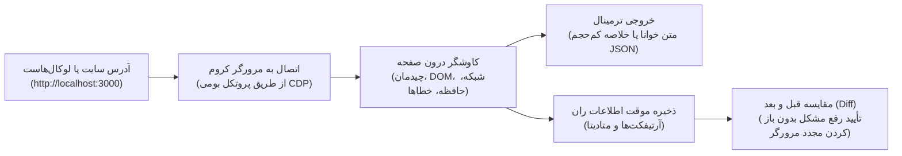

# agentsEye 👁️

> **موتور بازرسی ران‌تایم مرورگر و راستی‌آزمایی بصری بدون وابستگی خارجی (Zero Dependencies) برای ایجنت‌های هوش مصنوعی و برنامه‌نویسان.**

[](package.json)
[](LICENSE)
[](package.json)
[](package.json)

[English](README.md) | [فارسی](README.fa.md)

---

## فهرست مطالب
- [۱. چرا agentsEye ساخته شد و چه مشکلی را حل می‌کند؟](#۱-چرا-agentseye-ساخته-شد-و-چه-مشکلی-را-حل-میکند)
- [۲. چرخه کامل مهندسی فرانت‌اند (توسعه ← خطایابی ← راستی‌آزمایی نهایی)](#۲-چرخه-کامل-مهندسی-فرانتاند-توسعه--خطایابی--راستیآزمایی-نهایی)
- [۳. نحوه کارکرد به زبان ساده](#۳-نحوه-کارکرد-به-زبان-ساده)
- [۴. قابلیت‌های کلیدی و برجسته](#۴-قابلیتهای-کلیدی-و-برجسته)
- [۵. چطور از این ابزار به عنوان «اسکیل» در هوش مصنوعی استفاده کنیم؟](#۵-چطور-از-این-ابزار-به-عنوان-اسکیل-در-هوش-مصنوعی-استفاده-کنیم)
- [۶. شروع سریع و جدول دستورات کاربردی](#۶-شروع-سریع-و-جدول-دستورات-کاربردی)
- [۷. مدیریت هوشمند حافظه و پاکیزگی سیستم](#۷-مدیریت-هوشمند-حافظه-و-پاکیزگی-سیستم)
- [۸. خطایابی لاگ‌محور برای هوش مصنوعی (Log-Driven Debugging)](#۸-خطایابی-لاگمحور-برای-هوش-مصنوعی-log-driven-debugging)
- [۹. پرش ناخواسته صفحه (CLS) در برابر انیمیشن‌های تعمدی](#۹-پرش-ناخواسته-صفحه-cls-در-برابر-انیمیشنهای-تعمدی)
- [۱۰. امنیت و محدودیت‌ها](#۱۰-امنیت-و-محدودیتها)
- [License](#license)

---

### ۱. چرا agentsEye ساخته شد و چه مشکلی را حل می‌کند؟

وقتی یک برنامه‌نویس به کمک یک دستیار هوش مصنوعی (مثل Claude Code، Antigravity، Cursor یا Windsurf) مشغول توسعه یا خطایابی یک وب‌اپلیکیشن است، با یک چالش اساسی مواجه می‌شود: **هوش مصنوعی نسبت به اتفاقاتی که در صفحه مرورگر رخ می‌دهد، کاملاً نابیناست.**

ایجنت می‌تواند فایل‌های پروژه را ادیت کند و ساختار کد را تحلیل نماید، اما خروجی زنده ران‌تایم را نمی‌بیند:
- آیا یک کانتینر یا ویژگی Flexbox باعث **اسکرول افقی ناخواسته در گوشی‌های موبایل** شده است؟
- آیا ری‌اکت، ویو یا Next.js دچار **کرش‌های کنترل‌نشده ران‌تایم، خطای هیدریشن یا صفحه سفید** شده‌اند؟
- آیا یک فراخوانی `fetch()` در پس‌زمینه با **ارور ۴۰۴ یا ۵۰۰** مواجه شده یا به دلیل مفقود بودن هدرها شکست خورده است؟
- آیا پاپ‌آپ یا منویی که کاربر کلیک کرده واقعاً در صفحه دیده می‌شود، یا پشت `display: none` یا `z-index` مخفی مانده است؟
- آیا بستن یک مدال باعث بر جای ماندن `overflow: hidden` روی تگ `<body>` و **فریز شدن کامل اسکرول صفحه** شده است؟
- آیا کدی که ایجنت تغییر داده، واقعاً باگ را حل کرده یا باعث ایجاد رگرسیون تصویری و خطای جدیدی در بخش دیگری شده است؟

تلاش برای حل این مشکل معمولاً با دو رویکرد ناموفق مواجه می‌شود:

۱. **دامپ کردن کدهای خام HTML یا ساختار کامل DOM**: هزاران خط کد تکراری را وارد کانتکست ایجنت می‌کند؛ در حالی که استایل‌های محاسبه‌شده CSS، سرریز المان‌ها در ویوپورت، کرش‌های کلاینت، عدم تطابق‌های هیدریشن و وضعیت درخواست‌های ناموفق API را به کلی جا می‌اندازد.

۲. **نصب فریم‌ورک‌های سنگین تست مانند Playwright یا Puppeteer**: نیازمند نصب وابستگی‌های حجیم npm، دانلود باینری‌های چندصد مگابایتی مرورگر، نوشتن اسکریپت‌های پیچیده و تاخیر زیاد در راه‌اندازی (Cold-start) است که چابکی تعامل زنده ایجنت را از بین می‌برد.

**ابزار agentsEye چشمان هوشمند ایجنت در زمان اجرای برنامه است.** این ابزار مستقیماً از طریق پروتکل بومی CDP به مرورگرهای کرومیوم (Chrome، Edge، Brave یا Chromium) متصل شده و بدون **هیچ‌گونه وابستگی خارجی (Zero Dependencies)** و در قالب یک فایل مستقل، صفحه لوکال‌هاست یا وب‌سایت در حال اجرا را بررسی می‌کند. خروجی آن یک خلاصه فشرده، متناسب با بودجه توکن و تفکیک‌شده از ارورها، تله‌های اسکرول، وضعیت شبکه و چیدمان است که ایجنت و انسان می‌توانند در کسری از ثانیه آن را بفهمند و باگ را حل کنند.

#### کاملاً مستقل از فریم‌ورک و کتابخانه (Framework Agnostic)
این ابزار به هیچ فریم‌ورک خاصی محدود نیست؛ هر چیزی که در مرورگر رندر شود توسط agentsEye قابل بازرسی و خطایابی است:
- **فریم‌ورک‌های مدرن کامپوننت‌محور**: React، Next.js، Remix، Vue، Nuxt، Svelte، SvelteKit، Angular، Solid، Astro.
- **توسعه موبایل تحت وب**: React Native for Web، Ionic، Capacitor.
- **خروجی‌های کامپایل‌شده به وب**: Flutter Web (چه با رندرر HTML و چه با رندرر CanvasKit/Wasm)، زبان‌های مبتنی بر WebAssembly (Wasm) و Blazor.
- **فرانت‌اند کلاسیک**: صفحات ساده HTML5، جاوااسکریپت خام و قالب‌های سمت سرور.

---

### ۲. چرخه کامل مهندسی فرانت‌اند (توسعه ← خطایابی ← راستی‌آزمایی نهایی)

ابزار agentsEye یک چرخه بسته و مهندسی‌شده برای همکاری برنامه‌نویس و ایجنت فراهم می‌کند:

| مرحله کاری | مواردی که agentsEye بررسی می‌کند | ارزش کاربردی برای برنامه‌نویس و ایجنت |
| :--- | :--- | :--- |
| **۱. کاوش و ساخت** | • ساختار زنده DOM و استایل‌های محاسبه‌شده CSS<br/>• درخواست‌های شبکه، متدها و وضعیت APIها<br/>• اتصال به پروسه کرومیوم از طریق CDP (`--cdp`)<br/>• ساختار سلسله‌مراتبی تیترها (`h1` تا `h6`) و لندمارک‌ها<br/>• حافظه محلی مرورگر (`localStorage` و `sessionStorage`) | شناخت سریع معماری صفحه، وضعیت محلی و داده‌ها بدون خواندن هزاران خط HTML خام یا معطلی راه‌اندازی مرورگر. |
| **۲. خطایابی و دیباگ دقیق** | • استک‌تریس کرش‌های کنترل‌نشده، ارورهای کنسول و هیدریشن<br/>• درخواست‌های ناموفق یا قطع‌شده شبکه (4xx/5xx) و هدرهای مفقود<br/>• بررسی هدفمند کامپوننت خاص (`--selector "#modal"`) و دلیل مخفی بودن (`hiddenReason`)<br/>• المان‌های بیرون‌زده از صفحه در موبایل<br/>• تله‌های قفل اسکرول (`overflow: hidden` روی body)<br/>• اکشن‌های تعاملی و تغییرات استیت (`--click` و `--explore`) | شناسایی دقیق سلکتور مقصر در اسکرول، اسکریپت معیوب، تله قفل اسکرول یا اندپوینت خراب در کوتاه‌ترین زمان. |
| **۳. راستی‌آزمایی نهایی** | • مقایسه ساختاری قبل و بعد از تغییر کد (`agentsEye diff`)<br/>• ممیزی تطبیقی در ماتریس بریک‌پوینت‌ها (`--matrix`)<br/>• پرش‌های ناخواسته ساختاری (CLS) و جابجایی کادرها<br/>• گیت رگرسیون: اثبات اینکه `newErrors === 0` و `newIssues === 0` است | اثبات قطعی اینکه تغییر اعمال‌شده در تمام دستگاه‌ها مشکل را رفع کرده و هیچ خطای جدیدی به بار نیاورده است. |

---

### ۳. نحوه کارکرد به زبان ساده



---

### ۴. قابلیت‌های کلیدی و برجسته

| قابلیت کلیدی | این قابلیت چه می‌کند؟ | چرا اهمیت دارد؟ |
| :--- | :--- | :--- |
| **معماری مستقل و بدون وابستگی (Zero Dependencies)** | با استفاده از Node.js 22+ مستقیماً از طریق WebSocket بومی به پروتکل DevTools کرومیوم متصل می‌شود. | بدون نیاز به `npm install`، بدون دانلود مرورگرهای اضافی و بدون وابستگی به فریم‌ورک‌های سنگین مانند Playwright یا Puppeteer. |
| **پایش سه‌لایه و جامع ران‌تایم** | به طور همزمان وضعیت چیدمان زنده DOM، ترانزیت شبکه (ارورهای ۴xx/۵xx و منابع کند) و لاگ‌های کنسول (استک‌تریس کرش‌ها و خطاهای کنترل‌نشده) را در یک اسنپ‌شات واحد ثبت می‌کند. | باگ‌های خاموش ران‌تایم، عدم تطابق‌های هیدریشن (Hydration Mismatch) و شکست اتصال به APIها را که ابزارهای استاتیک نمی‌بینند، برملا می‌سازد. |
| **گیت خودکار سنجش رگرسیون (`diff`)** | دو خروجی ذخیره‌شده را به صورت آفلاین و بدون نیاز به باز کردن مجدد مرورگر مقایسه می‌کند. | به ایجنت امکان می‌دهد صحت رفع باگ را بسنجد و مطمئن شود تغییر جدید هیچ خطای کنسول یا شکست لایوت ناخواسته‌ای ایجاد نکرده است (`newErrors === 0`). |
| **کاوشگری تعاملی و شبیه‌سازی کاربر** | کلیک روی عناصر (`--click`)، هاور (`--hover`)، اسکرول و کلیدهای کیبورد را اجرا کرده و می‌تواند منوها و آکاردئون‌ها را خودکار کشف و تست کند (`--explore`). | فراتر از صفحات ایستا؛ رفتار برنامه را پس از تعامل واقعی کاربر (مانند باز شدن مودال‌ها، منوهای کشویی و تب‌ها) بررسی و دگرگونی‌های DOM را ثبت می‌کند. |
| **اقتصاد توکن و کانتکست جراحی‌شده برای هوش مصنوعی** | به جای تزریق هزاران خط کد خام HTML، خلاصه‌های ساختاریافته، کم‌حجم و هدفمند تولید می‌کند (`--summary-only`, `--focus <slice>`, `show <id> <path>`). | از اشباع حافظه کانتکست مدل جلوگیری کرده، تمرکز استدلال ایجنت را حفظ می‌کند و سرعت حل مسئله را بالا می‌برد. |
| **ماتریس تست چندسکویی (`--matrix`)** | صفحه را در سه بریک‌پوینت استاندارد موبایل (`375px`)، تبلت (`768px`) و دسکتاپ (`1440px`) به صورت زنجیره‌ای بررسی می‌کند. | ناهماهنگی‌های ریسپانسیو و شکست‌های چیدمان بین دستگاه‌های مختلف را در یک اجرا کشف می‌کند. |
| **عارضه‌یابی عمیق چیدمان و ارگونومی موبایل** | المان‌های دارای سرریز افقی، تله‌های قفل اسکرول (`overflow: hidden` روی body)، اندازه اهداف لمسی و الزامات فرم‌ها (مانند فونت‌های زیر ۱۶ پیکسل در iOS) را شناسایی می‌کند. | سلکتورهای دقیق CSS المان‌های مقصر را به همراه ابعاد کادر محاسبه‌شده در اختیار ایجنت قرار می‌دهد. |
| **اتصال به پروسه کرومیوم در حال اجرا (`--cdp`)** | با پرچم `--cdp http://127.0.0.1:9222` به مرورگر در حال اجرا متصل می‌شود. | تاخیر راه‌اندازی اولیه (Cold-start) را حذف می‌کند و در یک کانتکست ایزوله و تمیز اینکاگنیتو (`createBrowserContext`) اجرا می‌شود. برای سشن‌های نیازمند احراز هویت از `--header` با اسکوپ مبدأ استفاده کنید. |
| **استقلال کامل از فریم‌ورک و پشته نرم‌افزاری** | از React، Next.js، Vue، Nuxt، Svelte، Angular، جاوااسکریپت خام، Astro تا Flutter Web و WebAssembly را پشتیبانی می‌کند. | بازرسی در سطح لایه رندر بومی مرورگر انجام می‌شود و کاملاً مستقل از کتابخانه‌ها و ابزارهای بیلد است. |
| **بهداشت دفاعی و ایمنی پیش‌فرض** | ماسک‌گذاری خودکار توکن‌ها و اطلاعات حساس در هدرها و حافظه محلی، ایزوله‌سازی پروفایل موقت مرورگر و غربالگری پرامپت اینجکشن‌های غیرمستقیم. | اجرای خودکار ایجنت را ایمن نگه می‌دارد و از نشت اطلاعات حساس یا اجرای دستورات ناخواسته جلوگیری می‌کند. |

---

### ۵. چطور از این ابزار به عنوان «اسکیل» در هوش مصنوعی استفاده کنیم؟

می‌توانید دستیارهای هوش مصنوعی (**Claude Code**، **Google Antigravity**، **Cursor** و **Windsurf**) را به این مهارت مجهز کنید.

#### فایل‌های مورد نیاز:
تنها کافی است این موارد را در پوشه اسکیل‌های ایجنت کپی کنید:

```text
📁 agents-eye/
├── 📄 agentsEye.mjs       # موتور اجرایی بدون نیاز به پکیج‌های خارجی
├── 📄 SKILL.md            # راهنما و درخت تصمیم‌گیری اختصاصی هوش مصنوعی
└── 📁 references/         # راهنماهای تکمیلی (پرش‌های ساختاری، خطایابی لاگ‌محور)
```

#### مسیرهای پیشنهادی کپی:
- **Claude Code**: در مسیر `.claude/skills/agents-eye/`
- **Antigravity / Gemini CLI**: در مسیر `.agent/skills/agents-eye/` یا `~/.gemini/antigravity-cli/skills/agents-eye/`
- **Cursor یا سایر ایجنت‌ها**: در پوشه اسکیل‌های پروژه شما.

#### نمونه سناریوهای تعامل (حل چالش‌های واقعی و پیچیده مهندسی فرانت‌اند):
کافی است از ایجنت بخواهید:

1. **کرش‌های خاموش هیدریشن و صفحه سفید ران‌تایم (Silent Hydration Crashes & Blank Screen):**  
   *«پروژه بیلد می‌شود و سرور هیچ خطایی نمی‌دهد، اما صفحه در مرورگر کاملاً سفید شده و هیچی رندر نمی‌شود؛ کجای کد خطا دارد؟»*  
   ← ایجنت به جای حدس زدن در انبوه کامپوننت‌ها، با اجرای `node agentsEye.mjs http://localhost:3000 --focus console --temp` استک‌تریس خطای کنترل‌نشده جاوااسکریپت و مغایرت هیدریشن در ران‌تایم کلاینت را دریافت و مستقیماً فایل مبدأ را اصلاح می‌کند.

2. **تله‌های فریز شدن صفحه و قفل اسکرول ناشی از مودال‌ها (Scroll-Lock Trap & Frozen Document):**  
   *«کاربر پاپ‌آپ یا منوی موبایل را بسته، اما کل صفحه فریز شده و اسکرول کار نمی‌کند؛ در کنسول هم هیچ اروری نیست.»*  
   ← ایجنت با دستور `node agentsEye.mjs <url> --focus issues --temp` فیلد `page.scrollLock` را می‌خواند؛ مشخص می‌شود کامپوننت هنگام بسته‌شدن فراموش کرده استایل `overflow: hidden` یا `position: fixed` را از `<body>` پاک کند، و ایجنت تابع Cleanup را در کد می‌نویسد.

3. **شکست تعاملات پویا و منوهای پنهان‌شده (Dynamic Interaction & Trapped Drawers):**  
   *«روی دکمه باز کردن منو (#drawer-toggle) کلیک می‌کنم ولی منوی کناری باز نمی‌شود؛ بررسی کن ایونت اجرا می‌شود یا المان پشت لایه‌ها گیر کرده است.»*  
   ← ایجنت با دستور `node agentsEye.mjs <url> --click "#drawer-toggle" --selector "#drawer" --temp` کلیک ماوس را شبیه‌سازی کرده و با بررسی دگرگونی‌های DOM، ابعاد کادر و فیلد `hiddenReason` متوجه می‌شود که آیا دکمه ایونت هندلر ندارد یا دراور به خاطر `pointer-events: none` یا `z-index` نامناسب مخفی مانده است. *توجه: طبق قواعد ایمنی، کلمات حساس (مانند `delete`، `pay`، `checkout`، `حذف`، `پرداخت`) نیازمند پرچم `--allow-destructive` هستند؛ و لینک‌های ناوبری (`<a href>`) یا دکمه‌های Submit فرم هرگز کلیک نمی‌شوند.*

4. **حذف معطلی راه‌اندازی با کرومیوم فعال و احراز هویت امن (Running Chromium & Scoped Auth):**  
   *«یک پروسه کرومیوم روی پورت ۹۲۲۲ فعال است و می‌خواهیم یک مسیر محافظت‌شده داخلی را بدون اتلاف وقت برای باز شدن مرورگر تست کنیم؛ چطور بررسی‌اش کنیم؟»*  
   ← ایجنت با دستور `node agentsEye.mjs <url> --cdp http://127.0.0.1:9222 --header "Authorization: Bearer <token>" --focus network --temp` بلافاصله به مرورگر در حال کار متصل می‌شود. این اتصال یک کانتکست مجزا و ایزوله اینکاگنیتو با هدر ایمن (محدود به دامنه هدف) ایجاد کرده و اندپوینت‌های ناموفق ۴xx/۵xx را بدون تاخیر cold-start شناسایی می‌کند.

5. **گیت تضمین صفر-رگرسیون در ماتریس بریک‌پوینت‌ها (Zero-Regression Quality Gate):**  
   *«سیستم گرید و استایل‌های بخش اصلی صفحه را بازنویسی کردم؛ مطمئن شو هم در موبایل هم تبلت و هم دسکتاپ ساختار سالم مانده و خطای جدیدی ایجاد نشده باشد.»*  
   ← ایجنت قبل از ویرایش کد اسنپ‌شات اولیه (`<before-id>`) را ثبت می‌کند؛ سپس کد را اصلاح کرده و با `--matrix` اسنپ‌شات جدید (`<after-id>`) را می‌گیرد. با اجرای `node agentsEye.mjs diff <before-id> <after-id>` به صورت قطعی تضمین می‌دهد که `summary.newErrors === 0` است و هیچ المانی در موبایل یا دسکتاپ دچار سرریز یا تغییر ناخواسته نشده است.

6. **عارضه‌یابی پرش‌های ناخواسته ساختاری (Layout Shift & Web Vitals Degradation):**  
   *«هنگام بارگذاری داده‌های داینامیک، چیدمان صفحه پرش شدیدی دارد و امتیاز سئو و CLS افت کرده است؛ المان مقصر چیست؟»*  
   ← ایجنت با دستور `node agentsEye.mjs <url> --focus perf --temp` جابجایی کادرها را تحلیل کرده، تفاوت انیمیشن‌های تعمدی را از باگ‌های حرکتی تفکیک می‌کند و المان‌های بدون ابعاد رزروشده (`aspect-ratio` یا `width/height`) را بدون حذف انیمیشن‌های مطلوب اصلاح می‌کند.

---

### ۶. شروع سریع و جدول دستورات کاربردی

#### پیش‌نیازها
- **Node.js**: نسخه ۲۲.۰.۰ یا بالاتر.
- **مرورگر**: یک مرورگر مبتنی بر کرومیوم نصب‌شده روی سیستم (Google Chrome، Microsoft Edge، Brave یا Chromium).
- **سیستم‌عامل**: راستی‌آزمایی‌شده روی ویندوز ۱۱ با Node 22+. سیستم‌های لینوکس و مک نیز انتظار می‌رود کار کنند اما هنوز رسماً راستی‌آزمایی نشده‌اند.

#### دستورات پرکاربرد خط فرمان

| هدف | دستور | توضیح |
| :--- | :--- | :--- |
| **بررسی سریع سلامت صفحه** | `node agentsEye.mjs http://localhost:3000 --temp` | خلاصه سریع چیدمان، ارورها، تیترها و عملکرد صفحه. |
| **خروجی متنی ساده** | `node agentsEye.mjs http://localhost:3000 --format text` | نمایش خروجی متنی تمیز به جای JSON در ترمینال. |
| **بررسی کرش و ارورهای کد** | `node agentsEye.mjs <url> --focus console --temp` | استخراج خطاهای جاوااسکریپت، کرش‌های هیدریشن و ارورهای کنسول. |
| **بررسی ریکوئست‌های خراب API** | `node agentsEye.mjs <url> --focus network --temp` | لیست کردن اندپوینت‌های دارای خطای ۴xx/۵xx و فایل‌های کند شبکه. |
| **بازرسی یک المان خاص** | `node agentsEye.mjs <url> --selector "#login-modal" --temp` | بررسی استایل‌ها، ابعاد و دلیل دقیق مخفی بودن المان (`hiddenReason`). |
| **استایل‌های محاسباتی دقیق** | `node agentsEye.mjs <url> --selector "#modal" --style-props "display,position,z-index,backdrop-filter" --temp` | غیرفعال‌سازی خلاصه‌سازی استایل و استخراج مقادیر دقیق و بدون پیش‌فرض CSS. |
| **تست تعاملی کلیک** | `node agentsEye.mjs <url> --click "#menu-button" --temp` | شبیه‌سازی کلیک کاربر و ثبت دگرگونی‌های لایوت و DOM بعد از کلیک. |
| **زنجیره تعاملات متوالی** | `node agentsEye.mjs <url> --click "#menu" --key Escape --scroll 0,500 --temp` | اجرای متوالی تا ۵۰ کلیک، هاور، اسکرول و کلید کیبورد در یک اجرا. |
| **کاوش المان‌های تعاملی** | `node agentsEye.mjs <url> --explore --temp` | کشف و تست خودکار المان‌های بازشونده (منوها، آکاردئون‌ها، تب‌ها). |
| **صبر برای کامپوننت داینامیک** | `node agentsEye.mjs <url> --wait-for "#root" --temp` | صبر تا رندر شدن کامپوننت داینامیک در SPA قبل از ثبت گزارش. |
| **تم دارک و کنتراست** | `node agentsEye.mjs <url> --color-scheme dark --focus issues --temp` | شبیه‌سازی تم تاریک و سنجش کنتراست رنگ متون طبق استاندارد WCAG. |
| **بومی‌سازی و راست‌چین** | `node agentsEye.mjs <url> --locale fa-IR --timezone Asia/Tehran --temp` | شبیه‌سازی زبان فارسی، منطقه زمانی تهران و چیدمان راست‌به‌چپ (RTL). |
| **اتصال به مرورگر در حال کار** | `node agentsEye.mjs <url> --cdp http://127.0.0.1:9222 --temp` | اتصال به پروسه کرومیوم در حال اجرا از طریق CDP برای حذف تاخیر راه‌اندازی (در کانتکست ایزوله اینکاگنیتو). |
| **فیلتر ریجکس آفلاین لاگ‌ها** | `node agentsEye.mjs show <run-id> console --console-filter "/\[AUTH\]|error/i"` | جستجوی دقیق لاگ‌های کنسول با رجکس به صورت آفلاین و بدون باز کردن مجدد مرورگر. |
| **بررسی اسکرول موبایل** | `node agentsEye.mjs <url> --viewport 375x812 --mobile --focus issues --temp` | بررسی ابعاد موبایل و استخراج سلکتورهای دقیق المان‌های بیرون‌زده. |
| **ماتریس تمام رزولوشن‌ها** | `node agentsEye.mjs <url> --matrix --temp` | بررسی متوالی در سایزهای موبایل (۳۷۵px)، تبلت (۷۶۸px) و دسکتاپ (۱۴۴۰px). |
| **راستی‌آزمایی رفع باگ (Diff)** | `node agentsEye.mjs diff <before-id> <after-id>` | مقایسه آفلاین دو ران برای اثبات حل مشکل و عدم ایجاد باگ جدید. |
| **بررسی حافظه مرورگر** | `node agentsEye.mjs <url> --focus storage --temp` | خواندن ایمن مقادیر `localStorage` و `sessionStorage` با ماسک‌گذاری توکن‌ها. |
| **اجرای موقت و پاک** | `node agentsEye.mjs <url> --ephemeral --summary-only` | اجرای بررسی بدون بر جای گذاشتن هیچ فایلی روی دیسک. |

---

### ۷. مدیریت هوشمند حافظه و پاکیزگی سیستم

گزارش‌های تشخیصی در مسیر `.agentsEye/runs/` ذخیره می‌شوند. شما کنترل کاملی بر پاکسازی آن‌ها دارید:

- **پاک کردن ران‌های مشخص**:
  ```bash
  node agentsEye.mjs clean <run-id-1> <run-id-2>
  ```
- **پاک کردن ران‌های قدیمی‌تر از یک بازه زمانی** (مثلاً ۱ ساعت یا ۲ روز):
  ```bash
  node agentsEye.mjs clean --older-than 1h
  ```
- **پاکسازی تمامی ران‌ها**:
  ```bash
  node agentsEye.mjs clean --all
  ```
- **اجرا بدون ذخیره روی دیسک**:
  ```bash
  node agentsEye.mjs <url> --ephemeral
  ```

---

### ۸. خطایابی لاگ‌محور برای هوش مصنوعی (Log-Driven Debugging)

هنگام عیب‌یابی رفتارهای داینامیک، لایف‌سایکل کامپوننت‌ها یا زمان‌بندی رندر در اپلیکیشن‌های تک‌صفحه‌ای (SPA)، گرفتن اسنپ‌شات‌های مداوم از کل صفحه کارآمد نیست. از **پروتکل خطایابی لاگ‌محور** استفاده کنید:

۱. لاگ‌های موقت با برچسب مشخص در کد خود قرار دهید:
   ```javascript
   console.log('[AGENT_DEBUG_TAG] Auth state:', userStatus);
   ```

۲. ابزار را با فیلتر لاگ اجرا کنید:
   ```bash
   node agentsEye.mjs http://localhost:3000 --temp --focus console --console-filter '[AGENT_DEBUG_TAG]'
   ```

۳. تنها لاگ‌های مربوط به متغیر مورد نظر را بدون شلوغی و نویز فریم‌ورک مشاهده کنید.

۴. پس از رفع باگ، لاگ‌های موقت را پاک نمایید.

برای مطالعه بیشتر به [راهنمای خطایابی لاگ‌محور](references/log-driven-debugging.md) مراجعه کنید.

---

### ۹. پرش ناخواسته صفحه (CLS) در برابر انیمیشن‌های تعمدی

وب‌اپلیکیشن‌های مدرن دارای انیمیشن‌های تعمدی هستند (نوارهای متحرک لوگو، منوهای کشویی، باز شدن آکاردئون‌ها). بالا بودن شاخص CLS همیشه به معنای وجود باگ نیست:

- **حرکات تعمدی (رفتار طبیعی)**:
  - نوارهای اسکرول خودکار اخبار و لوگوها.
  - باز و بسته شدن انیمیشن‌دار دراورها و مدال‌ها.
  - انیمیشن‌های CSS شتاب‌یافته با GPU (`transform` و `opacity`) درون کادرهای مشخص.
  - *قاعده*: هرگز انیمیشن‌های تعمدی محصول را صرفاً برای کاهش عدد CLS غیرفعال نکنید.
- **باگ‌های واقعی پرش صفحه (نیازمند اصلاح)**:
  - نبود ابعاد مشخص برای تصاویر و ویدیوها (`width`، `height`، `aspect-ratio`).
  - تزریق محتوای داینامیک درون جریان صفحه بدون در نظر گرفتن فضای اولیه.
  - تغییر ویژگی‌های رندربرانگیز چیدمان (`top`، `margin`، `height`).

برای مطالعه بیشتر به [راهنمای پرش صفحه](references/layout-shift-guide.md) مراجعه کنید.

---

### ۱۰. امنیت و محدودیت‌ها

**موارد ایمن‌سازی شده**:
- استفاده از پروفایل کاربری موقت مرورگر که پس از خروج پاک می‌شود.
- پورت دیباگ DevTools اکیداً به آدرس لوکال (`127.0.0.1`) متصل می‌شود.
- بررسی آدرس URL برای جلوگیری از حملات SSRF و بلاک کردن متادیتای ابری و رنج‌های شبکه خصوصی RFC 1918.
- ماسک‌گذاری بهینه توکن‌ها و اطلاعات حساس در هدرها و تلمتری.
- عملکرد غیرفعال و فقط‌خواندنی به صورت پیش‌فرض (عدم ثبت فرم، کلیک یا ناوبری مگر با دستور صریح).
- گیت‌های ایمنی تعاملی: کلمات کلیدی مخرب یا حساس (مانند `delete`، `pay`، `checkout`، `حذف`، `پرداخت`) نیازمند `--allow-destructive` هستند؛ لینک‌های ناوبری (`<a href>`) و دکمه‌های Submit فرم هرگز کلیک نمی‌شوند.
- شناسایی و خنثی‌سازی نشانه‌های اولیه تزریق غیرمستقیم پرامپت.

**محدودیت‌ها و ریسک‌های مدیریت‌نشده**:
- عدم محافظت در برابر DNS Rebinding یا هدایت‌های ثانویه مرورگر.
- عدم شناسایی تزریق‌های پرامپت بازنویسی‌شده یا مفهومی.
- اسکرین‌شات‌ها پیکسل‌های واقعی صفحه هستند و ماسک نمی‌شوند.
- اسکریپت‌های متفرقه موجود در صفحه ممکن است تغییراتی در استیت یا شبکه ایجاد کنند.
- سایر برنامه‌های لوکال در سیستم ممکن است حین اجرای مرورگر به پورت دیباگ متصل شوند.

> [!WARNING]
> *محتوای صفحه ورودی نامعتبر تلقی می‌شود. سایت‌های ناشناس را فقط در محیط ایزوله بررسی کنید؛ این ابزار یک سندباکس کامل ضد SSRF نیست.*


---

## License

MIT License — Copyright (c) 2026 herehossein. See [LICENSE](LICENSE) for details.
