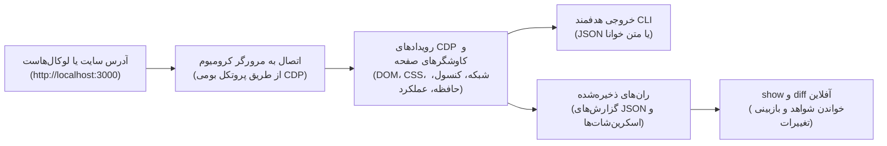

<div align="center">

# agentsEye 👁️

**اسکیلی که به ایجنت کدنویسی کمک می‌کند وب‌سایت را در مرورگر بررسی کند، علت خطاها را پیدا کند و نتیجهٔ اصلاحات را ارزیابی کند.**

[](package.json)
[](LICENSE)
[](package.json)
[](package.json)

[English](README.md) | [فارسی](README.fa.md)

</div>

<div dir="rtl">

<details>
<summary><strong>فهرست مطالب</strong></summary>

- [۱. چرا agentsEye ساخته شد و چه مشکلی را حل می‌کند؟](#۱-چرا-agentseye-ساخته-شد-و-چه-مشکلی-را-حل-میکند)
- [۲. کار با ایجنت در سه مرحله](#۲-کار-با-ایجنت-در-سه-مرحله)
- [۳. نحوه کارکرد به زبان ساده](#۳-نحوه-کارکرد-به-زبان-ساده)
- [۴. قابلیت‌های کلیدی و برجسته](#۴-قابلیتهای-کلیدی-و-برجسته)
- [۵. چطور از این ابزار به عنوان «اسکیل» در هوش مصنوعی استفاده کنیم؟](#۵-چطور-از-این-ابزار-به-عنوان-اسکیل-در-هوش-مصنوعی-استفاده-کنیم)
- [۶. شروع کار و دستورهای اختیاری](#۶-شروع-کار-و-دستورهای-اختیاری)
- [۷. نگهداری و حذف گزارش‌ها](#۷-نگهداری-و-حذف-گزارشها)
- [۸. پیدا کردن علت خطا با لاگ‌ها](#۸-پیدا-کردن-علت-خطا-با-لاگها)
- [۹. پرش ناخواسته صفحه (CLS) در برابر انیمیشن‌های تعمدی](#۹-پرش-ناخواسته-صفحه-cls-در-برابر-انیمیشنهای-تعمدی)
- [۱۰. امنیت و محدودیت‌ها](#۱۰-امنیت-و-محدودیتها)
- [۱۱. توسعه و معماری پروژه](#۱۱-توسعه-و-معماری-پروژه)
- [License](#license)

</details>

## ۱. چرا agentsEye ساخته شد و چه مشکلی را حل می‌کند؟

کد ظاهراً مشکلی ندارد، اما صفحه سفید می‌ماند. منو باز نمی‌شود یا اطلاعات سایت بارگذاری نمی‌شود. خواندن کد به‌تنهایی همیشه علت این مشکلات را نشان نمی‌دهد.

**agentsEye در درجهٔ اول یک اسکیل برای ایجنت‌های کدنویسی است.** اسکیل مجموعه‌ای از راهنماها و ابزارها برای انجام یک کار مشخص است. این اسکیل گزارش‌های مرورگر و تصاویر صفحه را در اختیار ایجنت می‌گذارد تا هنگام بررسی و اصلاح کد از آن‌ها استفاده کند.

بخشی از کاربرد‌های agentsEye عبارت‌اند از:

- **صفحه از کار می‌افتد یا خطا نشان می‌دهد:** خطاهای مرورگر و پیام‌های کنسول را ثبت می‌کند تا بتوان مشکلاتی را بررسی کرد که ممکن است هنگام بیلد برنامه دیده نشوند.

- **اطلاعات سایت بارگذاری نمی‌شود:** درخواست‌های ناموفق، پاسخ‌های خطا و درخواست‌های کندی را نشان می‌دهد که ممکن است روی صفحه اثر گذاشته باشند.

- **بخشی از رابط کاربری درست کار نمی‌کند:** منوها، تب‌ها و پنجره‌های داخل صفحه را می‌آزماید و امکان مقایسهٔ وضعیت قبل و بعد از تغییر کد را فراهم می‌کند.

از [نصب اسکیل](#۵-چطور-از-این-ابزار-به-عنوان-اسکیل-در-هوش-مصنوعی-استفاده-کنیم) شروع کنید؛ سپس نشانی صفحه و توضیح مشکل را به ایجنت بدهید. برای شروع لازم نیست دستورهای خط فرمان را یاد بگیرید. کاربران حرفه‌ای می‌توانند ابزار را مستقیم از ترمینال اجرا کنند.

## ۲. کار با ایجنت در سه مرحله

برای توسعهٔ یک قابلیت یا رفع خطا، از ایجنت بخواهید این سه مرحله را دنبال کند:

|                       مرحله |                                                                                       ایجنت چه می‌کند؟ |                                         فایده برای شما |
| --------------------------: | -----------------------------------------------------------------------------------------------------: | -----------------------------------------------------: |
|           **۱. بررسی صفحه** |                                                صفحه را باز می‌کند و گزارش و تصاویر آن را ذخیره می‌کند. |                         ثبت وضعیت صفحه پیش از تغییرات. |
| **۲. بررسی علت و اصلاح کد** | خطاها، مشکلات بارگذاری یا رفتار منوها و تب‌ها را بررسی می‌کند و از یافته‌ها برای اصلاح کد کمک می‌گیرد. | سرنخ‌هایی که به ایجنت در پیدا کردن راه‌حل کمک می‌کنند. |
|          **۳. بررسی نتیجه** |    بررسی را با همان اندازهٔ پنجره و همان تعامل‌ها تکرار می‌کند و گزارش‌های ذخیره‌شده را مقایسه می‌کند. |          کمک به تشخیص خطاهای تازه یا تغییرات ناخواسته. |

برای مثال، از ایجنت بخواهید:

> «با agentsEye صفحهٔ `http://localhost:3000` را بررسی کن، علت باز نشدن منو را پیدا کن و وضعیت قبل و بعد از اصلاح را مقایسه کن.»

در پایان، خودِ مشکل اولیه را دوباره بررسی کنید. نبود خطای تازه در مقایسهٔ گزارش‌ها، به معنی آزموده شدن همهٔ قابلیت‌های سایت نیست.

## ۳. نحوه کارکرد به زبان ساده

<div dir="ltr">



</div>

## ۴. قابلیت‌های کلیدی و برجسته

|                                  قابلیت |                                                                                                                           این قابلیت چه می‌کند؟ |                                                                                                                    ارزش کاربردی |
| --------------------------------------: | ----------------------------------------------------------------------------------------------------------------------------------------------: | ------------------------------------------------------------------------------------------------------------------------------: |
|                     **موتور مستقل CDP** |                                         یک فایل `.mjs` با APIهای بومی Node.js 22+ و مرورگر Chrome، Edge، Brave یا Chromium نصب‌شده اجرا می‌شود. |                                                                          بدون پکیج ران‌تایم npm یا نیاز به دانلود مرورگر اضافی. |
|             **شواهد یکپارچهٔ ران‌تایم** |                        DOM و CSS محاسبه‌شده، وضعیت و زمان درخواست‌ها، خطاهای جاوااسکریپت و کنسول، مشاهدات عملکرد و اسکرین‌شات‌ها را ثبت می‌کند. |                                              نشانه‌های رابط کاربری را به شواهدی متصل می‌کند که لاگ بیلد به‌تنهایی نشان نمی‌دهد. |
|               **خروجی متناسب با ایجنت** |                                               JSON یا متن خوانا، برش‌های `--focus`، کاتالوگ تعاملی فشرده و خروجی تعاملی `--delta` ارائه می‌دهد. |                                                                 بررسی را هدفمند نگه می‌دارد، به‌جای ارسال مکرر کل DOM به ایجنت. |
|        **تعامل معنایی در محدودهٔ مشخص** |                کلیک، هاور، اسکرول و کلیدهای کیبورد با سلکتور CSS یا رفرنس کاتالوگ مانند `e1`؛ `--interactive-scope` دامنهٔ کشف را محدود می‌کند. |                             انتخاب کنترل‌ها بر اساس نام و نقش؛ رفرنس‌ها مختص اسنپ‌شات هستند و با تغییر DOM ممکن است منقضی شوند. |
|              **بازبینی آفلاین رگرسیون** |                `show` گزارش ذخیره‌شده را می‌خواند؛ `diff` با تطبیق تخمینی DOM، موقعیت و ابعاد، استایل‌ها و خطاها و مسائل تازه را مقایسه می‌کند. |                                                استفادهٔ دوباره از شواهد بدون اجرای مرورگر؛ تفاوت‌ها همچنان نیازمند بازبینی‌اند. |
|              **اسنپ‌شات‌های ریسپانسیو** | `--matrix` از موبایل و بریک‌پوینت‌های تیلویند نمونه می‌گیرد؛ `--viewports` مجموعهٔ دلخواه را انتخاب می‌کند. برای هر ویوپورت اسکرین‌شات می‌گیرد. |                                                   بازبینی بریک‌پوینت‌ها در کرومیوم، نه آزمودن همهٔ دستگاه‌های واقعی و مرورگرها. |
| **نشانه‌های چیدمان، فرم و دسترس‌پذیری** |       ابعاد، دلایل مخفی بودن، خطر قفل اسکرول، هشدار اندازهٔ هدف لمسی و فونت ورودی، نمونه‌های کنتراست متن و دادهٔ اختیاری AX کرومیوم (`--a11y`). |                                        مسیرهای CSS و نشانه‌های مشکلات کاربردپذیری را ارائه می‌دهد؛ ممیزی کامل دسترس‌پذیری نیست. |
| **کرومیوم متصل و هدرهای محدود به مبدأ** |                           `--cdp` از کانتکست و تب تازهٔ اینکاگنیتو استفاده می‌کند؛ مقادیر `--header` فقط به مبدأ دقیق آدرس اولیه اعمال می‌شوند. |                           استفاده از پروسهٔ فعال بدون استفاده از تب‌های لاگین‌شده؛ پشتیبانی از مسیرهای دارای احراز هویت با هدر. |
|        **کاهش ریسک با کنترل‌های محدود** |                                                          ماسک‌گذاری اطلاعات حساس قابل‌شناسایی، بررسی تخمینی تزریق پرامپت و گیت‌های سیاست تعامل. | ریسک‌های شناخته‌شده را کاهش می‌دهد؛ دادهٔ صفحه همچنان غیرقابل‌اعتماد است. [مدل امنیتی](references/security-model.md) را ببینید. |

## ۵. چطور از این ابزار به عنوان «اسکیل» در هوش مصنوعی استفاده کنیم؟

اسکیل به ایجنت توضیح می‌دهد چه زمانی صفحه را در مرورگر بررسی کند و چطور گزارش را بخواند. آن را در دستیاری نصب کنید که از اسکیل‌ها پشتیبانی می‌کند و اجازهٔ اجرای دستورهای ترمینال را دارد. سپس نشانی صفحه و کاری را که می‌خواهید انجام شود به ایجنت بدهید و از او بخواهید از agentsEye استفاده کند.

### نصب از فایل ZIP ریلیز:

1. در صفحهٔ [آخرین ریلیز GitHub](https://github.com/herehossein/agentsEye/releases/latest)، **بستهٔ اسکیل با پسوند `.zip`** را از بخش **Assets** دانلود کنید.

2. فایل ZIP را استخراج کنید. **تمام فایل‌های مورد نیاز** شامل `agentsEye.mjs`، `SKILL.md` و پوشهٔ کامل `references/` داخل همین بسته هستند.

3. پوشهٔ استخراج‌شدهٔ اسکیل را با نام `agents-eye/` به یکی از محل‌های نصب زیر منتقل کنید. تمام محتویات را کنار هم نگه دارید؛ فایل `SKILL.md` باید مستقیماً داخل این پوشه باشد:

   <div dir="ltr">

   ```text
   📁 agents-eye/
   ├── 📄 agentsEye.mjs       # موتور اجرایی بدون نیاز به پکیج‌های خارجی
   ├── 📄 SKILL.md            # راهنما و درخت تصمیم‌گیری اختصاصی هوش مصنوعی
   └── 📁 references/         # راهنماهای تکمیلی (پرش‌های ساختاری، خطایابی لاگ‌محور)
   ```

   </div>

### محل‌های نصب پوشهٔ استخراج‌شده:

- **Claude Code**: مسیر `.claude/skills/agents-eye/` برای پروژه یا `~/.claude/skills/agents-eye/` برای کاربر.

- **Antigravity IDE/CLI**: مسیر `.agents/skills/agents-eye/` برای ورک‌اسپیس. نسخهٔ Antigravity CLI مسیر کاربری `~/.gemini/antigravity-cli/skills/agents-eye/` را هم پشتیبانی می‌کند.

- **Gemini CLI**: مسیر `.gemini/skills/agents-eye/` برای ورک‌اسپیس یا `~/.gemini/skills/agents-eye/` برای کاربر.

- **Cursor**: مسیر `.cursor/skills/agents-eye/` برای پروژه یا `~/.cursor/skills/agents-eye/` برای کاربر.

- **سایر دستیارهای دارای قابلیت اسکیل**: مسیر مستندشده برای نسخهٔ همان دستیار را انتخاب کنید؛ در صورت نیاز اسکیل را مورد اعتماد قرار دهید یا دوباره بارگذاری کنید.

### نمونه سناریوهای تعامل:

کافی است از ایجنت بخواهید:

1. **کرش هیدریشن و رندر ناهمگام:**

   > _«بیلد موفق است، اما رابط کاربری بعد از بارگذاری کرش می‌کند؛ خطای مرورگر را پیدا کن.»_

   ← با `--focus console` و `--console-level error,warn` خطاها و ردپای هیدریشن را بررسی کنید.

2. **شکست API در مسیر محافظت‌شده:**

   > _«این پاسخ 401/500 را بازتولید کن و اندپوینت ناموفق را پیدا کن.»_

   ← از `--focus network --compact` و هدرهای محدود به مبدأ با `--header` استفاده کنید. `--cdp` اختیاری یک کانتکست تازه و مجزا می‌سازد، نه تب لاگین‌شدهٔ کاربر.

3. **شرایط رقابتی در استیت و لایف‌سایکل:**

   > _«ردیابی کن چرا وضعیت احراز هویت بعد از mount مجدد کامپوننت ریست می‌شود.»_

   ← لاگ موقت `[AUTH_TRACE]` اضافه کنید، با `--console-filter '[AUTH_TRACE]'` آن را زنده یا آفلاین از طریق `show` بررسی کنید و پس از رفع مشکل لاگ‌ها را حذف کنید.

4. **خطایابی تعامل در یک بخش مشخص:**

   > _«در این دیالوگ، تب را عوض کن، با Escape ببند و دلیل هر اکشن ردشده را توضیح بده.»_

   ← با `--interactive-scope` و `--focus interactive --compact` کاتالوگ تازه بگیرید؛ همان اسکوپ را برای `--click e1 --key Escape --delta` نگه دارید و رفرنس را از کاتالوگ انتخاب کنید. دلیل رد اکشن را در `interactions.actions` بخوانید.

5. **بررسی رگرسیون در چند ویوپورت:**

   > _«ران‌های متناظر قبل و بعد را مقایسه کن و بریک‌پوینت‌های دیگر را هم بررسی کن.»_

   ← همان ویوپورت و اکشن‌ها را تکرار کنید، `node agentsEye.mjs diff <before-id> <after-id>` را اجرا کنید و هر دو شمارندهٔ رگرسیون و مشکل اولیه را بررسی کنید. با `--matrix`، مجموعهٔ `matrix.snapshots` را جداگانه ببینید.

تعاملات را فقط روی برنامه‌های مورد اعتماد اجرا کنید؛ [گیت‌های ایمنی تعامل](references/interactive-refs-guide.md) همچنان برقرارند.

## ۶. شروع کار و دستورهای اختیاری

### به چه چیزهایی نیاز دارید؟

- **Node.js**: نسخهٔ ۲۲ یا بالاتر.
- **مرورگر**: Google Chrome، Microsoft Edge، Brave یا Chromium نصب‌شده. کاربران حرفه‌ای می‌توانند با `--cdp` به مرورگر کرومیوم فعال هم متصل شوند.
- **سیستم‌عامل**: روی ویندوز ۱۱ با Node 22+ آزمایش شده است. انتظار می‌رود روی لینوکس و macOS هم کار کند، اما هنوز روی آن‌ها تأیید نشده است.

برنامه را اجرا کنید تا صفحهٔ آن در دسترس باشد، یا نشانی یک سایت موجود را به کار ببرید. پس از نصب اسکیل، مشکل را برای ایجنت توضیح دهید و از او بخواهید با agentsEye صفحه را بررسی کند. **دستورهای زیر اختیاری‌اند؛ می‌توانید اجرای آن‌ها را به ایجنت بسپارید.**

### اجرای مستقیم ابزار (اختیاری)

این دستور را از پوشهٔ نصب اسکیل که فایل `agentsEye.mjs` در آن است اجرا کنید. به‌جای `http://localhost:3000` نشانی صفحهٔ خودتان را بگذارید:

<div dir="ltr">

```bash
node agentsEye.mjs http://localhost:3000 --format text --temp
```

</div>

گزینهٔ `--format text` گزارش را به متن خوانا در ترمینال تبدیل می‌کند. گزینهٔ `--temp` آن را بیرون از پروژه ذخیره می‌کند تا شما یا ایجنت بتوانید بعداً آن را دوباره بررسی کنید.

<details>
<summary><strong>دستورهای بیشتر برای کاربران حرفه‌ای</strong></summary>

این مثال‌ها برای بستهٔ نصب‌شدهٔ ریلیز هستند. اگر از کد مخزن استفاده می‌کنید، ابتدا `npm run build` را اجرا کنید و سپس از ریشهٔ مخزن، به‌جای `node agentsEye.mjs` از `node dist/agentsEye.mjs` استفاده کنید.

`<url>` یعنی نشانی صفحه و `<run-id>` یعنی شناسهٔ بررسی در گزارش. آن‌ها را با مقدارهای مربوط به خودتان جایگزین کنید. سلکتورهای CSS مانند `#menu-button` باید با عناصر صفحهٔ شما مطابقت داشته باشند.

شناسه‌هایی مانند `e1` از آخرین فهرست عناصر تعاملی انتخاب می‌شوند. محدودهٔ فهرست‌کردن و کلیک باید یکسان باشد؛ این شناسه‌ها ممکن است تغییر کنند. در PowerShell از `e1` یا شکل نقل‌قول‌شدهٔ `'@e1'` استفاده کنید.

|                                هدف | دستور                                                                                                                                 |                                                                                                                                         توضیح |
| ---------------------------------: | :------------------------------------------------------------------------------------------------------------------------------------ | --------------------------------------------------------------------------------------------------------------------------------------------: |
|                     **بررسی سریع** | <span dir="ltr">`node agentsEye.mjs http://localhost:3000 --temp`</span>                                                              |                                                                         خلاصه‌ای از چیدمان، خطاها، تیترها و عملکرد بارگذاری صفحه نشان می‌دهد. |
|                     **خروجی متنی** | <span dir="ltr">`node agentsEye.mjs http://localhost:3000 --format text --temp`</span>                                                |                                                                                                به‌جای JSON، متن خوانا در ترمینال نشان می‌دهد. |
| **بررسی خطا و از کار افتادن صفحه** | <span dir="ltr">`node agentsEye.mjs <url> --focus console --temp`</span>                                                              |                                       خطاهای ثبت‌شدهٔ مرورگر و پیام‌های کنسول را نشان می‌دهد که ممکن است علت از کار افتادن صفحه را روشن کنند. |
|              **مشکلات شبکه و API** | <span dir="ltr">`node agentsEye.mjs <url> --focus network --compact --temp`</span>                                                    |                                                                درخواست‌های ناموفق، پاسخ‌های خطا و کندترین درخواست‌های ثبت‌شده را نشان می‌دهد. |
|           **بررسی یک بخش از صفحه** | <span dir="ltr">`node agentsEye.mjs <url> --selector "#login-modal" --temp`</span>                                                    |                                                                              ظاهر، اندازه و وضعیت نمایش بخش انتخاب‌شدهٔ صفحه را بررسی می‌کند. |
|       **خواندن مقدارهای مشخص CSS** | <span dir="ltr">`node agentsEye.mjs <url> --selector "#modal" --style-props "display,position,z-index,backdrop-filter" --temp`</span> |                                               مقدار ویژگی‌های CSS درخواستی را نشان می‌دهد، حتی مقدارهای پیش‌فرضی که در حالت عادی حذف می‌شوند. |
|                    **آزمودن کلیک** | <span dir="ltr">`node agentsEye.mjs <url> --click "#menu-button" --temp`</span>                                                       |                                                                            کلیک را امتحان می‌کند و نتیجه یا دلیل انجام نشدن آن را ثبت می‌کند. |
|        **استفاده از شناسهٔ عناصر** | <span dir="ltr">`node agentsEye.mjs <url> --click e1 --hover e2 --scroll e3 --temp`</span>                                            |                                                                         از شناسه‌های یک فهرست تازه استفاده می‌کند؛ این شناسه‌ها دائمی نیستند. |
|           **محدود کردن کشف عناصر** | <span dir="ltr">`node agentsEye.mjs <url> --interactive-scope "#modal" --click e1 --temp`</span>                                      |                                                        به عناصر داخل `#modal` شناسه می‌دهد؛ شناسه‌ها را از فهرستی با همین محدوده انتخاب کنید. |
|             **فهرست عناصر تعاملی** | <span dir="ltr">`node agentsEye.mjs <url> --focus interactive --compact --temp`</span>                                                |                                                             عناصر تعاملی، نام‌ها، نوع ورودی‌ها و موقعیت آن‌ها را تا سقف جمع‌آوری نشان می‌دهد. |
|        **اجرای تعامل‌ها به‌ترتیب** | <span dir="ltr">`node agentsEye.mjs <url> --click "#menu" --key Escape --scroll 0,500 --temp`</span>                                  |                                                                    حداکثر ۵۰ کلیک، هاور، اسکرول و تعامل با صفحه‌کلید را به‌ترتیب اجرا می‌کند. |
|        **آزمودن بخش‌های بازشونده** | <span dir="ltr">`node agentsEye.mjs <url> --explore --temp`</span>                                                                    |                                         منوها، تب‌ها و بخش‌های بازشوندهٔ پشتیبانی‌شده را می‌آزماید؛ نه همهٔ دکمه‌ها یا یک مسیر کامل کاربر را. |
|            **انتظار برای یک عنصر** | <span dir="ltr">`node agentsEye.mjs <url> --wait-for "#results" --temp`</span>                                                        |                                 منتظر پیدا شدن عنصر موردنظر می‌ماند؛ ممکن است آن عنصر هنوز مخفی باشد. اگر زمان انتظار تمام شود، هشدار می‌دهد. |
|           **حالت تاریک و کنتراست** | <span dir="ltr">`node agentsEye.mjs <url> --color-scheme dark --focus issues --temp`</span>                                           |                                          ترجیح حالت تاریک را شبیه‌سازی می‌کند و مشکلات احتمالی کنتراست متن روی زمینهٔ تک‌رنگ را گزارش می‌دهد. |
|          **Locale و منطقهٔ زمانی** | <span dir="ltr">`node agentsEye.mjs <url> --locale fa-IR --timezone Asia/Tehran --temp`</span>                                        |                                          قالب‌بندی وابسته به Locale و منطقهٔ زمانی را تغییر می‌دهد، نه زبان برنامه یا جهت راست‌به‌چپ صفحه را. |
|         **استفاده از مرورگر فعال** | <span dir="ltr">`node agentsEye.mjs <url> --cdp http://127.0.0.1:9222 --temp`</span>                                                  |                                         از مرورگر فعال با یک نشست خصوصی تازه استفاده می‌کند، نه تب‌هایی که از قبل در آن‌ها وارد حساب شده‌اید. |
|  **جست‌وجو در پیام‌های ذخیره‌شده** | <span dir="ltr">`node agentsEye.mjs show <run-id> console --console-filter "/\[AUTH\].*error/i"`</span>                               |                                                                       خطاهای ثبت‌شدهٔ احراز هویت را بدون باز کردن دوبارهٔ مرورگر پیدا می‌کند. |
|     **بررسی سرریز صفحه در موبایل** | <span dir="ltr">`node agentsEye.mjs <url> --focus issues --temp`</span>                                                               |                                                 نمونه‌هایی از عناصر بیرون‌زده از لبهٔ صفحه را در اندازهٔ پیش‌فرض موبایل 375x667 گزارش می‌دهد. |
|         **بررسی چند اندازهٔ صفحه** | <span dir="ltr">`node agentsEye.mjs <url> --matrix --temp`</span>                                                                     |                                                          اندازه‌های موبایل و اندازه‌های استاندارد تیلویند، از `sm` تا `2xl`، را بررسی می‌کند. |
|              **مقایسهٔ قبل و بعد** | <span dir="ltr">`node agentsEye.mjs diff <before-id> <after-id>`</span>                                                               |                 تغییرات ساختار و ظاهر صفحه، همراه با خطاها و مشکلات تازه را نشان می‌دهد. مشکل اولیه و درخواست‌های شبکه را جداگانه بررسی کنید. |
|   **داده‌های ذخیره‌شده در مرورگر** | <span dir="ltr">`node agentsEye.mjs <url> --focus storage --temp`</span>                                                              | داده‌های ذخیره‌شده در مرورگر را به گزارش اضافه می‌کند. اطلاعات حساس قابل‌شناسایی پوشانده می‌شود، اما پیش از اشتراک‌گذاری گزارش را بررسی کنید. |
|                  **بررسی یک‌باره** | <span dir="ltr">`node agentsEye.mjs <url> --ephemeral --summary-only`</span>                                                          |                         پس از خروجی دادن، برای حذف فایل‌های بررسی تلاش می‌کند. فقط وقتی استفاده کنید که به `show` یا `diff` بعدی نیاز ندارید. |

در بررسی چند اندازهٔ صفحه، `--matrix` گزارش هر اندازه را جداگانه در `matrix.snapshots` نگه می‌دارد. یک `diff` معمول فقط گزارش اصلی را مقایسه می‌کند؛ اندازه‌های دیگر را جداگانه بررسی کنید.

</details>

### نتیجهٔ اجرا چه معنایی دارد؟

پس از پایان اجرا، وضعیت ابزار با عددی به نام **کد خروج** اعلام می‌شود. این عدد وضعیت اجرای ابزار را نشان می‌دهد، نه بی‌خطا بودن سایت را.

> [!IMPORTANT]
> **پایان موفق بررسی به معنی بی‌خطا بودن صفحه نیست.** حتی در صورت اجرای موفق، خطاها و هشدارهای گزارش را بخوانید.

| کد خروج |                                  معنی |                                                                                         چه کار کنید؟ |
| ------: | ------------------------------------: | ---------------------------------------------------------------------------------------------------: |
| **`0`** |             بررسی به پایان رسیده است. |                                            یافته‌ها را بخوانید؛ ممکن است صفحه همچنان خطا داشته باشد. |
| **`1`** |     ابزار نتوانسته بررسی را کامل کند. |                              نشانی صفحه، اتصال شبکه و مرورگر را بررسی کنید و پیام خطا را دنبال کنید. |
| **`2`** | دستور یا نشانی صفحه پذیرفته نشده است. | گزینه‌ها و نشانی را بررسی کنید. بعضی نشانی‌ها به دلایل امنیتی مسدودند؛ پیام خطا علت را توضیح می‌دهد. |

<details>
<summary><strong>ویژهٔ اسکریپت‌ها و بررسی‌های خودکار</strong></summary>

مقدار `report.ok === true` نیز فقط به معنی پایان موفق بررسی است، نه بی‌خطا بودن صفحه. بخش‌های `issues`، `network.failures`، `errors.uncaught`، `console.errors` و `warnings` را بررسی کنید.

برای مقایسهٔ قبل و بعد، `summary.newErrors === 0` و `summary.newIssues === 0` را بررسی کنید. همچنان مشکل اولیه، درخواست‌های ناموفق شبکه و تفاوت‌های چیدمان و ظاهر را جداگانه بازبینی کنید.

همهٔ کدهای خروج در [راهنمای خط فرمان](references/cli-reference.md) و فیلدهای JSON در [مرجع گزارش](references/schema-reference.md) توضیح داده شده‌اند.

</details>

## ۷. نگهداری و حذف گزارش‌ها

مجموعهٔ گزارش و تصاویر یک بررسی در این ابزار **run** نام دارد. با نگه داشتن آن، ایجنت می‌تواند یافته‌ها را دوباره بخواند یا دو بررسی را بدون باز کردن دوبارهٔ سایت مقایسه کند.

گزارش‌ها به‌صورت پیش‌فرض در `.agentsEye/runs/` ذخیره می‌شوند. با `--temp`، به‌جای آن در پوشهٔ موقت سیستم قرار می‌گیرند. `show` و `diff` آن‌ها را در این محل به‌طور خودکار پیدا می‌کنند. **گزینهٔ `--temp` به‌تنهایی گزارش‌ها را در پایان اجرا حذف نمی‌کند.**

گزارش‌ها را تا پایان بررسی اصلاحات نگه دارید؛ سپس از ایجنت بخواهید فقط فایل‌های بررسی‌های مربوط به همان کار را حذف کند. برای حذف یک بررسی، شناسهٔ کنار `Run:` در خروجی متنی یا `run.id` در JSON را به‌جای `<run-id>` بگذارید:

<div dir="ltr">

```bash
node agentsEye.mjs clean <run-id>
```

</div>

با حذف یک بررسی، تصاویر ذخیره‌شدهٔ آن هم حذف می‌شوند. دستور `clean` بدون شناسه یا گزینهٔ پاکسازی، چیزی حذف نمی‌کند.

<details>
<summary><strong>گزینه‌های دیگر پاکسازی (پیشرفته)</strong></summary>

> [!WARNING]
> گزینه‌های `--older-than` و `--all` مسیرهای موقت مشترک و محل‌های ذخیره‌سازی قدیمی را هم بررسی می‌کنند. ممکن است گزارش‌های پروژه‌های دیگر را حذف کنند، نه فقط فایل‌های کار فعلی را. تنها زمانی از آن‌ها استفاده کنید که قصد چنین پاکسازی گسترده‌ای را دارید.

- **حذف گزارش‌های قدیمی‌تر از یک ساعت:**

   <div dir="ltr">

  ```bash
  node agentsEye.mjs clean --older-than 1h
  ```

   </div>

- **حذف همهٔ گزارش‌ها در محل‌هایی که ابزار بررسی می‌کند:**

   <div dir="ltr">

  ```bash
  node agentsEye.mjs clean --all
  ```

   </div>

- **نگه داشتن فقط خروجی یک بررسی یک‌باره:**

   <div dir="ltr">

  ```bash
  node agentsEye.mjs <url> --ephemeral
  ```

   </div>

  گزینهٔ `--ephemeral` در پایان اجرا برای حذف فایل‌های بررسی تلاش می‌کند. فایل‌ها ابتدا نوشته می‌شوند؛ سپس ابزار برای حذف آن‌ها تلاش می‌کند. اگر به `show` یا `diff` بعدی نیاز دارید، از آن استفاده نکنید. فایل‌هایی که با `--out` یا `--screenshot` جداگانه خروجی گرفته‌اید باقی می‌مانند. مجوزهای سیستم یا قفل بودن فایل ممکن است مانع پاکسازی شود.

</details>

## ۸. پیدا کردن علت خطا با لاگ‌ها

برخی خطاها فقط هنگام کار با برنامه دیده می‌شوند؛ مثلاً منو باز می‌شود و بلافاصله بسته می‌شود. یک تصویر از صفحه به‌تنهایی علت را نشان نمی‌دهد. **لاگ‌ها پیام‌هایی هستند که برنامه در کنسول مرورگر ثبت می‌کند** و می‌توانند ترتیب اجرای مراحل را نشان دهند.

از ایجنت بخواهید:

> «با agentsEye و چند لاگ موقت، علت بسته شدن منو بلافاصله پس از باز شدن را پیدا کن. در پایان فقط لاگ‌هایی را حذف کن که خودت اضافه کرده‌ای.»

روند کار ساده است:

1. ایجنت چند پیام با برچسب مشخص نزدیک کدی که به آن مشکوک است اضافه می‌کند.
2. agentsEye این پیام‌ها را ثبت می‌کند و پیام‌های نامرتبط را کنار می‌گذارد.
3. ایجنت ترتیب پیام‌ها را بررسی می‌کند تا علت مشکل را پیدا و کد را اصلاح کند.
4. نتیجه را بررسی می‌کند و فقط پیام‌هایی را که خودش اضافه کرده حذف می‌کند؛ لاگ‌های قبلی برنامه دست‌نخورده می‌مانند.

> هرگز رمز عبور، توکن احراز هویت، کوکی یا اطلاعات کاربران را در لاگ‌های خطایابی ثبت نکنید.

<details>
<summary><strong>نمونه برای برنامه‌نویسان</strong></summary>

یک پیام با برچسب مشخص در کدی که بررسی می‌کنید بگذارید:

<div dir="ltr">

```javascript
console.log('[AGENT_DEBUG_TAG]', 'Menu opened');
```

</div>

سپس فقط پیام‌های دارای همان برچسب را بخوانید:

<div dir="ltr">

```bash
node agentsEye.mjs http://localhost:3000 --temp --focus console --console-filter '[AGENT_DEBUG_TAG]'
```

</div>

پس از رفع خطا، فقط پیام‌های موقت با همان برچسب را حذف کنید، نه تمام دستورهای `console.log` برنامه را.

</details>

نمونه‌های بیشتر در [راهنمای خطایابی با لاگ‌ها](references/log-driven-debugging.md) آمده‌اند.

## ۹. پرش ناخواسته صفحه (CLS) در برابر انیمیشن‌های تعمدی

وب‌اپلیکیشن‌های مدرن حرکت تعمدی دارند، مانند نوار لوگو، منوی کشویی و باز شدن آکاردئون. CLS و تغییر موقعیت یا ابعاد کادر، نشانه‌های متفاوت‌اند؛ هیچ‌کدام به‌تنهایی حرکت را باگ تلقی نمی‌کنند:

### حرکات تعمدی (رفتار طبیعی):

- نوارهای اسکرول خودکار اخبار و لوگوها.
- باز و بسته شدن انیمیشن‌دار آکاردئون‌ها، دراورها و مودال‌ها.
- انیمیشن‌های CSS با `transform` و `opacity` درون کادرهای مشخص.
- _قاعده_: هرگز انیمیشن‌های تعمدی محصول را صرفاً برای کاهش عدد CLS غیرفعال نکنید.

### باگ‌های واقعی پرش صفحه (نیازمند اصلاح):

- نبود ابعاد مشخص برای تصاویر و ویدیوها (`width`، `height`، `aspect-ratio`).
- تزریق محتوای داینامیک درون جریان صفحه بدون در نظر گرفتن فضای اولیه.
- جابجایی ناخواستهٔ محتوای اطراف در اثر تغییر ویژگی‌های مؤثر بر چیدمان، مانند `top`، `margin` و `height`.

برای مطالعه بیشتر به [راهنمای پرش صفحه](references/layout-shift-guide.md) مراجعه کنید.

برای بررسی مکان‌یاب‌های معنایی و ایمنی تعاملات به [Interactive Refs Guide](references/interactive-refs-guide.md) مراجعه کنید.

## ۱۰. امنیت و محدودیت‌ها

agentsEye را روی برنامه‌های متعلق به خودتان یا مورد اعتماد، ترجیحاً نسخهٔ توسعه یا آزمایشی، استفاده کنید.

### ابزار چطور ریسک را کاهش می‌دهد؟

- **صفحه را جدا باز می‌کند.** از تب‌هایی استفاده نمی‌کند که از قبل در آن‌ها وارد حساب شده‌اید.

- **در حالت پیش‌فرض کلیک یا فشار کلید انجام نمی‌دهد.** باز شدن صفحه همچنان کدهای خود سایت را اجرا می‌کند. تعامل‌های درخواستی ممکن است اطلاعات را تغییر دهند یا درخواست شبکه ارسال کنند.

- **اطلاعات حساس قابل‌شناسایی را پنهان می‌کند، اما ممکن است بعضی را تشخیص ندهد.** پیش از اشتراک‌گذاری، گزارش‌ها را بررسی کنید. اطلاعات داخل تصاویر پوشانده نمی‌شود و ممکن است اطلاعات خصوصی در آن‌ها دیده شود.

- **محتوای صفحه را غیرقابل‌اعتماد می‌داند.** حتی پس از فیلتر شدن، متن صفحه، پیام‌های کنسول، داده‌های ذخیره‌شده در مرورگر و متن گزارش، دستورهایی برای ایجنت نیستند.

### چه چیزهایی را تضمین نمی‌کند؟

- **مقایسه، تأیید قطعی رفع خطا نیست.** `diff` تغییرات ساختار و ظاهر صفحه، همراه با خطاها و مشکلات تازه را نشان می‌دهد. تصاویر را پیکسل‌به‌پیکسل یا درخواست‌های ناموفق شبکه را مقایسه نمی‌کند. مشکل اولیه را هم دوباره بررسی کنید.

- **گزارش ممکن است کامل نباشد.** زمان بررسی و حجم اطلاعات ثبت‌شده محدود است. ممکن است خطاهایی که بعداً رخ می‌دهند یا بعضی بخش‌های صفحه در گزارش دیده نشوند. هشدارهای مربوط به گزارش ناقص را بخوانید.

- **جایگزین آزمون‌های گسترده‌تر نیست.** بررسی‌ها در کرومیوم انجام می‌شوند، نه در Safari، Firefox یا موبایل واقعی. هشدارهای دسترس‌پذیری و کنتراست نیز جای ارزیابی کامل دسترس‌پذیری را نمی‌گیرند.

> [!WARNING]
> **این ابزار جایگزین محیط آزمایشی جداگانه نیست.** بررسی `localhost` و سایت‌های شبکهٔ خصوصی برای توسعه مجاز است. سایت‌های ناشناس یا مشکوک را فقط در محیطی جداگانه با دسترسی محدود به شبکه بررسی کنید.

<details>
<summary><strong>مرزهای فنی بررسی (پیشرفته)</strong></summary>

بررسی مرورگر به وضعیت داخلی کامپوننت‌های فریم‌ورک، ریشه‌های بستهٔ Shadow DOM، سند iframe خارج از مبدأ و کنترل‌های رسم‌شده در Canvas/WebGL دسترسی ندارد. نشانه‌های دسترس‌پذیری و کنتراست نیز ممیزی کامل WCAG نیستند.

گزینهٔ `--allow-destructive` فقط فیلتر نام‌های حساس انگلیسی و فارسی را کنار می‌گذارد؛ کنترل‌های ناوبری، ارسال یا بازنشانی فرم، بارگذاری فایل، ورودی‌های قابل‌ویرایش و عناصر غیرفعال یا پوشیده‌شده همچنان مسدود می‌مانند. اتصال به دیباگر مرورگر غیرمحلی به `--allow-remote-cdp` نیاز دارد. کنترل‌های شبکه آدرس‌های DNS را ثابت نگه نمی‌دارند و حفاظت در برابر DNS Rebinding را تضمین نمی‌کنند.

قواعد دقیق نشانی‌های IP، محدودهٔ هدرها، پورت‌های مرورگر، منع دانلود و پاکسازی در [مدل امنیتی](references/security-model.md) و جزئیات تعامل‌های انجام‌نشده در [راهنمای تعامل](references/interactive-refs-guide.md) آمده‌اند.

</details>

## ۱۱. توسعه و معماری پروژه

این بخش برای کسانی است که می‌خواهند کد منبع agentsEye را تغییر دهند و در توسعهٔ آن مشارکت کنند. کاربران اسکیل فقط به فایل ZIP ریلیز نیاز دارند و لازم نیست دستورهای توسعهٔ زیر را اجرا کنند.

کد منبع پروژه با TypeScript و به‌صورت ماژولار در پوشهٔ `src/` نوشته شده است. ابزار `esbuild` آن را به فایل مستقل `dist/agentsEye.mjs` تبدیل می‌کند که برای اجرا به بسته‌های npm نیاز ندارد. پوشهٔ تولیدشدهٔ `dist/` در Git نادیده گرفته می‌شود. برای مشارکت، `src/` را ویرایش کنید، بیلد را روی سیستم خودتان انجام دهید و تغییرات کد منبع را کامیت کنید؛ فایل تولیدشده را کامیت نکنید.

اجرای ابزار به Node.js نسخهٔ ۲۲ یا بالاتر نیاز دارد. برای توسعهٔ پروژه، از Node.js نسخهٔ `22.13.0` یا بالاتر در شاخهٔ ۲۲، یا نسخهٔ ۲۴ یا بالاتر استفاده کنید.

`npm ci` دستور داخلی npm است و نیازی به تعریف آن در بخش `scripts` فایل `package.json` نیست. ابزارهای لازم برای بیلد و بررسی کد را با نسخه‌های ثبت‌شده در `package-lock.json` نصب می‌کند. اگر پوشهٔ `node_modules` از قبل وجود داشته باشد، آن را حذف و دوباره ایجاد می‌کند؛ `package.json` و فایل قفل را تغییر نمی‌دهد.

<div dir="ltr">

```bash
# نصب ابزارهای لازم برای بیلد و بررسی کد
npm ci

# بررسی صحت تایپ‌های تایپ‌اسکریپت
npm run typecheck

# بررسی استایل کد و صحت فرمت‌بندی
npm run lint
npm run format:check

# بیلد و باندل src/ به dist/agentsEye.mjs
npm run build

# اجرا از ریشه مخزن
node dist/agentsEye.mjs http://localhost:3000 --temp

# اجرای تمامی تست‌های پروژه (ابتدا بیلد اجرا می‌شود)
npm test
```

</div>

<div dir="ltr">

## License

MIT License — Copyright (c) 2026 herehossein. See [LICENSE](LICENSE) for details.

</div>

</div>
