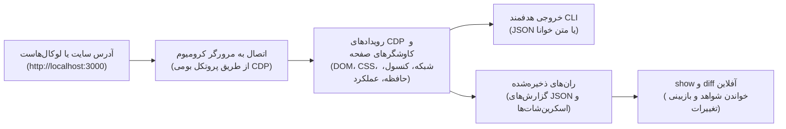

<div align="center">

# agentsEye 👁️

**بازرس مستقل ران‌تایم مرورگر برای ایجنت‌های کدنویسی و برنامه‌نویسان: گزارش ساختاریافته، تعامل هدفمند و مقایسهٔ قبل و بعد، بدون وابستگی ران‌تایم به پکیج‌های npm.**

[](package.json)
[](LICENSE)
[](package.json)
[](package.json)

[English](README.md) | [فارسی](README.fa.md)

</div>

<div dir="rtl">

<details>
<summary><strong>فهرست مطالب</strong></summary>

- [۱. چرا agentsEye ساخته شد و چه مشکلی را حل می‌کند؟](#۱-چرا-agentseye-ساخته-شد-و-چه-مشکلی-را-حل-میکند)
- [۲. چرخه کامل مهندسی فرانت‌اند (توسعه ← خطایابی ← راستی‌آزمایی نهایی)](#۲-چرخه-کامل-مهندسی-فرانتاند-توسعه--خطایابی--راستیآزمایی-نهایی)
- [۳. نحوه کارکرد به زبان ساده](#۳-نحوه-کارکرد-به-زبان-ساده)
- [۴. قابلیت‌های کلیدی و برجسته](#۴-قابلیتهای-کلیدی-و-برجسته)
- [۵. چطور از این ابزار به عنوان «اسکیل» در هوش مصنوعی استفاده کنیم؟](#۵-چطور-از-این-ابزار-به-عنوان-اسکیل-در-هوش-مصنوعی-استفاده-کنیم)
- [۶. شروع سریع و جدول دستورات کاربردی](#۶-شروع-سریع-و-جدول-دستورات-کاربردی)
- [۷. مدیریت و پاکسازی ران‌ها](#۷-مدیریت-و-پاکسازی-رانها)
- [۸. خطایابی لاگ‌محور برای هوش مصنوعی (Log-Driven Debugging)](#۸-خطایابی-لاگمحور-برای-هوش-مصنوعی-log-driven-debugging)
- [۹. پرش ناخواسته صفحه (CLS) در برابر انیمیشن‌های تعمدی](#۹-پرش-ناخواسته-صفحه-cls-در-برابر-انیمیشنهای-تعمدی)
- [۱۰. امنیت و محدودیت‌ها](#۱۰-امنیت-و-محدودیتها)
- [۱۱. توسعه و معماری پروژه](#۱۱-توسعه-و-معماری-پروژه)
- [License](#license)

</details>

## ۱. چرا agentsEye ساخته شد و چه مشکلی را حل می‌کند؟

ایجنت‌های کدنویسی سورس را می‌خوانند و تغییر می‌دهند، اما برای شناخت رفتار واقعی برنامه به شواهد مرورگر نیاز دارند. **agentsEye این بازخورد را با سه کاربرد اصلی فراهم می‌کند:**

- **تشخیص کرش و خطاهای ران‌تایم:** ثبت خطاهای کنترل‌نشدهٔ جاوااسکریپت و لاگ‌های کنسول، از جمله خطاهای هیدریشن گزارش‌شده توسط برنامه؛ فیلتر لاگ‌های برچسب‌دار برای بررسی باگ‌های استیت و لایف‌سایکل.

- **خطایابی شبکه و API:** شناسایی درخواست‌های ناموفق، پاسخ‌های 4xx/5xx و اندپوینت‌های کند؛ بررسی مسیرهای محافظت‌شده با هدرهای محدود به مبدأ هدف.

- **آزمودن تعاملات و راستی‌آزمایی رفع باگ:** اجرای تعامل با منوها، تب‌ها و مودال‌ها از طریق رفرنس‌های معنایی محدود به یک بخش، سپس مقایسهٔ ران‌های قبل و بعد برای یافتن خطاها و مسائل جدید.

موتور از یک فایل `.mjs`، با Node.js 22+ و یک مرورگر کرومیوم نصب‌شده، مستقل از فریم‌ورک فرانت‌اند اجرا می‌شود. رویدادهای مرورگر و کاوشگرهای صفحه را به خروجی هدفمند JSON یا متن خوانا تبدیل می‌کند و گزارش‌ها و اسکرین‌شات‌ها را برای بازبینی نگه می‌دارد. وضعیت را یک‌بار ثبت کنید و سپس شواهد را آفلاین بخوانید، به‌جای اینکه هر بار کل صفحه را وارد کانتکست ایجنت کنید.

## ۲. چرخه کامل مهندسی فرانت‌اند (توسعه ← خطایابی ← راستی‌آزمایی نهایی)

چرخهٔ کار را بر پایهٔ شواهد پیش ببرید: **ثبت وضعیت ← بازتولید مشکل ← اصلاح کد ← مقایسه**.

| مرحله | روال فعلی | نتیجهٔ مورد انتظار |
| ---: | ---: | ---: |
| **۱. مشاهده و ثبت مبنا** | ران را با `--temp` ذخیره کنید؛ ابتدا خلاصه و سپس `--focus interactive --compact` را برای نام کنترل‌ها، نوع ورودی‌ها و رفرنس‌ها ببینید. اگر توکن‌های طراحی موضوع بررسی نیستند، از `--no-css-vars` استفاده کنید. | یک مبنای ذخیره‌شده و کاتالوگ تعاملی هدفمند. |
| **۲. بازتولید و خطایابی** | لاگ‌های کنسول را فیلتر و شکست شبکه را بررسی کنید؛ CSS محاسبه‌شدهٔ بخش هدف را با `--selector`/`--style-props` ببینید. از رفرنس‌های تازه با `--interactive-scope`، اکشن‌های زنجیره‌ای و `--delta` استفاده کنید؛ `--explore` فقط عناصر بازشونده را می‌آزماید. | شواهد ران‌تایم برای اصلاح هدفمند سورس. |
| **۳. راستی‌آزمایی و بازبینی** | همان ویوپورت و اکشن‌ها را تکرار کنید، سپس `node agentsEye.mjs diff <before-id> <after-id>` را اجرا کنید. جزئیات را آفلاین با `node agentsEye.mjs show <run-id> interactive.items[15]` بخوانید. | بررسی `summary.newErrors === 0` و `summary.newIssues === 0`؛ بازبینی تغییرات چیدمان و استایل، `network.failures` و رفع مشکل اولیه. |

`--matrix` مجموعه‌ای از ویوپورت‌ها را ثبت می‌کند؛ `matrix.snapshots` را جداگانه بررسی کنید. مقایسهٔ قبل و بعد با یک diff، اسنپ‌شات اصلی را مقایسه می‌کند، نه همهٔ بریک‌پوینت‌ها را. ران‌های `--temp` را تا پایان کوئری‌ها و مقایسه‌ها نگه دارید، سپس فقط همان شناسه‌ها را پاک کنید.

## ۳. نحوه کارکرد به زبان ساده

<div dir="ltr">



</div>

## ۴. قابلیت‌های کلیدی و برجسته

| قابلیت | این قابلیت چه می‌کند؟ | ارزش کاربردی |
| ---: | ---: | ---: |
| **موتور مستقل CDP** | یک فایل `.mjs` با APIهای بومی Node.js 22+ و مرورگر Chrome، Edge، Brave یا Chromium نصب‌شده اجرا می‌شود. | بدون پکیج ران‌تایم npm یا نیاز به دانلود مرورگر اضافی. |
| **شواهد یکپارچهٔ ران‌تایم** | DOM و CSS محاسبه‌شده، وضعیت و زمان درخواست‌ها، خطاهای جاوااسکریپت و کنسول، مشاهدات عملکرد و اسکرین‌شات‌ها را ثبت می‌کند. | نشانه‌های رابط کاربری را به شواهدی متصل می‌کند که لاگ بیلد به‌تنهایی نشان نمی‌دهد. |
| **خروجی متناسب با ایجنت** | JSON یا متن خوانا، برش‌های `--focus`، کاتالوگ تعاملی فشرده و خروجی تعاملی `--delta` ارائه می‌دهد. | بررسی را هدفمند نگه می‌دارد، به‌جای ارسال مکرر کل DOM به ایجنت. |
| **تعامل معنایی در محدودهٔ مشخص** | کلیک، هاور، اسکرول و کلیدهای کیبورد با سلکتور CSS یا رفرنس کاتالوگ مانند `e1`؛ `--interactive-scope` دامنهٔ کشف را محدود می‌کند. | انتخاب کنترل‌ها بر اساس نام و نقش؛ رفرنس‌ها مختص اسنپ‌شات هستند و با تغییر DOM ممکن است منقضی شوند. |
| **بازبینی آفلاین رگرسیون** | `show` گزارش ذخیره‌شده را می‌خواند؛ `diff` با تطبیق تخمینی DOM، موقعیت و ابعاد، استایل‌ها و خطاها و مسائل تازه را مقایسه می‌کند. | استفادهٔ دوباره از شواهد بدون اجرای مرورگر؛ تفاوت‌ها همچنان نیازمند بازبینی‌اند. |
| **اسنپ‌شات‌های ریسپانسیو** | `--matrix` از موبایل و بریک‌پوینت‌های تیلویند نمونه می‌گیرد؛ `--viewports` مجموعهٔ دلخواه را انتخاب می‌کند. برای هر ویوپورت اسکرین‌شات می‌گیرد. | بازبینی بریک‌پوینت‌ها در کرومیوم، نه آزمودن همهٔ دستگاه‌های واقعی و مرورگرها. |
| **نشانه‌های چیدمان، فرم و دسترس‌پذیری** | ابعاد، دلایل مخفی بودن، خطر قفل اسکرول، هشدار اندازهٔ هدف لمسی و فونت ورودی، نمونه‌های کنتراست متن و دادهٔ اختیاری AX کرومیوم (`--a11y`). | مسیرهای CSS و نشانه‌های مشکلات کاربردپذیری را ارائه می‌دهد؛ ممیزی کامل دسترس‌پذیری نیست. |
| **کرومیوم متصل و هدرهای محدود به مبدأ** | `--cdp` از کانتکست و تب تازهٔ اینکاگنیتو استفاده می‌کند؛ مقادیر `--header` فقط به مبدأ دقیق آدرس اولیه اعمال می‌شوند. | استفاده از پروسهٔ فعال بدون استفاده از تب‌های لاگین‌شده؛ پشتیبانی از مسیرهای دارای احراز هویت با هدر. |
| **کاهش ریسک با کنترل‌های محدود** | ماسک‌گذاری اطلاعات حساس قابل‌شناسایی، بررسی تخمینی تزریق پرامپت و گیت‌های سیاست تعامل. | ریسک‌های شناخته‌شده را کاهش می‌دهد؛ دادهٔ صفحه همچنان غیرقابل‌اعتماد است. [مدل امنیتی](references/security-model.md) را ببینید. |

## ۵. چطور از این ابزار به عنوان «اسکیل» در هوش مصنوعی استفاده کنیم؟

بستهٔ اسکیل، موتور اجرایی را با `SKILL.md` و راهنماهای هدفمند `references/` همراه می‌کند. آن را در دستیاری نصب کنید که از اسکیل‌های محلی پشتیبانی می‌کند تا علاوه بر اجرای CLI، روال بازرسی را هم دنبال کند.

### نصب از فایل ZIP ریلیز:

1. در صفحهٔ [آخرین ریلیز GitHub](https://github.com/herehossein/agentsEye/releases/latest)، **بستهٔ اسکیل با پسوند `.zip`** را از بخش **Assets** دانلود کنید.

2. فایل ZIP را استخراج کنید. **تمام فایل‌های مورد نیاز** شامل `agentsEye.mjs`، `SKILL.md` و پوشهٔ کامل `references/` داخل همین بسته هستند.

3. پوشهٔ استخراج‌شدهٔ اسکیل را با نام `agents-eye/` به یکی از محل‌های نصب زیر منتقل کنید. تمام محتویات را کنار هم نگه دارید؛ فایل `SKILL.md` باید مستقیماً داخل این پوشه باشد:

   <div dir="ltr">

   ```text
   📁 agents-eye/
   ├── 📄 agentsEye.mjs       # موتور اجرایی بدون نیاز به پکیج‌های خارجی
   ├── 📄 SKILL.md            # راهنما و درخت تصمیم‌گیری اختصاصی هوش مصنوعی
   └── 📁 references/         # راهنماهای تکمیلی (پرش‌های ساختاری، خطایابی لاگ‌محور)
   ```

   </div>

### محل‌های نصب پوشهٔ استخراج‌شده:

- **Claude Code**: مسیر `.claude/skills/agents-eye/` برای پروژه یا `~/.claude/skills/agents-eye/` برای کاربر.

- **Antigravity IDE/CLI**: مسیر `.agents/skills/agents-eye/` برای ورک‌اسپیس. نسخهٔ Antigravity CLI مسیر کاربری `~/.gemini/antigravity-cli/skills/agents-eye/` را هم پشتیبانی می‌کند.

- **Gemini CLI**: مسیر `.gemini/skills/agents-eye/` برای ورک‌اسپیس یا `~/.gemini/skills/agents-eye/` برای کاربر.

- **Cursor**: مسیر `.cursor/skills/agents-eye/` برای پروژه یا `~/.cursor/skills/agents-eye/` برای کاربر.

- **سایر دستیارهای دارای قابلیت اسکیل**: مسیر مستندشده برای نسخهٔ همان دستیار را انتخاب کنید؛ در صورت نیاز اسکیل را مورد اعتماد قرار دهید یا دوباره بارگذاری کنید.

### نمونه سناریوهای تعامل:

کافی است از ایجنت بخواهید:

1. **کرش هیدریشن و رندر ناهمگام:**

   > _«بیلد موفق است، اما رابط کاربری بعد از بارگذاری کرش می‌کند؛ خطای مرورگر را پیدا کن.»_

   ← با `--focus console` و `--console-level error,warn` خطاها و ردپای هیدریشن را بررسی کنید.

2. **شکست API در مسیر محافظت‌شده:**

   > _«این پاسخ 401/500 را بازتولید کن و اندپوینت ناموفق را پیدا کن.»_

   ← از `--focus network --compact` و هدرهای محدود به مبدأ با `--header` استفاده کنید. `--cdp` اختیاری یک کانتکست تازه و مجزا می‌سازد، نه تب لاگین‌شدهٔ کاربر.

3. **شرایط رقابتی در استیت و لایف‌سایکل:**

   > _«ردیابی کن چرا وضعیت احراز هویت بعد از mount مجدد کامپوننت ریست می‌شود.»_

   ← لاگ موقت `[AUTH_TRACE]` اضافه کنید، با `--console-filter '[AUTH_TRACE]'` آن را زنده یا آفلاین از طریق `show` بررسی کنید و پس از رفع مشکل لاگ‌ها را حذف کنید.

4. **خطایابی تعامل در یک بخش مشخص:**

   > _«در این دیالوگ، تب را عوض کن، با Escape ببند و دلیل هر اکشن ردشده را توضیح بده.»_

   ← با `--interactive-scope` و `--focus interactive --compact` کاتالوگ تازه بگیرید؛ همان اسکوپ را برای `--click e1 --key Escape --delta` نگه دارید و رفرنس را از کاتالوگ انتخاب کنید. دلیل رد اکشن را در `interactions.actions` بخوانید.

5. **بررسی رگرسیون در چند ویوپورت:**

   > _«ران‌های متناظر قبل و بعد را مقایسه کن و بریک‌پوینت‌های دیگر را هم بررسی کن.»_

   ← همان ویوپورت و اکشن‌ها را تکرار کنید، `node agentsEye.mjs diff <before-id> <after-id>` را اجرا کنید و هر دو شمارندهٔ رگرسیون و مشکل اولیه را بررسی کنید. با `--matrix`، مجموعهٔ `matrix.snapshots` را جداگانه ببینید.

تعاملات را فقط روی برنامه‌های مورد اعتماد اجرا کنید؛ [گیت‌های ایمنی تعامل](references/interactive-refs-guide.md) همچنان برقرارند.

## ۶. شروع سریع و جدول دستورات کاربردی

### پیش‌نیازها

- **Node.js**: نسخه ۲۲.۰.۰ یا بالاتر.
- **مرورگر**: یک مرورگر کرومیوم نصب‌شده، مانند Google Chrome، Microsoft Edge، Brave یا Chromium، یا اتصال به CDP کرومیوم موجود با `--cdp`.
- **سیستم‌عامل**: راستی‌آزمایی‌شده روی ویندوز ۱۱ با Node 22+. سیستم‌های لینوکس و مک نیز انتظار می‌رود کار کنند اما هنوز رسماً راستی‌آزمایی نشده‌اند.

<details>
<summary><strong>دستورات پرکاربرد خط فرمان</strong></summary>

این مثال‌ها را از پوشه نصب حاوی `agentsEye.mjs` اجرا کنید. در نسخه سورس مخزن، ابتدا `npm run build` را اجرا کرده و سپس از ریشه مخزن به‌جای آن از `node dist/agentsEye.mjs` استفاده کنید.

| هدف | دستور | توضیح |
| ---: | :--- | ---: |
| **بازرسی سریع** | <span dir="ltr">`node agentsEye.mjs http://localhost:3000 --temp`</span> | خلاصهٔ چیدمان، خطاها، تیترها و نشانه‌های عملکرد ثبت‌شده. |
| **خروجی متنی ساده** | <span dir="ltr">`node agentsEye.mjs http://localhost:3000 --format text --temp`</span> | متن خوانا به‌جای JSON در ترمینال. |
| **بررسی کرش و خطاهای JS** | <span dir="ltr">`node agentsEye.mjs <url> --focus console --temp`</span> | خطاهای گزارش‌شدهٔ مرورگر و کنسول، از جمله خطاهای هیدریشن گزارش‌شده توسط برنامه. |
| **شکست شبکه و API** | <span dir="ltr">`node agentsEye.mjs <url> --focus network --compact --temp`</span> | درخواست‌های ناموفق، پاسخ‌های 4xx/5xx و کندترین درخواست‌های ثبت‌شده. |
| **بازرسی یک المان خاص** | <span dir="ltr">`node agentsEye.mjs <url> --selector "#login-modal" --temp`</span> | استایل محاسبه‌شده، ابعاد و دلایل رندر یا مخفی بودن در زیرشاخهٔ انتخاب‌شده. |
| **CSS محاسبه‌شدهٔ دقیق** | <span dir="ltr">`node agentsEye.mjs <url> --selector "#modal" --style-props "display,position,z-index,backdrop-filter" --temp`</span> | نگه‌داشتن ویژگی‌های محاسبه‌شدهٔ درخواستی به‌جای فشرده‌سازی استایل‌های پیش‌فرض. |
| **تست تعاملی کلیک** | <span dir="ltr">`node agentsEye.mjs <url> --click "#menu-button" --temp`</span> | اجرای کلیک با گیت ایمنی و ثبت شواهد پس از اکشن یا دلیل رد آن. |
| **تعامل با رفرنس معنایی** | <span dir="ltr">`node agentsEye.mjs <url> --click e1 --hover e2 --scroll e3 --temp`</span> | رفرنس را از کاتالوگ تازه انتخاب کنید؛ شناسهٔ دائمی بین ران‌ها نیست. رفرنس بدون `@` مشکل splatting در PowerShell را هم ندارد. |
| **محدودسازی دامنهٔ رفرنس‌ها** | <span dir="ltr">`node agentsEye.mjs <url> --interactive-scope "#modal" --click e1 --temp`</span> | تخصیص رفرنس در زیرشاخهٔ انتخاب‌شده؛ رفرنس را از همان اسکوپ بردارید. |
| **کاتالوگ تعاملی** | <span dir="ltr">`node agentsEye.mjs <url> --focus interactive --compact --temp`</span> | رفرنس‌ها، نام‌های دسترس‌پذیری، نوع ورودی‌ها و ابعاد در محدودهٔ سقف جمع‌آوری. |
| **زنجیرهٔ اکشن‌ها** | <span dir="ltr">`node agentsEye.mjs <url> --click "#menu" --key Escape --scroll 0,500 --temp`</span> | اجرای متوالی حداکثر ۵۰ کلیک، هاور، اسکرول و اکشن کیبورد در یک ران. |
| **کاوش عناصر بازشونده** | <span dir="ltr">`node agentsEye.mjs <url> --explore --temp`</span> | کاوش محافظه‌کارانهٔ عناصر بازشونده، نه دکمه‌های دلخواه یا یک مسیر کامل کاربر. |
| **صبر برای سلکتور** | <span dir="ltr">`node agentsEye.mjs <url> --wait-for "#results" --temp`</span> | انتظار برای وجود سلکتور، نه دیده‌شدن یا آمادگی کامل برنامه؛ در تایم‌اوت هشدار می‌دهد. |
| **تم تاریک و کنتراست** | <span dir="ltr">`node agentsEye.mjs <url> --color-scheme dark --focus issues --temp`</span> | شبیه‌سازی `prefers-color-scheme` و گزارش تخمینی کنتراست متن روی زمینهٔ تک‌رنگ. |
| **تنظیم Locale و منطقهٔ زمانی** | <span dir="ltr">`node agentsEye.mjs <url> --locale fa-IR --timezone Asia/Tehran --temp`</span> | شبیه‌سازی قالب‌بندی وابسته به Locale و منطقهٔ زمانی؛ برنامه را ترجمه یا اجباراً RTL نمی‌کند. |
| **اتصال به مرورگر فعال** | <span dir="ltr">`node agentsEye.mjs <url> --cdp http://127.0.0.1:9222 --temp`</span> | استفاده از پروسهٔ فعال در کانتکست تازهٔ اینکاگنیتو، نه تب لاگین‌شدهٔ موجود. |
| **رجکس آفلاین کنسول** | <span dir="ltr">`node agentsEye.mjs show <run-id> console --console-filter "/\[AUTH\].*error/i"`</span> | یافتن لاگ‌های ثبت‌شدهٔ خطای احراز هویت، بدون باز کردن دوبارهٔ مرورگر. |
| **بررسی سرریز موبایل** | <span dir="ltr">`node agentsEye.mjs <url> --focus issues --temp`</span> | استفاده از پیش‌فرض موبایل‌محور 375x667 و گزارش نمونه‌های المان‌های بیرون‌زده. |
| **ماتریس ویوپورت‌ها** | <span dir="ltr">`node agentsEye.mjs <url> --matrix --temp`</span> | نمونه‌گیری از موبایل و بریک‌پوینت‌های استاندارد تیلویند، از `sm` تا `2xl`. |
| **بازبینی رفع باگ با Diff** | <span dir="ltr">`node agentsEye.mjs diff <before-id> <after-id>`</span> | مقایسهٔ آفلاین ساختار، استایل و خطاها و مسائل؛ تفاوت‌ها و مشکل اولیه را بازبینی کنید. |
| **بررسی حافظهٔ مرورگر** | <span dir="ltr">`node agentsEye.mjs <url> --focus storage --temp`</span> | دریافت اختیاری ورودی‌های حافظه با ماسک‌گذاری اطلاعات حساس قابل‌شناسایی. |
| **اجرای یک‌بارهٔ Ephemeral** | <span dir="ltr">`node agentsEye.mjs <url> --ephemeral --summary-only`</span> | ابتدا آرتیفکت‌ها را می‌نویسد، سپس برای حذف پوشهٔ ران هنگام خروج تلاش می‌کند؛ `show` و `diff` بعدی ممکن نیست. |

</details>

> [!IMPORTANT]
> کد خروج `0` یا `report.ok === true` یعنی بازرسی کامل شده، نه اینکه صفحه بدون خطاست. `issues`، `network.failures`، `errors.uncaught`، `console.errors` و `warnings` را بررسی کنید. کد `1` خطای عملیاتی، از جمله شکست DNS، و کد `2` استفادهٔ نامعتبر یا رد سیاست SSRF در بررسی اولیه را نشان می‌دهد.

## ۷. مدیریت و پاکسازی ران‌ها

ران‌ها در `.agentsEye/runs/` یا با `--temp` در پوشهٔ موقت سیستم‌عامل ذخیره می‌شوند. `show` و `diff` ران‌های موقت را خودکار پیدا می‌کنند. ترجیحاً فقط شناسه‌های مربوط به کار خودتان را پاک کنید؛ دستور `clean` بدون آرگومان چیزی حذف نمی‌کند و با کد `2` خارج می‌شود.

- **پاک کردن ران‌های مشخص**:

   <div dir="ltr">

   ```bash
   node agentsEye.mjs clean <run-id-1> <run-id-2>
   ```

   </div>

- **پاکسازی گسترده**: گزینه‌های `--older-than` و `--all` مسیرهای موقت مشترک سیستم‌عامل و مسیرهای قدیمی را هم بررسی می‌کنند و ممکن است ران‌های پروژه‌های دیگر را حذف کنند. فقط با قصد پاکسازی همین دامنه از آن‌ها استفاده کنید.

- **پاک کردن ران‌های قدیمی‌تر از یک بازه زمانی** (مثلاً ۱ ساعت یا ۲ روز):

   <div dir="ltr">

   ```bash
   node agentsEye.mjs clean --older-than 1h
   ```

   </div>

- **پاکسازی تمامی ران‌ها**:

   <div dir="ltr">

   ```bash
   node agentsEye.mjs clean --all
   ```

   </div>

- **اجرا و سپس حذف آرتیفکت‌ها**:

   <div dir="ltr">

   ```bash
   node agentsEye.mjs <url> --ephemeral
   ```

   </div>

> `--ephemeral` حالت بدون نوشتن روی دیسک نیست: فایل‌ها ابتدا ساخته می‌شوند، سپس برای پاکسازی تلاش می‌شود. خروجی‌های صریح `--out` و `--screenshot` حذف نمی‌شوند. برای کوئری یا مقایسهٔ بعدی، ران‌ها را نگه دارید.

## ۸. خطایابی لاگ‌محور برای هوش مصنوعی (Log-Driven Debugging)

هنگام بررسی زمان‌بندی لایف‌سایکل یا استیت پیچیده در SPA، دامپ مکرر کل صفحه می‌تواند نشانهٔ اصلی را پنهان کند. از **روال خطایابی لاگ‌محور** استفاده کنید:

1. لاگ موقت برچسب‌دار برای مرحلهٔ اجرا یا مقدار بولی اضافه کنید، نه توکن، کوکی یا اطلاعات کاربر:

   <div dir="ltr">

   ```javascript
   console.log('[AGENT_DEBUG_TAG]', { phase: 'session-restored' });
   ```

   </div>

2. ابزار را با فیلتر لاگ اجرا کنید:

   <div dir="ltr">

   ```bash
   node agentsEye.mjs http://localhost:3000 --temp --focus console --console-filter '[AGENT_DEBUG_TAG]'
   ```

   </div>

3. لاگ‌های مربوط به مراحل اجرا را بدون شلوغی لاگ‌های فریم‌ورک و کتابخانه‌های جانبی مشاهده کنید.

4. پس از رفع باگ، لاگ‌های موقت را پاک کنید.

برای مطالعه بیشتر به [راهنمای خطایابی لاگ‌محور](references/log-driven-debugging.md) مراجعه کنید.

## ۹. پرش ناخواسته صفحه (CLS) در برابر انیمیشن‌های تعمدی

وب‌اپلیکیشن‌های مدرن حرکت تعمدی دارند، مانند نوار لوگو، منوی کشویی و باز شدن آکاردئون. CLS و تغییر موقعیت یا ابعاد کادر، نشانه‌های متفاوت‌اند؛ هیچ‌کدام به‌تنهایی حرکت را باگ تلقی نمی‌کنند:

### حرکات تعمدی (رفتار طبیعی):

- نوارهای اسکرول خودکار اخبار و لوگوها.
- باز و بسته شدن انیمیشن‌دار آکاردئون‌ها، دراورها و مودال‌ها.
- انیمیشن‌های CSS با `transform` و `opacity` درون کادرهای مشخص.
- _قاعده_: هرگز انیمیشن‌های تعمدی محصول را صرفاً برای کاهش عدد CLS غیرفعال نکنید.

### باگ‌های واقعی پرش صفحه (نیازمند اصلاح):

- نبود ابعاد مشخص برای تصاویر و ویدیوها (`width`، `height`، `aspect-ratio`).
- تزریق محتوای داینامیک درون جریان صفحه بدون در نظر گرفتن فضای اولیه.
- جابجایی ناخواستهٔ محتوای اطراف در اثر تغییر ویژگی‌های مؤثر بر چیدمان، مانند `top`، `margin` و `height`.

برای مطالعه بیشتر به [راهنمای پرش صفحه](references/layout-shift-guide.md) مراجعه کنید.

برای بررسی مکان‌یاب‌های معنایی و ایمنی تعاملات به [Interactive Refs Guide](references/interactive-refs-guide.md) مراجعه کنید.

## ۱۰. امنیت و محدودیت‌ها

### کنترل‌های پیاده‌سازی‌شده:

- کرومیوم تازه‌اجراشده از پروفایل موقت و پورت دیباگ لوپ‌بک استفاده می‌کند. اتصال CDP کانتکست و تب تازهٔ اینکاگنیتو می‌سازد؛ اتصال به مبدأ راه دور نیازمند `--allow-remote-cdp` است.

- بررسی اولیهٔ هدف، متادیتای ابری شناخته‌شده و آدرس‌های link-local نسخهٔ IPv4 را رد می‌کند. اهداف خصوصی و لوپ‌بک برای توسعه مجازند؛ حدود IPv6 و گارد درخواست در [مدل امنیتی](references/security-model.md) آمده است.

- بازرسی پیش‌فرض بدون کلیک یا کلید درخواستی است؛ بااین‌حال صفحه بارگذاری می‌شود، کاوشگرها اجرا می‌شوند و دیالوگ‌های مرورگر بسته می‌شوند.

- گیت کلیک، کنترل‌های ناوبری و لینک، ثبت یا بازنشانی فرم، ورودی فایل و المان قابل‌ویرایش و موارد نامناسب برای تعامل را رد می‌کند. `--allow-destructive` فقط فیلتر واژه‌های انگلیسی/فارسی را کنار می‌گذارد، نه گیت‌های ساختاری را.

- مقادیر `--header` فقط به مبدأ دقیق URL اولیه اعمال می‌شوند؛ نام هدرهای مطابق از درخواست‌های رهگیری‌شدهٔ خارج از آن مبدأ حذف می‌شوند.

- ماسک‌گذاری اطلاعات حساس قابل‌شناسایی، بررسی تخمینی تزریق پرامپت و درخواست منع دانلود، ریسک‌های شناخته‌شده را کاهش می‌دهند؛ تضمین ایزوله‌سازی نیستند.

### مرزهای مشاهده و ریسک‌های باقی‌مانده:

- `diff` مقایسهٔ تخمینی ساختار است، نه مقایسهٔ پیکسلی یا مقایسهٔ شکست شبکه. صفر بودن شمارنده‌های خطا و مسئلهٔ جدید، رفع همهٔ باگ‌ها را ثابت نمی‌کند؛ مشکل اولیه، شکست شبکه و تغییرات چیدمان و استایل را بازبینی کنید.

- گزارش فقط بازهٔ مشاهده و سقف‌های تنظیم‌شدهٔ جمع‌آوری را پوشش می‌دهد. خطای ناهمگام دیرهنگام ممکن است ثبت نشود؛ `warnings` و فیلدهای truncation را بررسی کنید. نشانه‌های دسترس‌پذیری و کنتراست، ممیزی کامل WCAG نیستند.

- بازرسی در سطح مرورگر مستقل از فریم‌ورک است، نه بازرسی وضعیت داخلی کامپوننت‌ها. کاوشگر DOM به ریشه‌های بستهٔ Shadow DOM، سند iframe خارج از مبدأ و کنترل‌های رسم‌شده در Canvas/WebGL دسترسی ساختاری ندارد؛ اسکرین‌شات و تلمتری مرورگر همچنان کمک می‌کنند.

- شبیه‌سازی ویوپورت و رسانه در کرومیوم، راستی‌آزمایی در Safari/Firefox یا دستگاه موبایل واقعی نیست. `--locale` برنامه را ترجمه یا جهت آن را RTL نمی‌کند.

- آدرس‌های DNS پین نمی‌شوند و تضمینی در برابر DNS Rebinding وجود ندارد. اسکریپت صفحه و تعامل درخواستی می‌تواند استیت یا شبکه را تغییر دهد؛ بررسی تخمینی تزریق پرامپت هم ممکن است حمله را نبیند.

- اسکرین‌شات ماسک نمی‌شود. سایر پروسه‌های محلی ممکن است به پورت دیباگ دسترسی داشته باشند. برای پاکسازی تلاش می‌شود، اما مجوز سیستم‌عامل یا قفل فایل می‌تواند مانع حذف کامل شود.

> [!WARNING]
> _دادهٔ صفحه، کنسول، حافظه و گزارش مشتق‌شده حتی پس از پاکسازی غیرقابل‌اعتماد می‌ماند. سایت‌های مهاجم را فقط در محیط ایزوله با سیاست شبکهٔ مناسب بررسی کنید؛ این ابزار سندباکس ضد SSRF نیست._

## ۱۱. توسعه و معماری پروژه

سورس‌کد پروژه با معماری ماژولار تایپ‌اسکریپت در پوشه `src/` قرار دارد و با استفاده از `esbuild` در قالب فایل مستقل و بدون وابستگی `dist/agentsEye.mjs` باندل می‌شود. پوشه خروجی `dist/` توسط Git نادیده گرفته می‌شود. برای مشارکت، `src/` را ویرایش کنید، بیلد را محلی انجام دهید و تغییرات سورس را کامیت کنید؛ باندل کامپایل‌شده نباید کامیت شود.

ران‌تایم به Node.js 22+ نیاز دارد؛ ابزارهای توسعهٔ قفل‌شده در مخزن، Node.js با شرط `^22.13.0 || >=24` می‌خواهند.

<div dir="ltr">

```bash
# نصب ابزارهای توسعه (صرفاً devDependencies؛ ران‌تایم فاقد هرگونه وابستگی است)
npm ci

# بررسی صحت تایپ‌های تایپ‌اسکریپت
npm run typecheck

# بررسی استایل کد و صحت فرمت‌بندی
npm run lint
npm run format:check

# بیلد و باندل src/ به dist/agentsEye.mjs
npm run build

# اجرا از ریشه مخزن
node dist/agentsEye.mjs http://localhost:3000 --temp

# اجرای تمامی تست‌های پروژه (ابتدا بیلد اجرا می‌شود)
npm test
```

</div>

**انتشار دستی:** پس از اعتبارسنجی، `npm run build` را از سورس تگ انتشار اجرا کنید. فایل `dist/agentsEye.mjs` را با نام `agentsEye.mjs`، همراه با `SKILL.md` و پوشهٔ کامل `references/` داخل یک پوشهٔ `agents-eye/` قرار دهید. این پوشه را به فایل `.zip` تبدیل کرده و به GitHub Release پیوست کنید؛ کاربران فقط همین بسته را دانلود، استخراج و نصب می‌کنند.

<div dir="ltr">

## License

MIT License — Copyright (c) 2026 herehossein. See [LICENSE](LICENSE) for details.

</div>

</div>
