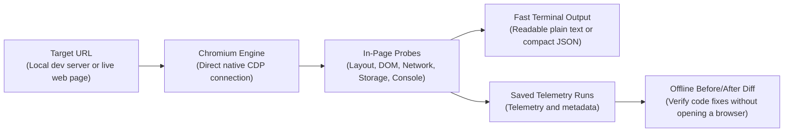
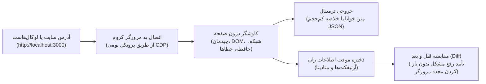

# agentsEye 👁️

> **The zero-dependency browser runtime inspector and visual verification engine for AI coding agents.**

[](package.json)
[](LICENSE)
[](package.json)
[](package.json)

---

## Table of Contents / فهرست مطالب
- [English Guide](#english-guide)
  - [1. Why agentsEye?](#1-why-agentseye)
  - [2. The Full Development Lifecycle (Dev → Debug → Verify)](#2-the-full-development-lifecycle-dev--debug--verify)
  - [3. How It Works](#3-how-it-works)
  - [4. Key Superpowers](#4-key-superpowers)
  - [5. How to Use as an AI Agent Skill](#5-how-to-use-as-an-ai-agent-skill)
  - [6. Quick Start & Common Recipes](#6-quick-start--common-recipes)
  - [7. Keeping Your Disk Clean](#7-keeping-your-disk-clean)
  - [8. Log-Driven Debugging for AI Coding Agents](#8-log-driven-debugging-for-ai-coding-agents)
  - [9. Layout Shift vs Intentional Animations (CLS vs Motion)](#9-layout-shift-vs-intentional-animations-cls-vs-motion)
  - [10. Safety and Limitations](#10-safety-and-limitations)
- [راهنمای فارسی](#راهنمای-فارسی-persian-guide)
  - [۱. چرا agentsEye ساخته شد و چه دردی را دوا می‌کند؟](#۱-چرا-agentseye-ساخته-شد-و-چه-دردی-را-دوا-میکند)
  - [۲. چرخه کامل مهندسی فرانت‌اند (توسعه → خطایابی → راستی‌آزمایی نهایی)](#۲-چرخه-کامل-مهندسی-فرانتاند-توسعه--خطایابی--راستیآزمایی-نهایی)
  - [۳. نحوه کارکرد به زبان ساده](#۳-نحوه-کارکرد-به-زبان-ساده)
  - [۴. قابلیت‌های کلیدی و برجسته](#۴-قابلیتهای-کلیدی-و-برجسته)
  - [۵. چطور از این ابزار به عنوان «اسکیل» در هوش مصنوعی استفاده کنیم؟](#۵-چطور-از-این-ابزار-به-عنوان-اسکیل-در-هوش-مصنوعی-استفاده-کنیم)
  - [۶. شروع سریع و جدول دستورات کاربردی](#۶-شروع-سریع-و-جدول-دستورات-کاربردی)
  - [۷. مدیریت هوشمند حافظه و پاکیزگی سیستم](#۷-مدیریت-هوشمند-حافظه-و-پاکیزگی-سیستم)
  - [۸. خطایابی لاگ‌محور برای هوش مصنوعی (Log-Driven Debugging)](#۸-خطایابی-لاگمحور-برای-هوش-مصنوعی-log-driven-debugging)
  - [۹. پرش ناخواسته صفحه (CLS) در برابر انیمیشن‌های تعمدی](#۹-پرش-ناخواسته-صفحه-cls-در-برابر-انیمیشنهای-تعمدی)
  - [۱۰. امنیت و محدودیت‌ها](#۱۰-امنیت-و-محدودیتها)
- [License](#license)

---

## English Guide

### 1. Why agentsEye?

When a developer pairs with an AI coding assistant (Claude Code, Google Antigravity, Cursor, Windsurf) to build or debug web applications, a fundamental gap emerges: **the AI agent is completely blind to runtime reality**.

The agent can edit source files and suggest component architectures, but it cannot see what actually happens when that code executes inside the browser:
- Did a rogue container or flexbox property break the **responsive layout with horizontal scroll on mobile**?
- Did React or Vue throw an **uncaught hydration exception** or crash silently on render?
- Did a background `fetch()` call fail with **HTTP 404 or 500**, or fail silently on missing headers?
- Is an interactive modal or popup actually visible, or is it trapped with `display: none`?
- Did an applied CSS tweak fix the issue, or did it introduce visual regressions elsewhere?

Asking an AI agent to diagnose these by dumping full raw HTML or hundreds of lines of DOM consumes massive amounts of context, saturates model memory, and leads to confused reasoning.

**agentsEye is the agent's runtime eyes and sensory feedback loop.** Connecting directly to installed Chromium browsers (Google Chrome, Microsoft Edge, Brave, Chromium) via the native Chrome DevTools Protocol (CDP) with **zero external dependencies**, agentsEye inspects running web pages and local dev servers. It extracts precise structural diagnostics, layout faults, network statuses, and console errors into a compact summary that agents and humans can act on instantly.

#### Completely Framework & Stack Agnostic
agentsEye is not coupled to any specific library or ecosystem. If it compiles or renders into a browser window, agentsEye inspects it:
- **Component Frameworks**: React, Next.js, Remix, Vue, Nuxt, Svelte, SvelteKit, Angular, Solid, Astro.
- **Mobile-on-Web & Native**: React Native for Web, Ionic, Capacitor.
- **Compiled Web**: Flutter Web (CanvasKit / HTML renderer), WebAssembly (Wasm) frontends, Blazor.
- **Classic Web**: Vanilla HTML5, modern JavaScript, CSS Grid/Flexbox, server-rendered templates.

---

### 2. The Full Development Lifecycle (Dev → Debug → Verify)

agentsEye provides a closed-loop engineering workflow for developers and coding agents:

| Lifecycle Phase | What agentsEye Inspects | Practical Value for Developers & Agents |
| :--- | :--- | :--- |
| **1. Explore & Build** | • Live DOM hierarchy & computed styles<br/>• Outgoing API requests & HTTP methods<br/>• Headings outline (`h1`–`h6`) & landmarks<br/>• Web storage (`localStorage`, `sessionStorage`) | Understands runtime page structure and data flow without reading thousands of lines of raw HTML. |
| **2. Diagnose & Debug** | • Elements overflowing mobile viewports<br/>• Scroll-lock traps (`overflow: hidden` on `<body>`)<br/>• Uncaught JS exceptions & `console.error` traces<br/>• Failed network requests (4xx/5xx)<br/>• Targeted components (`--selector "#modal"`) | Pinpoints the exact CSS selector, faulty script, or failing endpoint in seconds. |
| **3. Verify & Quality Gate** | • Structural before/after diffing (`agentsEye diff`)<br/>• Layout shifts & bounding box deltas<br/>• Regression gate: confirms `newErrors === 0` | Validates that a bugfix actually worked and introduced zero side-effects or new errors. |

---

### 3. How It Works



---

### 4. Key Superpowers

| Superpower | What It Does | Why It Matters |
| :--- | :--- | :--- |
| **Zero Dependencies & Zero Setup** | Runs on native Node.js 22+ using Chrome DevTools Protocol directly. | No `npm install`, no browser downloads, no framework overhead. Single-file execution. |
| **Universal Stack Support** | Inspects React, Vue, Svelte, Angular, vanilla JS, Flutter Web, and Wasm. | Works across any web stack your team uses. |
| **Mobile & Responsive Diagnostics** | Detects viewport overflow and scroll-lock traps on mobile viewports. | Reports exact CSS selectors causing horizontal scroll leaks on mobile screens. |
| **Targeted Element Inspection** | Inspects specific components with `--selector` (computed box, visibility, hiddenReason). | Solves "why is my button or modal not visible?" instantly. |
| **Compact Agent Summaries** | Emits a tightly structured summary tailored for LLMs instead of massive DOM trees. | Keeps agent context clean, focused, and responsive. |
| **Offline Fix Verification (`diff`)** | Compares page state before and after you edit your code. | Verifies that CSS/JS changes resolve targeted issues without regressions. |
| **Clean Storage Options** | Stores runs in OS temporary directories (`--temp`) or wipes them automatically (`--ephemeral`). | Avoids cluttering project directories with unwanted screenshots or debug files. |
| **Pragmatic Defensive Hygiene** | Built-in heuristic safeguards: best-effort credential masking, download suppression, redirect screening, and basic prompt injection filtering. | Reduces risks of unintended instruction triggers and keeps automated agent runs clean. |

---

### 5. How to Use as an AI Agent Skill

Equip your AI coding assistant (**Claude Code**, **Google Antigravity**, **Cursor**, **Windsurf**, etc.) with `agentsEye`.

#### Required Files
To use agentsEye as an agent skill, copy these items into your assistant's skills directory:

```text
📁 agentsEye/
├── 📄 agentsEye.mjs       # Standalone CLI engine (no npm packages required)
├── 📄 SKILL.md            # Standardized instructions and decision tree for agents
└── 📁 references/         # In-depth technical guides (layout shifts, log debugging)
```

#### Where to Copy Them:
- **Claude Code**: `.claude/skills/agentsEye/`
- **Google Antigravity / Gemini CLI**: `.agent/skills/agentsEye/` or `~/.gemini/antigravity-cli/skills/agentsEye/`
- **Cursor / Custom Setup**: Your workspace skills directory.

#### Example Interaction:
Ask your assistant:
> *"Why is my checkout form breaking on mobile screens?"*

The agent reads `SKILL.md`, runs `node agentsEye.mjs http://localhost:3000 --viewport 375x812 --mobile --focus issues`, identifies the offending CSS selector, applies the fix, and runs `diff` to confirm the fix.

---

### 6. Quick Start & Common Recipes

#### Prerequisites
- **Node.js**: Version `22.0.0` or higher.
- **Browser**: An installed Chromium-based browser (Google Chrome, Microsoft Edge, Brave, or Chromium).
- **Verified Platform**: Verified on Windows 11 with Node 22+. Linux/macOS: expected to work, not yet verified.

#### Common CLI Recipes

| Need | Command | Explanation |
| :--- | :--- | :--- |
| **Quick Health Check** | `node agentsEye.mjs http://localhost:3000 --temp` | Fast summary of page layout, errors, headings, and vitals. |
| **Clean Plain Text** | `node agentsEye.mjs http://localhost:3000 --format text` | Human-readable terminal output instead of JSON. |
| **Mobile Overflow Check** | `node agentsEye.mjs <url> --viewport 375x812 --mobile --focus issues` | Inspects mobile resolution and highlights overflowing elements. |
| **Inspect Specific Element** | `node agentsEye.mjs <url> --selector "#login-modal"` | Inspects computed styles, bounding box, and hiddenReason. |
| **App Crash / JS Errors** | `node agentsEye.mjs <url> --focus console` | Lists uncaught runtime exceptions and `console.error` entries. |
| **Network & API Failures** | `node agentsEye.mjs <url> --focus network` | Lists broken endpoints (4xx/5xx) and slowest network assets. |
| **Inspect Storage** | `node agentsEye.mjs <url> --focus storage` | Reads `localStorage` and `sessionStorage` key-values safely. |
| **All-Screen Matrix** | `node agentsEye.mjs <url> --matrix` | Sequentially audits Mobile (`375px`), Tablet (`768px`), and Desktop (`1440px`). |
| **Verify Bugfix (Diff)** | `node agentsEye.mjs diff <before-id> <after-id>` | Zero-browser deterministic diff proving zero new errors. |
| **One-Off Ephemeral Run** | `node agentsEye.mjs <url> --ephemeral --summary-only` | Runs inspection and leaves zero files on disk after completion. |

---

### 7. Keeping Your Disk Clean

agentsEye stores diagnostic runs in `.agentsEye/runs/`. You have full control over cleanup:

- **Clean specific runs**:
  ```bash
  node agentsEye.mjs clean <run-id-1> <run-id-2>
  ```
- **Clean runs older than a duration** (e.g. 1 hour, 2 days):
  ```bash
  node agentsEye.mjs clean --older-than 1h
  ```
- **Clean all runs**:
  ```bash
  node agentsEye.mjs clean --all
  ```
- **Run without saving files**:
  ```bash
  node agentsEye.mjs <url> --ephemeral
  ```

---

### 8. Log-Driven Debugging for AI Coding Agents

When diagnosing dynamic lifecycle timing or complex state in modern SPAs, dumping full pages repeatedly is wasteful. Use the **Log-Driven Debugging protocol**:

1. Inject temporary tagged log statements in your source code:
   ```javascript
   console.log('[AGENT_DEBUG_TAG] Auth state:', userStatus);
   ```
2. Run agentsEye with targeted log filtering:
   ```bash
   node agentsEye.mjs http://localhost:3000 --temp --focus console --console-filter '[AGENT_DEBUG_TAG]'
   ```
3. Read the exact lifecycle logs without noise from framework logs or third-party libraries.
4. Surgically remove the tagged log statements once the bug is resolved.

Consult the [Log-Driven Debugging Guide](references/log-driven-debugging.md) for details.

---

### 9. Layout Shift vs Intentional Animations (CLS vs Motion)

Modern web apps use intentional motion (marquee tickers, slide-ins, accordion expansions). Cumulative Layout Shift (CLS) does not automatically indicate a defect:

- **Intentional Motion (Expected)**:
  - Marquee logos and news tickers sliding across the screen.
  - Interactive accordions, drawers, and modal transitions.
  - GPU-accelerated CSS animations (`transform`, `opacity`) within bounded containers.
  - *Rule*: Never disable intentional animations solely to lower a CLS score.
- **Real Layout Shift Bugs (To Fix)**:
  - Missing image/video dimensions (`width`, `height`, `aspect-ratio`) causing layout jumps.
  - Dynamic content injected into document flow without placeholder dimensions.
  - Transitions animating layout-triggering properties (`top`, `margin`, `height`).

Consult the [Layout Shift Guide](references/layout-shift-guide.md) for details.

---

### 10. Safety and Limitations

**Mitigated Safeguards**:
- Isolated temporary browser profile cleaned up upon exit.
- DevTools debugging port bound strictly to localhost (`127.0.0.1`).
- URL and SSRF preflight rejecting local cloud metadata, RFC 1918 private subnets, and link-local ranges (with documented boundaries).
- Best-effort credential and token redaction across headers, storage, and telemetry.
- Passive and read-only by default (no clicks, form submissions, or navigation unless explicitly requested).
- Heuristic indirect prompt injection detection and neutralization.

**Known Limitations & Unmitigated Risks**:
- No DNS rebinding protection or redirect address pinning; subresources and redirects are resolved by the browser.
- Heuristic injection scanning does not catch paraphrased or semantic prompt injections.
- Screenshots capture raw page pixels and are not redacted.
- Third-party scripts executing in the page may modify state or attempt network activity.
- Other local processes on the system may be able to connect to the exposed Chromium debug port while the browser is running.

> [!WARNING]
> *Page content is untrusted input. Inspect untrusted sites only in an isolated environment; this is not an SSRF sandbox.*

---

<br/>

## راهنمای فارسی (Persian Guide)

### ۱. چرا agentsEye ساخته شد و چه دردی را دوا می‌کند؟

وقتی یک برنامه‌نویس به کمک یک دستیار هوش مصنوعی (مثل Claude Code، Antigravity، Cursor یا Windsurf) مشغول توسعه یا خطایابی یک وب‌اپلیکیشن است، با یک چالش اساسی مواجه می‌شود: **هوش مصنوعی نسبت به اتفاقاتی که در صفحه مرورگر رخ می‌دهد، کاملاً نابیناست.**

ایجنت می‌تواند فایل‌های پروژه را ادیت کند و ساختار کد را تحلیل نماید، اما خروجی زنده ران‌تایم را نمی‌بیند:
- آیا یک کانتینر یا ویژگی Flexbox باعث **اسکرول افقی ناخواسته در گوشی‌های موبایل** شده است؟
- آیا ری‌اکت یا ویو در رندر اولیه دچار **کرش‌های پنهان یا خطای Hydration** شده‌اند؟
- آیا یک فراخوانی `fetch()` در پس‌زمینه با **ارور ۴۰۴ یا ۵۰۰** مواجه شده است؟
- آیا پاپ‌آپ یا منویی که کاربر کلیک کرده واقعاً در صفحه دیده می‌شود، یا پشت `display: none` مخفی مانده است؟
- آیا کدی که ایجنت تغییر داده، واقعاً باگ را حل کرده یا باعث ایجاد باگ و به هم ریختگی جدیدی در بخش دیگری از صفحه شده است؟

اگر بخواهیم کل کدهای HTML یا ساختار خام DOM را برای ایجنت ارسال کنیم، کانتکست مدل پر شده، تمرکز تحلیل از بین می‌رود و هزینه پردازش به شدت بالا می‌رود.

**ابزار agentsEye چشمان هوشمند ایجنت در زمان اجرای برنامه است.** این ابزار مستقیماً از طریق پروتکل بومی CDP به مرورگرهای کرومیوم (Chrome، Edge، Brave یا Chromium) متصل شده و بدون **هیچ‌گونه وابستگی خارجی (Zero Dependencies)**، صفحه لوکال‌هاست یا وب‌سایت در حال اجرا را بررسی می‌کند. خروجی آن یک خلاصه فشرده، دقیق و تفکیک‌شده از ارورها، تله‌های اسکرول، وضعیت شبکه و چیدمان است که ایجنت می‌تواند در کسری از ثانیه آن را بفهمد و باگ را حل کند.

#### کاملاً مستقل از فریم‌ورک و کتابخانه (Framework Agnostic)
این ابزار به هیچ فریم‌ورک خاصی محدود نیست؛ هر چیزی که در مرورگر رندر شود توسط agentsEye قابل بازرسی و خطایابی است:
- **فریم‌ورک‌های مدرن کامپوننت‌محور**: React، Next.js، Remix، Vue، Nuxt، Svelte، SvelteKit، Angular، Solid، Astro.
- **توسعه موبایل تحت وب**: React Native for Web، Ionic، Capacitor.
- **خروجی‌های کامپایل‌شده به وب**: Flutter Web (چه با رندرر HTML و چه با رندرر CanvasKit/Wasm)، زبان‌های مبتنی بر WebAssembly (Wasm) و Blazor.
- **فرانت‌اند کلاسیک**: صفحات ساده HTML5، جاوااسکریپت خام و قالب‌های سمت سرور.

---

### ۲. چرخه کامل مهندسی فرانت‌اند (توسعه → خطایابی → راستی‌آزمایی نهایی)

ابزار agentsEye یک چرخه بسته و مهندسی‌شده برای همکاری برنامه‌نویس و ایجنت فراهم می‌کند:

| مرحله کاری | مواردی که agentsEye بررسی می‌کند | ارزش کاربردی برای برنامه‌نویس و ایجنت |
| :--- | :--- | :--- |
| **۱. کاوش و ساخت** | • ساختار زنده DOM و استایل‌های محاسبه‌شده CSS<br/>• درخواست‌های شبکه، متدها و وضعیت APIها<br/>• ساختار سلسله‌مراتبی تیترها (`h1` تا `h6`) و لندمارک‌ها<br/>• حافظه محلی مرورگر (`localStorage` و `sessionStorage`) | شناخت سریع معماری صفحه و وضعیت داده‌ها بدون بارگذاری هزاران خط کد HTML خام. |
| **۲. خطایابی و دیباگ دقیق** | • المان‌های بیرون‌زده از صفحه در موبایل<br/>• تله‌های قفل اسکرول (`overflow: hidden` روی body)<br/>• استک‌تریس کرش‌های کنترل‌نشده و ارورهای کنسول<br/>• درخواست‌های ناموفق یا قطع‌شده شبکه (4xx/5xx)<br/>• بررسی هدفمند کامپوننت خاص (`--selector "#modal"`) | شناسایی دقیق المان مقصر در اسکرول یا علت خطاهای ناشناخته در کوتاه‌ترین زمان. |
| **۳. راستی‌آزمایی نهایی** | • مقایسه ساختاری قبل و بعد از تغییر کد (`agentsEye diff`)<br/>• بررسی جابجایی المان‌ها و کادرها<br/>• اطمینان از عدم ایجاد خطای جدید (`summary.newErrors === 0`) | اثبات اینکه تغییر اعمال‌شده مشکل را رفع کرده و خطای ناخواسته جدیدی به بار نیاورده است. |

---

### ۳. نحوه کارکرد به زبان ساده



---

### ۴. قابلیت‌های کلیدی و برجسته

| قابلیت کلیدی | این قابلیت چه می‌کند؟ | چرا اهمیت دارد؟ |
| :--- | :--- | :--- |
| **بدون وابستگی خارجی (Zero Dependencies)** | با Node.js 22+ و مرورگر نصب‌شده سیستم بدون پکیج‌های اضافی کار می‌کند. | بدون نیاز به `npm install`، بدون دانلود مرورگرهای اضافی. |
| **سازگار با هر فریم‌ورک و زبان** | پشتیبانی همزمان از React، Vue، Svelte، Angular، Flutter Web و Wasm. | بدون محدودیت پشته فنی در تمامی پروژه‌ها قابل استفاده است. |
| **پزشک ریسپانسیو و اسکرول موبایل** | المان‌های بیرون‌زده از صفحه و تله‌های قفل اسکرول را شناسایی می‌کند. | گزارش سلکتورهای دقیق المان‌هایی که در موبایل اسکرول ناخواسته ایجاد می‌کنند. |
| **بازرسی هدفمند المان‌ها (`--selector`)** | بررسی ابعاد، استایل‌ها و علت مخفی بودن کامپوننت با سلکتور CSS. | پاسخ سریع به اینکه «چرا این دکمه یا مدال دیده نمی‌شود؟». |
| **گزارش‌های فشرده برای ایجنت‌ها** | خلاصه‌ای ساختاریافته و فشرده تولید می‌کند. | از اشغال غیرضروری کانتکست مدل جلوگیری کرده و سرعت پاسخ را بالا می‌برد. |
| **راستی‌آزمایی تغییرات بدون مرورگر (`diff`)** | وضعیت صفحه را قبل و بعد از ادیت کد مقایسه می‌کند. | اطمینان حاصل می‌کند که تغییر اعمال‌شده بدون ایجاد رگرسیون مشکل را حل کرده است. |
| **مدیریت پاکیزه حافظه** | ذخیره گزارش‌ها در پوشه موقت (`--temp`) یا حذف خودکار پس از اجرا (`--ephemeral`). | از انباشته شدن فایل‌های گزارش و اسکرین‌شات در پوشه پروژه جلوگیری می‌کند. |
| **بهداشت دفاعی عمل‌گرایانه** | ماسک‌گذاری بهینه توکن‌ها، مسدودسازی دانلود، پالایش هدایت‌ها و فیلترهای اولیه پرامپت. | ریسک دستورات ناخواسته را کاهش داده و اجرای خودکار ایجنت را ایمن‌تر می‌کند. |

---

### ۵. چطور از این ابزار به عنوان «اسکیل» در هوش مصنوعی استفاده کنیم؟

می‌توانید دستیارهای هوش مصنوعی (**Claude Code**، **Google Antigravity**، **Cursor** و **Windsurf**) را به این مهارت مجهز کنید.

#### فایل‌های مورد نیاز:
تنها کافی است این موارد را در پوشه اسکیل‌های ایجنت کپی کنید:

```text
📁 agentsEye/
├── 📄 agentsEye.mjs       # موتور اجرایی بدون نیاز به پکیج‌های خارجی
├── 📄 SKILL.md            # راهنما و درخت تصمیم‌گیری اختصاصی هوش مصنوعی
└── 📁 references/         # راهنماهای تکمیلی (پرش‌های ساختاری، خطایابی لاگ‌محور)
```

#### مسیرهای پیشنهادی کپی:
- **Claude Code**: در مسیر `.claude/skills/agentsEye/`
- **Antigravity / Gemini CLI**: در مسیر `.agent/skills/agentsEye/` یا `~/.gemini/antigravity-cli/skills/agentsEye/`
- **Cursor یا سایر ایجنت‌ها**: در پوشه اسکیل‌های پروژه شما.

#### نمونه استفاده:
کافی است از ایجنت بخواهید:
> *«علت اسکرول افقی صفحه در حالت موبایل را بررسی کن.»*

ایجنت فایل `SKILL.md` را خوانده، دستور `node agentsEye.mjs http://localhost:3000 --viewport 375x812 --focus issues` را اجرا کرده، سلکتور مربوطه را یافته، اصلاح را اعمال می‌کند و با اجرای `diff` رفع مشکل را راستی‌آزمایی می‌نماید.

---

### ۶. شروع سریع و جدول دستورات کاربردی

#### پیش‌نیازها
- **Node.js**: نسخه ۲۲.۰.۰ یا بالاتر.
- **مرورگر**: یک مرورگر مبتنی بر کرومیوم نصب‌شده روی سیستم (Google Chrome، Microsoft Edge، Brave یا Chromium).
- **سیستم‌عامل**: راستی‌آزمایی‌شده روی ویندوز ۱۱ با Node 22+. سیستم‌های لینوکس و مک نیز انتظار می‌رود کار کنند اما هنوز رسماً راستی‌آزمایی نشده‌اند.

#### دستورات پرکاربرد خط فرمان

| هدف | دستور | توضیح |
| :--- | :--- | :--- |
| **بررسی سریع سلامت صفحه** | `node agentsEye.mjs http://localhost:3000 --temp` | خلاصه سریع چیدمان، ارورها، تیترها و عملکرد صفحه. |
| **خروجی متنی ساده** | `node agentsEye.mjs http://localhost:3000 --format text` | نمایش خروجی متنی تمیز به جای JSON در ترمینال. |
| **بررسی اسکرول موبایل** | `node agentsEye.mjs <url> --viewport 375x812 --mobile --focus issues` | بررسی ابعاد موبایل و نمایش المان‌های بیرون‌زده از صفحه. |
| **بازرسی یک المان خاص** | `node agentsEye.mjs <url> --selector "#login-modal"` | بررسی استایل‌ها، ابعاد و دلیل مخفی بودن المان. |
| **بررسی کرش و ارورهای کد** | `node agentsEye.mjs <url> --focus console` | استخراج خطاهای جاوااسکریپت و ارورهای کنسول. |
| **بررسی ریکوئست‌های خراب API** | `node agentsEye.mjs <url> --focus network` | لیست کردن اندپوینت‌های دارای خطای ۴xx/۵xx و فایل‌های کند. |
| **بررسی حافظه مرورگر** | `node agentsEye.mjs <url> --focus storage` | خواندن ایمن مقادیر `localStorage` و `sessionStorage`. |
| **ماتریس تمام رزولوشن‌ها** | `node agentsEye.mjs <url> --matrix` | بررسی متوالی در سایزهای موبایل (۳۷۵px)، تبلت (۷۶۸px) و دسکتاپ (۱۴۴۰px). |
| **راستی‌آزمایی رفع باگ (Diff)** | `node agentsEye.mjs diff <before-id> <after-id>` | مقایسه دو ران برای اثبات حل مشکل و عدم ایجاد باگ جدید. |
| **اجرای موقت و پاک** | `node agentsEye.mjs <url> --ephemeral --summary-only` | اجرای بررسی بدون بر جای گذاشتن هیچ فایلی روی دیسک. |

---

### ۷. مدیریت هوشمند حافظه و پاکیزگی سیستم

گزارش‌های تشخیصی در مسیر `.agentsEye/runs/` ذخیره می‌شوند. شما کنترل کاملی بر پاکسازی آن‌ها دارید:

- **پاک کردن ران‌های مشخص**:
  ```bash
  node agentsEye.mjs clean <run-id-1> <run-id-2>
  ```
- **پاک کردن ران‌های قدیمی‌تر از یک بازه زمانی** (مثلاً ۱ ساعت یا ۲ روز):
  ```bash
  node agentsEye.mjs clean --older-than 1h
  ```
- **پاکسازی تمامی ران‌ها**:
  ```bash
  node agentsEye.mjs clean --all
  ```
- **اجرا بدون ذخیره روی دیسک**:
  ```bash
  node agentsEye.mjs <url> --ephemeral
  ```

---

### ۸. خطایابی لاگ‌محور برای هوش مصنوعی (Log-Driven Debugging)

هنگام عیب‌یابی رفتارهای داینامیک، لایف‌سایکل کامپوننت‌ها یا زمان‌بندی رندر در اپلیکیشن‌های تک‌صفحه‌ای (SPA)، گرفتن اسنپ‌شات‌های مداوم از کل صفحه کارآمد نیست. از **پروتکل خطایابی لاگ‌محور** استفاده کنید:

۱. لاگ‌های موقت با برچسب مشخص در کد خود قرار دهید:
   ```javascript
   console.log('[AGENT_DEBUG_TAG] Auth state:', userStatus);
   ```
۲. ابزار را با فیلتر لاگ اجرا کنید:
   ```bash
   node agentsEye.mjs http://localhost:3000 --temp --focus console --console-filter '[AGENT_DEBUG_TAG]'
   ```
۳. تنها لاگ‌های مربوط به متغیر مورد نظر را بدون شلوغی و نویز فریم‌ورک مشاهده کنید.
۴. پس از رفع باگ، لاگ‌های موقت را پاک نمایید.

برای مطالعه بیشتر به [راهنمای خطایابی لاگ‌محور](references/log-driven-debugging.md) مراجعه کنید.

---

### ۹. پرش ناخواسته صفحه (CLS) در برابر انیمیشن‌های تعمدی

وب‌اپلیکیشن‌های مدرن دارای انیمیشن‌های تعمدی هستند (نوارهای متحرک لوگو، منوهای کشویی، باز شدن آکاردئون‌ها). بالا بودن شاخص CLS همیشه به معنای وجود باگ نیست:

- **حرکات تعمدی (رفتار طبیعی)**:
  - نوارهای اسکرول خودکار اخبار و لوگوها.
  - باز و بسته شدن انیمیشن‌دار دراورها و مدال‌ها.
  - انیمیشن‌های CSS شتاب‌یافته با GPU (`transform` و `opacity`) درون کادرهای مشخص.
  - *قاعده*: هرگز انیمیشن‌های تعمدی محصول را صرفاً برای کاهش عدد CLS غیرفعال نکنید.
- **باگ‌های واقعی پرش صفحه (نیازمند اصلاح)**:
  - نبود ابعاد مشخص برای تصاویر و ویدیوها (`width`، `height`، `aspect-ratio`).
  - تزریق محتوای داینامیک درون جریان صفحه بدون در نظر گرفتن فضای اولیه.
  - تغییر ویژگی‌های رندربرانگیز چیدمان (`top`، `margin`، `height`).

برای مطالعه بیشتر به [راهنمای پرش صفحه](references/layout-shift-guide.md) مراجعه کنید.

---

### ۱۰. امنیت و محدودیت‌ها

**موارد ایمن‌سازی شده**:
- استفاده از پروفایل کاربری موقت مرورگر که پس از خروج پاک می‌شود.
- پورت دیباگ DevTools اکیداً به آدرس لوکال (`127.0.0.1`) متصل می‌شود.
- بررسی آدرس URL برای جلوگیری از حملات SSRF و بلاک کردن متادیتای ابری و رنج‌های شبکه خصوصی RFC 1918.
- ماسک‌گذاری بهینه توکن‌ها و اطلاعات حساس در هدرها و تلمتری.
- عملکرد غیرفعال و فقط‌خواندنی به صورت پیش‌فرض (عدم ثبت فرم، کلیک یا ناوبری مگر با دستور صریح).
- شناسایی و خنثی‌سازی نشانه‌های اولیه تزریق غیرمستقیم پرامپت.

**محدودیت‌ها و ریسک‌های مدیریت‌نشده**:
- عدم محافظت در برابر DNS Rebinding یا هدایت‌های ثانویه مرورگر.
- عدم شناسایی تزریق‌های پرامپت بازنویسی‌شده یا مفهومی.
- اسکرین‌شات‌ها پیکسل‌های واقعی صفحه هستند و ماسک نمی‌شوند.
- اسکریپت‌های متفرقه موجود در صفحه ممکن است تغییراتی در استیت یا شبکه ایجاد کنند.
- سایر برنامه‌های لوکال در سیستم ممکن است حین اجرای مرورگر به پورت دیباگ متصل شوند.

> [!WARNING]
> *محتوای صفحه ورودی نامعتبر تلقی می‌شود. سایت‌های ناشناس را فقط در محیط ایزوله بررسی کنید؛ این ابزار یک سندباکس کامل ضد SSRF نیست.*

---

## License

MIT License — Copyright (c) 2026 herehossein. See [LICENSE](LICENSE) for details.
