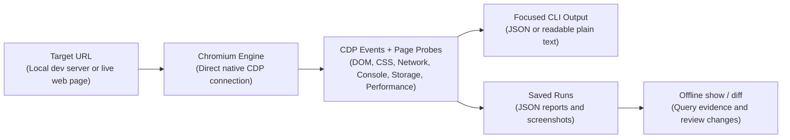

<div align="center">

# agentsEye 👁️

**An agent skill that helps your AI coding assistant inspect web apps, investigate bugs, and review fixes in a real browser.**

[](package.json)
[](LICENSE)
[](package.json)
[](package.json)

[English](README.md) | [فارسی](README.fa.md)

</div>

<details>
<summary><strong>Table of Contents</strong></summary>

- [1. Why agentsEye?](#1-why-agentseye)
- [2. Working with Your Assistant in Three Steps](#2-working-with-your-assistant-in-three-steps)
- [3. How It Works](#3-how-it-works)
- [4. Key Capabilities](#4-key-capabilities)
- [5. How to Use as an AI Agent Skill](#5-how-to-use-as-an-ai-agent-skill)
- [6. Getting Started and Optional Commands](#6-getting-started-and-optional-commands)
- [7. Keeping and Deleting Saved Reports](#7-keeping-and-deleting-saved-reports)
- [8. Finding Bugs with Log Messages](#8-finding-bugs-with-log-messages)
- [9. Layout Shift vs Intentional Animations (CLS vs Motion)](#9-layout-shift-vs-intentional-animations-cls-vs-motion)
- [10. Safety and Limitations](#10-safety-and-limitations)
- [11. Development & Architecture](#11-development--architecture)
- [License](#license)

</details>

## 1. Why agentsEye?

The code looks fine, but the page is blank. A menu won't open, or data never loads. Reading the code alone may not explain why.

**agentsEye is primarily an agent skill for AI coding assistants.** A skill packages instructions and tools for a specific task. This one gives your assistant browser reports and screenshots to help it investigate and review code changes.

Here are some ways agentsEye can help:

- **The page crashes or shows errors:** Collect browser errors and console messages to investigate failures that may not appear in build output.

- **Data fails to load:** See failed requests, error responses, and slow requests that may be affecting the page.

- **A control does not work as expected:** Test menus, tabs, and dialogs, then compare the page before and after a code change.

Start by [installing the skill](#5-how-to-use-as-an-ai-agent-skill), then give your assistant the page URL and a description of the problem. You do not need to learn the commands to get started. Experienced developers can also run the tool directly in a terminal.

## 2. Working with Your Assistant in Three Steps

Whether you are building a feature or fixing a bug, ask your assistant to follow three steps:

| Step | What your assistant does | What you gain |
| :--- | :--- | :--- |
| **1. Check the page** | Opens the page and saves a report and screenshots. | A record of the page before changes. |
| **2. Investigate and improve** | Examines errors, loading problems, or how menus and tabs respond, then uses the findings to guide code changes. | Clues that help the assistant choose a fix. |
| **3. Review the result** | Repeats the check at the same window size and with the same actions, then compares the saved reports. | A way to spot new errors or unexpected changes. |

For example, ask:

> "Use agentsEye to check `http://localhost:3000`, find why the menu won't open, and compare the page before and after the fix."

The final check still needs to confirm that the original problem is gone. A comparison with no new errors does not mean every feature has been tested.

## 3. How It Works



## 4. Key Capabilities

| Capability | What it does | Practical value |
| :--- | :--- | :--- |
| **Standalone CDP engine** | One `.mjs` file using native Node.js 22+ APIs and an installed Chrome, Edge, Brave, or Chromium browser. | No runtime npm packages or additional browser download required. |
| **Combined runtime evidence** | Collects DOM/computed CSS, request statuses and timings, JavaScript/console errors, performance observations, and screenshots. | Connects UI symptoms with browser-side evidence that build logs alone cannot provide. |
| **Agent-focused output** | JSON or plain text, targeted `--focus` slices, compact interactive catalogs, and interactive `--delta` output. | Keeps inspection focused instead of repeatedly sending full DOM dumps to the agent. |
| **Scoped semantic interactions** | Click, hover, scroll, and keyboard actions using CSS selectors or catalog refs such as `e1`; `--interactive-scope` narrows discovery. | Targets controls by their names and roles. Refs are snapshot-specific and can become stale after DOM changes. |
| **Offline regression review** | `show` queries saved JSON; `diff` uses heuristic DOM matching to compare bounds, styles, and newly observed errors/issues. | Reuses captured evidence without launching a browser; differences still need review. |
| **Responsive snapshots** | `--matrix` samples mobile and Tailwind breakpoints; `--viewports` selects a custom series. Captures a screenshot per viewport. | Supports cross-breakpoint review in Chromium, not testing every physical device or browser. |
| **Layout, form & accessibility signals** | Bounds, visibility reasons, scroll-lock risks, touch-target/input-font warnings, sampled text contrast, and opt-in Chromium AX data (`--a11y`). | Provides CSS paths and usability signals—not a complete accessibility audit. |
| **Attached Chromium & scoped headers** | `--cdp` uses a fresh incognito context/tab; `--header` values apply only to the exact initial origin. | Reuses a running browser process without reusing its signed-in tabs; supports header-authenticated routes. |
| **Best-effort safeguards** | Recognized credential masking, prompt-injection heuristics, and interaction policy checks. | Reduces known risks; page data remains untrusted. See the [security model](references/security-model.md). |

## 5. How to Use as an AI Agent Skill

The skill explains when to check a page in the browser and how to read the results. Install it in an assistant that supports skills and is allowed to run terminal commands. Then give it the page URL and your task, and ask it to use agentsEye.

### Install from the Release ZIP

1. Open the [latest GitHub Release](https://github.com/herehossein/agentsEye/releases/latest) and download the **skill `.zip` package** from **Assets**.

2. Extract the ZIP. It includes **all required files**: `agentsEye.mjs`, `SKILL.md`, and the complete `references/` directory.

3. Move the extracted skill folder to one of the installation locations below as `agents-eye/`. Keep all its contents together; `SKILL.md` must be directly inside that folder:

   ```text
   📁 agents-eye/
   ├── 📄 agentsEye.mjs       # Standalone CLI engine (no npm packages required)
   ├── 📄 SKILL.md            # Standardized instructions and decision tree for agents
   └── 📁 references/         # In-depth technical guides (layout shifts, log debugging)
   ```

### Installation Locations:

- **Claude Code**: `.claude/skills/agents-eye/` (project) or `~/.claude/skills/agents-eye/` (user).

- **Antigravity IDE/CLI**: `.agents/skills/agents-eye/` (workspace). Antigravity CLI also supports `~/.gemini/antigravity-cli/skills/agents-eye/` (user).

- **Gemini CLI**: `.gemini/skills/agents-eye/` (workspace) or `~/.gemini/skills/agents-eye/` (user).

- **Cursor**: `.cursor/skills/agents-eye/` (project) or `~/.cursor/skills/agents-eye/` (user).

- **Other skill-capable assistants**: Use the skill location documented for your assistant's version; trust/reload the skill if required.

### Example Interactions:

Ask your assistant:

1. **Hydration and async-render crashes:**

   > _"The build passes, but the UI crashes after loading. Find the browser-side failure."_

   → Inspect `--focus console` with `--console-level error,warn` for exceptions and hydration traces.

2. **Protected-route API failures:**

   > _"Reproduce this 401/500 response and identify the failing endpoint."_

   → Use `--focus network --compact` and origin-scoped `--header` values. Optional `--cdp` creates a fresh isolated context, not a signed-in tab.

3. **State and lifecycle races:**

   > _"Trace why authentication state resets after a component remount."_

   → Add temporary `[AUTH_TRACE]` logs, filter with `--console-filter '[AUTH_TRACE]'`, and inspect live or offline via `show`; remove the logs after the fix.

4. **Scoped interaction debugging:**

   > _"Inside this dialog, switch tabs, close it with Escape and explain any skipped action."_

   → Read a fresh catalog with `--interactive-scope` and `--focus interactive --compact`; keep the same scope for `--click e1 --key Escape --delta`, choosing the ref from that catalog. Inspect `interactions.actions` for skip reasons.

5. **Multi-viewport regression checks:**

   > _"Compare matched before/after runs and review the other breakpoints."_

   → Repeat the same viewport/actions, run `node agentsEye.mjs diff <before-id> <after-id>`, and check both regression counters and the original defect. Use `--matrix` to review `matrix.snapshots` separately.

Use interactions only on trusted applications; the [interaction safety gates](references/interactive-refs-guide.md) still apply.

## 6. Getting Started and Optional Commands

### What You Need

- **Node.js**: Version 22 or higher.
- **Browser**: An installed Google Chrome, Microsoft Edge, Brave, or Chromium browser. Advanced users can also connect to a running Chromium browser with `--cdp`.
- **Platforms**: Tested on Windows 11 with Node 22+. Linux and macOS are expected to work but have not yet been verified.

Start your app's development server, or use the URL of an existing site. With the skill installed, describe the problem and ask your assistant to use agentsEye. **The commands below are optional; you can let your assistant run them.**

### Run It Yourself (Optional)

Run this from the installed skill folder containing `agentsEye.mjs`. Replace `http://localhost:3000` with your page URL:

```bash
node agentsEye.mjs http://localhost:3000 --format text --temp
```

`--format text` makes the report easier to read in the terminal. `--temp` saves it outside your project so you or your assistant can review it later.

<details>
<summary><strong>More Commands for Advanced Users</strong></summary>

These examples use the installed Release package. In a source checkout, run `npm run build` first and use `node dist/agentsEye.mjs` from the repository root instead.

`<url>` means the page address; `<run-id>` means the inspection ID in the report. Replace them with your own values. Selectors such as `#menu-button` must match your page.

IDs such as `e1` come from the latest list of controls. Use the same scope when listing and clicking; these IDs can change. In PowerShell, use `e1` or quote `'@e1'`.

| Need | Command | Explanation |
| :--- | :--- | :--- |
| **Quick Inspection** | `node agentsEye.mjs http://localhost:3000 --temp` | Displays a short summary of the page's layout, errors, headings, and loading performance. |
| **Plain Text Output** | `node agentsEye.mjs http://localhost:3000 --format text --temp` | Displays readable text instead of JSON in the terminal. |
| **App Crash / JS Errors** | `node agentsEye.mjs <url> --focus console --temp` | Shows recorded browser errors and console messages that may explain a crash. |
| **Network & API Failures** | `node agentsEye.mjs <url> --focus network --compact --temp` | Shows failed requests, error responses, and the slowest captured requests. |
| **Inspect One Part of the Page** | `node agentsEye.mjs <url> --selector "#login-modal" --temp` | Checks the appearance, size, and visibility of the selected part of the page. |
| **Read Specific CSS Values** | `node agentsEye.mjs <url> --selector "#modal" --style-props "display,position,z-index,backdrop-filter" --temp` | Shows the named CSS properties, including default values that would otherwise be omitted. |
| **Try a Click** | `node agentsEye.mjs <url> --click "#menu-button" --temp` | Attempts a click and records the result, or explains why the action was skipped. |
| **Use Control IDs** | `node agentsEye.mjs <url> --click e1 --hover e2 --scroll e3 --temp` | Uses IDs from a fresh list of controls. They are not permanent identifiers. |
| **Limit Control Discovery** | `node agentsEye.mjs <url> --interactive-scope "#modal" --click e1 --temp` | Assigns control IDs within `#modal`; use IDs from a list with the same scope. |
| **List Controls** | `node agentsEye.mjs <url> --focus interactive --compact --temp` | Lists controls, their names, input types, and positions, within the collection limits. |
| **Run Actions in Order** | `node agentsEye.mjs <url> --click "#menu" --key Escape --scroll 0,500 --temp` | Runs up to 50 click, hover, scroll, and keyboard actions in order. |
| **Try Expandable Controls** | `node agentsEye.mjs <url> --explore --temp` | Tries supported menus, tabs, and expandable sections—not every button or a full user workflow. |
| **Wait for Initial Content** | `node agentsEye.mjs <url> --wait-for "#results" --temp` | Waits before actions for a matching element to exist in the main document. It may still be hidden; a timeout produces a warning. |
| **Dark Mode & Contrast** | `node agentsEye.mjs <url> --color-scheme dark --focus issues --temp` | Tests a dark-mode preference and flags possible text-contrast issues on solid backgrounds. |
| **Locale & Time Zone** | `node agentsEye.mjs <url> --locale fa-IR --timezone Asia/Tehran --temp` | Changes locale-based formatting and the time zone, not the app's language or right-to-left layout. |
| **Use a Running Browser** | `node agentsEye.mjs <url> --cdp http://127.0.0.1:9222 --temp` | Uses a running browser but opens a new private session. It does not reuse your signed-in tabs. |
| **Search Saved Console Logs** | `node agentsEye.mjs show <run-id> console --console-filter "/\[AUTH\].*error/i"` | Finds captured authentication errors without opening the browser again. |
| **Mobile Overflow Check** | `node agentsEye.mjs <url> --focus issues --temp` | Reports examples of elements extending past the edge of the default 375x667 mobile-sized page. |
| **Check Several Screen Sizes** | `node agentsEye.mjs <url> --matrix --temp` | Checks mobile and standard Tailwind screen sizes (`sm` through `2xl`). |
| **Compare Before and After** | `node agentsEye.mjs diff <before-id> <after-id>` | Shows changes in page structure and styles, plus new errors and issues. Recheck the original bug and network requests separately. |
| **Inspect Browser Storage** | `node agentsEye.mjs <url> --focus storage --temp` | Includes browser-stored values. Recognized secrets are masked, but review the report before sharing it. |
| **One-Time Check** | `node agentsEye.mjs <url> --ephemeral --summary-only` | Attempts to delete the saved inspection after output. Use only when you do not need later `show` or `diff`. |

For content loaded by a click, choose a selector that matches only when the result is ready:

```bash
node agentsEye.mjs <url> --click "#load-results" --wait-after "#results[data-ready]" --temp
```

`--wait-after` checks main-document selector existence once after the entire action sequence, only if an explicit action and the final action were performed without a safety stop. It does not check visibility, shadow DOM, or iframe content. A pre-existing container can match too soon.

Read-only and exploration-only runs do not wait. `--timeout` limits the wait; a timeout warns and inspection continues without retrying inputs. Document/URL changes stop the wait. See the [interaction guide](references/interactive-refs-guide.md#post-action-readiness) for the full behavior.

For multiple screen sizes, `--matrix` stores separate snapshots in `matrix.snapshots`. A normal `diff` compares only the primary snapshot, so review the other sizes separately.

</details>

### Understanding the Result

When a command finishes, it returns a status number called an **exit code**. This tells you whether the tool ran, not whether the website has bugs.

> [!IMPORTANT]
> **A completed check does not mean a bug-free page.** Read the report's errors and warnings even when the command reports success.

| Exit code | Meaning | What to do |
| :--- | :--- | :--- |
| **`0`** | The check finished. | Review the findings; the page may still have errors. |
| **`1`** | The tool could not finish the check. | Check the page address, network connection, and browser, then follow the error message. |
| **`2`** | The command or page address was rejected. | Check the options and URL. Some addresses are blocked by security checks; the error message explains why. |

<details>
<summary><strong>For Scripts and Automated Checks</strong></summary>

`report.ok === true` also means the inspection completed, not that the page is error-free. Review `issues`, `network.failures`, `errors.uncaught`, `console.errors`, and `warnings`.

For a before/after comparison, check `summary.newErrors === 0` and `summary.newIssues === 0`. Still verify the original defect and review network failures and layout/style differences separately.

See the [CLI reference](references/cli-reference.md) for all exit codes and the [report reference](references/schema-reference.md) for JSON fields.

</details>

## 7. Keeping and Deleting Saved Reports

A saved inspection, called a **run** in the tool, contains a report and screenshots. Keeping it lets your assistant review findings or compare two checks without opening the site again.

Reports go in `.agentsEye/runs/` by default. With `--temp`, they go in the system's temporary folder instead. `show` and `diff` find them there automatically. **Using `--temp` by itself does not delete reports when the command finishes.**

Keep reports until you finish reviewing the fix, then ask your assistant to delete only the inspections created for that task. To delete one yourself, copy the ID beside `Run:` in text output or `run.id` in JSON, and use it in place of `<run-id>`:

```bash
node agentsEye.mjs clean <run-id>
```

Deleting an inspection also deletes its saved screenshots. `clean` without an ID or a cleanup option deletes nothing.

<details>
<summary><strong>Other Cleanup Options (Advanced)</strong></summary>

> [!WARNING]
> `--older-than` and `--all` also search shared temporary and older storage locations. They may delete reports from other projects, not just the current task. Use them only when you intend that broader cleanup.

- **Delete reports older than one hour:**

   ```bash
   node agentsEye.mjs clean --older-than 1h
   ```

- **Delete all saved reports in the searched locations:**

   ```bash
   node agentsEye.mjs clean --all
   ```

- **Keep only the output of a one-time check:**

   ```bash
   node agentsEye.mjs <url> --ephemeral
   ```

   `--ephemeral` attempts to delete the saved inspection on exit. Files are still written first, then deletion is attempted. Do not use it when you need later `show` or `diff`. Files explicitly exported with `--out` or `--screenshot` are kept. Permissions or file locks can prevent cleanup.

</details>

## 8. Finding Bugs with Log Messages

Some bugs only happen while the app is running: a menu opens and immediately closes, for example. A screenshot alone may not explain why. **Logs are messages the app writes to the browser console**; they can show which steps ran and in what order.

Ask your assistant:

> "Use agentsEye and temporary debug logs to find why the menu closes right after it opens. Remove only the logs you added when you finish."

The workflow is simple:

1. Your assistant adds a few clearly labeled messages near the suspected code.
2. agentsEye captures those messages and filters out unrelated logs.
3. The assistant follows the sequence to investigate the problem and update the code.
4. It checks the result and removes only the messages it added, leaving existing app logs intact.

> Never put passwords, authentication tokens, cookies, or user data in debug logs.

<details>
<summary><strong>Example for Developers</strong></summary>

Place a labeled message in the code you are investigating:

```javascript
console.log('[AGENT_DEBUG_TAG]', 'Menu opened');
```

Then read only messages with that label:

```bash
node agentsEye.mjs http://localhost:3000 --temp --focus console --console-filter '[AGENT_DEBUG_TAG]'
```

Remove only the temporary messages with that label after the fix—not every `console.log` in the application.

</details>

See the [Log-Driven Debugging Guide](references/log-driven-debugging.md) for more examples.

## 9. Layout Shift vs Intentional Animations (CLS vs Motion)

Modern web apps use intentional motion (marquee tickers, slide-ins, accordion expansions). CLS and bounding-box changes are different signals; neither alone classifies motion as a defect:

### Intentional Motion (Expected):

- Marquee logos and news tickers sliding across the screen.
- Interactive accordions, drawers, and modal transitions.
- CSS animations (`transform`, `opacity`) within bounded containers.
- _Rule_: Never disable intentional animations solely to lower a CLS score.

### Real Layout Shift Bugs (To Fix):

- Missing image/video dimensions (`width`, `height`, `aspect-ratio`) causing layout jumps.
- Dynamic content injected into document flow without placeholder dimensions.
- Unintended displacement of surrounding content from layout-affecting transitions (`top`, `margin`, `height`).

Consult the [Layout Shift Guide](references/layout-shift-guide.md) for details.

Consult the [Interactive Refs Guide](references/interactive-refs-guide.md) for semantic ref locators, scoping, and interaction safety.

## 10. Safety and Limitations

Use agentsEye on applications you own or trust, preferably a development or test copy.

### What It Does to Reduce Risk

- **Uses a separate browser session.** It opens the page separately from your existing signed-in tabs.

- **Does not click or press keys by default.** Opening the page still runs its code. Requested interactions may change data or send network requests.

- **Masks recognized secrets, but may miss some.** Review reports before sharing them. Screenshots are not masked and may show private information.

- **Treats page content as untrusted.** Even after filtering, page text, console messages, browser-stored values, and report data are not instructions for your assistant to follow.

### What It Does Not Guarantee

- **A comparison is not proof that a fix works.** `diff` shows changes in page structure and styles, plus new errors and issues. It does not compare screenshots pixel by pixel or compare failed network requests. Recheck the original problem too.

- **A report may not capture everything.** Each check has time and data limits. It may miss errors that happen later or parts of the page it cannot access. Read warnings about incomplete results.

- **It does not replace broader testing.** Checks run in Chromium, not Safari, Firefox, or physical mobile devices. Accessibility and contrast warnings are not a complete accessibility audit.

> [!WARNING]
> **This is not a security sandbox.** `localhost` and private-network pages are allowed for development. Inspect unknown or hostile sites only in an isolated environment with restricted network access.

<details>
<summary><strong>Technical Boundaries (Advanced)</strong></summary>

Browser inspection does not read framework component state, closed shadow roots, cross-origin frame documents, or controls drawn inside Canvas/WebGL. Accessibility and contrast signals are not a full WCAG audit.

`--allow-destructive` only disables the English/Persian action-name filter; navigation, submit/reset, file/editable, disabled, and obstructed controls remain blocked. Connecting to a nonlocal browser debugger requires `--allow-remote-cdp`. Network checks do not pin DNS addresses, so they cannot guarantee protection against DNS rebinding.

See the [security model](references/security-model.md) for exact rules on IP addresses, header scope, browser ports, download denial, and cleanup, and the [interaction guide](references/interactive-refs-guide.md) for skipped actions.

</details>

## 11. Development & Architecture

This section is only for people modifying agentsEye itself. Skill users should install the [Release ZIP](#5-how-to-use-as-an-ai-agent-skill) and do not need any of these development commands.

The repository contains modular TypeScript source in `src/`. `esbuild` bundles it into the standalone `dist/agentsEye.mjs`, which needs no runtime npm packages. The generated `dist/` directory is ignored by Git. Edit and commit the source, not the generated bundle.

Running agentsEye requires Node.js 22 or higher. The contributor tools need Node.js 22.13+ in the 22.x series, or Node.js 24+.

`npm ci` is built into npm, so it does not need a script in `package.json`. It installs the tools used to build and check this project's source, using the versions in `package-lock.json`. It replaces any existing `node_modules` folder without changing `package.json` or the lockfile.

```bash
# Install the tools needed to build and check the source
npm ci

# Type check TypeScript source files
npm run typecheck

# Lint and check formatting
npm run lint
npm run format:check

# Bundle src/ into standalone dist/agentsEye.mjs
npm run build

# Run from the repository root
node dist/agentsEye.mjs http://localhost:3000 --temp

# Run complete test suite (builds first)
npm test
```

## License

MIT License — Copyright (c) 2026 herehossein. See [LICENSE](LICENSE) for details.
