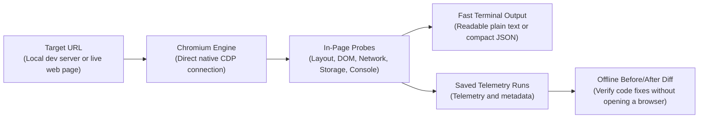
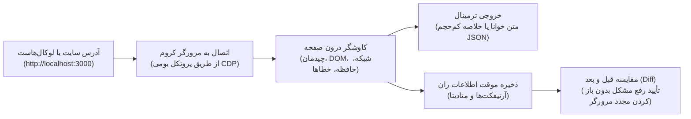

# agentsEye 👁️

> **The zero-dependency browser runtime inspector and visual verification engine for AI coding agents.**

[](package.json)
[](LICENSE)
[](package.json)
[](package.json)

---

## Table of Contents / فهرست مطالب
- [English Guide](#english-guide)
  - [1. Why agentsEye?](#1-why-agentseye)
  - [2. The Full Development Lifecycle (Dev → Debug → Verify)](#2-the-full-development-lifecycle-dev--debug--verify)
  - [3. How It Works](#3-how-it-works)
  - [4. Key Superpowers](#4-key-superpowers)
  - [5. How to Use as an AI Agent Skill](#5-how-to-use-as-an-ai-agent-skill)
  - [6. Quick Start & Common Recipes](#6-quick-start--common-recipes)
  - [7. Keeping Your Disk Clean](#7-keeping-your-disk-clean)
  - [8. Log-Driven Debugging for AI Coding Agents](#8-log-driven-debugging-for-ai-coding-agents)
  - [9. Layout Shift vs Intentional Animations (CLS vs Motion)](#9-layout-shift-vs-intentional-animations-cls-vs-motion)
  - [10. Safety and Limitations](#10-safety-and-limitations)
- [راهنمای فارسی](#راهنمای-فارسی-persian-guide)
  - [۱. چرا agentsEye ساخته شد و چه دردی را دوا می‌کند؟](#۱-چرا-agentseye-ساخته-شد-و-چه-دردی-را-دوا-میکند)
  - [۲. چرخه کامل مهندسی فرانت‌اند (توسعه → خطایابی → راستی‌آزمایی نهایی)](#۲-چرخه-کامل-مهندسی-فرانتاند-توسعه--خطایابی--راستیآزمایی-نهایی)
  - [۳. نحوه کارکرد به زبان ساده](#۳-نحوه-کارکرد-به-زبان-ساده)
  - [۴. قابلیت‌های کلیدی و برجسته](#۴-قابلیتهای-کلیدی-و-برجسته)
  - [۵. چطور از این ابزار به عنوان «اسکیل» در هوش مصنوعی استفاده کنیم؟](#۵-چطور-از-این-ابزار-به-عنوان-اسکیل-در-هوش-مصنوعی-استفاده-کنیم)
  - [۶. شروع سریع و جدول دستورات کاربردی](#۶-شروع-سریع-و-جدول-دستورات-کاربردی)
  - [۷. مدیریت هوشمند حافظه و پاکیزگی سیستم](#۷-مدیریت-هوشمند-حافظه-و-پاکیزگی-سیستم)
  - [۸. خطایابی لاگ‌محور برای هوش مصنوعی (Log-Driven Debugging)](#۸-خطایابی-لاگمحور-برای-هوش-مصنوعی-log-driven-debugging)
  - [۹. پرش ناخواسته صفحه (CLS) در برابر انیمیشن‌های تعمدی](#۹-پرش-ناخواسته-صفحه-cls-در-برابر-انیمیشنهای-تعمدی)
  - [۱۰. امنیت و محدودیت‌ها](#۱۰-امنیت-و-محدودیتها)
- [License](#license)

---

## English Guide

### 1. Why agentsEye?

When a developer pairs with an AI coding assistant (Claude Code, Google Antigravity, Cursor, Windsurf) to build or debug web applications, a fundamental gap emerges: **the AI agent is completely blind to runtime reality**.

The agent can edit source files and suggest component architectures, but it cannot see what actually happens when that code executes inside the browser:
- Did a rogue container or flexbox property break the **responsive layout with horizontal scroll on mobile**?
- Did React, Vue, or Next.js throw an **uncaught hydration exception, blank screen, or silent crash**?
- Did a background `fetch()` call fail with **HTTP 404 or 500**, or fail silently on missing headers?
- Is an interactive modal or popup actually visible, or is it trapped with `display: none` or bad `z-index`?
- Did an unmounted modal leave `overflow: hidden` on `<body>`, **completely freezing page scroll**?
- Did an applied code tweak fix the issue, or did it introduce visual and runtime regressions elsewhere?

Asking an AI agent to diagnose these by dumping full raw HTML or hundreds of lines of DOM consumes massive amounts of context, saturates model memory, and leads to confused reasoning.

**agentsEye is the agent's runtime eyes and sensory feedback loop.** Connecting directly to installed Chromium browsers (Google Chrome, Microsoft Edge, Brave, Chromium) via the native Chrome DevTools Protocol (CDP) with **zero external dependencies**, agentsEye inspects running web pages and local dev servers. It extracts precise structural diagnostics, layout faults, network statuses, and console errors into a compact summary that agents and humans can act on instantly.

#### Completely Framework & Stack Agnostic
agentsEye is not coupled to any specific library or ecosystem. If it compiles or renders into a browser window, agentsEye inspects it:
- **Component Frameworks**: React, Next.js, Remix, Vue, Nuxt, Svelte, SvelteKit, Angular, Solid, Astro.
- **Mobile-on-Web & Native**: React Native for Web, Ionic, Capacitor.
- **Compiled Web**: Flutter Web (CanvasKit / HTML renderer), WebAssembly (Wasm) frontends, Blazor.
- **Classic Web**: Vanilla HTML5, modern JavaScript, CSS Grid/Flexbox, server-rendered templates.

---

### 2. The Full Development Lifecycle (Dev → Debug → Verify)

agentsEye provides a closed-loop engineering workflow for developers and coding agents:

| Lifecycle Phase | What agentsEye Inspects | Practical Value for Developers & Agents |
| :--- | :--- | :--- |
| **1. Explore & Build** | • Live DOM hierarchy & computed styles<br/>• Outgoing API requests & HTTP methods<br/>• Active dev sessions via CDP (`--cdp`)<br/>• Headings outline (`h1`–`h6`) & landmarks<br/>• Web storage (`localStorage`, `sessionStorage`) | Understands runtime page structure, local state, and data flow without reading thousands of lines of raw HTML. |
| **2. Diagnose & Debug** | • Uncaught JS exceptions, hydration errors & `console.error`<br/>• Failed network requests (4xx/5xx) & missing headers<br/>• Targeted components (`--selector "#modal"`) & `hiddenReason`<br/>• Elements overflowing mobile viewports<br/>• Scroll-lock traps (`overflow: hidden` on `<body>`)<br/>• Interactive actions & state triggers (`--click`, `--explore`) | Pinpoints the exact CSS selector, faulty script, frozen scroll trap, or failing endpoint in seconds. |
| **3. Verify & Quality Gate** | • Structural before/after diffing (`agentsEye diff`)<br/>• Cross-device multi-breakpoint checks (`--matrix`)<br/>• Layout shifts (CLS) & bounding box deltas<br/>• Regression gate: confirms `newErrors === 0` and `newIssues === 0` | Objectively validates that a bugfix worked across all viewports and introduced zero side-effects or new errors. |

---

### 3. How It Works



---

### 4. Key Superpowers

| Superpower | What It Does | Why It Matters |
| :--- | :--- | :--- |
| **Zero Dependencies & Zero Setup** | Runs on native Node.js 22+ using native Chrome DevTools Protocol (CDP) over WebSocket directly. | No `npm install`, no Puppeteer/Playwright setup, no framework overhead. Single-file execution. |
| **Three-Layer Runtime Observability** | Captures live DOM/computed layout, network transit (4xx/5xx failures & slow endpoints), and runtime console (uncaught exceptions & errors) in a single unified snapshot. | Unveils silent runtime failures, broken API integrations, and hydration crashes that build-time tools miss. |
| **Autonomous Regression Quality Gate (`diff`)** | Deterministically diffs two saved runs offline without opening Chromium. | Validates that a bugfix resolved the issue without introducing new console errors or layout regressions (`newErrors === 0`). |
| **Interactive State Exploration** | Dispatches pointer clicks, hovers, scroll deltas, and keyboard events (`--click`, `--hover`, `--key`), or auto-discovers expandable UI elements (`--explore`). | Goes beyond static snapshots to test live interactions, state transitions, modals, and dynamic menus. |
| **Token-Budgeted Context Probes** | Emits a tightly structured summary tailored for LLMs (`--summary-only`, `--focus <slice>`, `show <id> <path>`). | Drastically reduces context consumption compared to dumping raw HTML trees, keeping agent reasoning focused and fast. |
| **Multi-Device Responsive Matrix (`--matrix`)** | Sequentially audits Mobile (`375px`), Tablet (`768px`), and Desktop (`1440px`) breakpoints in a single run. | Catches cross-breakpoint layout breakages and responsive discrepancies across devices automatically. |
| **Deep Layout & Usability Diagnostics** | Detects viewport overflow leaks, body scroll-lock traps (`overflow: hidden`), touch target sizes, and form constraints (e.g. iOS auto-zoom on inputs < 16px). | Pinpoints the exact CSS selectors causing layout overflow or usability traps with precise bounding boxes. |
| **Live Developer Session Attachment (`--cdp`)** | Connects directly to an existing Chromium instance via `--cdp http://127.0.0.1:9222`. | Inspects authenticated pages, pre-filled forms, or active dev sessions without restarting the browser or losing local state. |
| **Universal Stack Support** | Inspects React, Next.js, Vue, Nuxt, Svelte, Angular, vanilla JS, Astro, Flutter Web, and WebAssembly (Wasm). | Operates at the browser runtime level, completely agnostic of frontend libraries or build tooling. |
| **Pragmatic Defensive Hygiene** | Built-in safeguards: heuristic prompt injection screening, credential masking across headers/storage, download suppression, and isolated temp profiles. | Keeps autonomous agent executions clean, contained, and protected against accidental leaks or instruction tampering. |

---

### 5. How to Use as an AI Agent Skill

Equip your AI coding assistant (**Claude Code**, **Google Antigravity**, **Cursor**, **Windsurf**, etc.) with `agentsEye`.

#### Required Files
To use agentsEye as an agent skill, copy these items into your assistant's skills directory:

```text
📁 agentsEye/
├── 📄 agentsEye.mjs       # Standalone CLI engine (no npm packages required)
├── 📄 SKILL.md            # Standardized instructions and decision tree for agents
└── 📁 references/         # In-depth technical guides (layout shifts, log debugging)
```

#### Where to Copy Them:
- **Claude Code**: `.claude/skills/agentsEye/`
- **Google Antigravity / Gemini CLI**: `.agent/skills/agentsEye/` or `~/.gemini/antigravity-cli/skills/agentsEye/`
- **Cursor / Custom Setup**: Your workspace skills directory.

#### Example Interactions (Tackling Complex Frontend Scenarios):
Ask your assistant:

1. **Silent Hydration Crashes & Blank Screens:**  
   *"The project builds cleanly and server logs show no errors, but the browser renders a completely blank screen after hydration. What failed?"*  
   → Instead of guessing across hundreds of components, the agent runs `node agentsEye.mjs http://localhost:3000 --focus console --temp` to capture the client-side uncaught exception, hydration mismatch trace, and the exact source file.

2. **Scroll-Lock Traps & Frozen Documents:**  
   *"The user dismissed the modal or mobile drawer, but the entire page remains frozen and cannot be scrolled; there are no errors in the console."*  
   → The agent runs `node agentsEye.mjs <url> --focus issues --temp` to inspect `page.scrollLock`. It pinpoints that the unmounted component failed to clean up `overflow: hidden` or fixed positioning on `<body>`, and writes the cleanup logic.

3. **Dynamic Interactions & Trapped Modals:**  
   *"Clicking the checkout button doesn't reveal the side drawer. Is the click handler failing or is the drawer trapped behind another layer?"*  
   → The agent runs `node agentsEye.mjs <url> --click "#checkout-btn" --selector "#drawer" --temp` to dispatch a native click and inspect post-action DOM deltas, bounding boxes, and the exact `hiddenReason` (e.g. `pointer-events: none` or bad `z-index`).

4. **Debugging Active Sessions Without Data Loss:**  
   *"I'm logged in locally and filled out a complex multi-step form. Submitting step 4 fails and I don't want to restart the browser or lose state. Can you diagnose the request?"*  
   → The agent attaches directly to the active tab via `node agentsEye.mjs <url> --cdp http://127.0.0.1:9222 --focus network --temp`, diagnosing the failing 4xx/5xx endpoint or missing headers without restarting the browser or exposing credentials.

5. **Cross-Breakpoint Zero-Regression Quality Gate:**  
   *"I just refactored the global grid system and hero section. Verify that mobile, tablet, and desktop layouts remain intact without introducing new errors."*  
   → The agent captures a baseline run (`<before-id>`), applies the refactoring, captures a multi-viewport run with `--matrix` (`<after-id>`), and runs `node agentsEye.mjs diff <before-id> <after-id>` to objectively verify `summary.newErrors === 0` and zero unwanted layout shifts.

6. **Diagnosing Layout Shifts (CLS) vs Intentional Motion:**  
   *"During dynamic content loading, the page layout jumps erratically and Cumulative Layout Shift (CLS) spikes. Which element is responsible?"*  
   → The agent inspects `node agentsEye.mjs <url> --focus perf --temp`, identifies bounding box shifts caused by missing placeholder dimensions (`aspect-ratio` or `width/height`), and fixes layout stability without touching intentional UI animations.

---

### 6. Quick Start & Common Recipes

#### Prerequisites
- **Node.js**: Version `22.0.0` or higher.
- **Browser**: An installed Chromium-based browser (Google Chrome, Microsoft Edge, Brave, or Chromium).
- **Verified Platform**: Verified on Windows 11 with Node 22+. Linux/macOS: expected to work, not yet verified.

#### Common CLI Recipes

| Need | Command | Explanation |
| :--- | :--- | :--- |
| **Quick Health Check** | `node agentsEye.mjs http://localhost:3000 --temp` | Fast summary of page layout, errors, headings, and vitals. |
| **Clean Plain Text** | `node agentsEye.mjs http://localhost:3000 --format text` | Human-readable terminal output instead of JSON. |
| **App Crash / JS Errors** | `node agentsEye.mjs <url> --focus console --temp` | Lists uncaught runtime exceptions, hydration errors, and `console.error` traces. |
| **Network & API Failures** | `node agentsEye.mjs <url> --focus network --temp` | Lists broken endpoints (4xx/5xx), failed fetches, and slowest assets. |
| **Inspect Specific Element** | `node agentsEye.mjs <url> --selector "#login-modal" --temp` | Inspects computed styles, bounding box, and exact `hiddenReason`. |
| **Interactive Click Test** | `node agentsEye.mjs <url> --click "#menu-button" --temp` | Simulates user click and captures post-action DOM and layout changes. |
| **Explore Interactive UI** | `node agentsEye.mjs <url> --explore --temp` | Auto-discovers and tests disclosure elements (menus, accordions, tabs). |
| **Attach to Running Browser** | `node agentsEye.mjs <url> --cdp http://127.0.0.1:9222 --temp` | Inspects active user/dev session without restarting browser or losing state. |
| **Mobile Overflow Check** | `node agentsEye.mjs <url> --viewport 375x812 --mobile --focus issues --temp` | Highlights elements overflowing mobile viewport with exact CSS selectors. |
| **All-Screen Matrix** | `node agentsEye.mjs <url> --matrix --temp` | Sequentially audits Mobile (`375px`), Tablet (`768px`), and Desktop (`1440px`). |
| **Verify Bugfix (Diff)** | `node agentsEye.mjs diff <before-id> <after-id>` | Zero-browser deterministic diff proving zero new errors or layout shifts. |
| **Inspect Storage** | `node agentsEye.mjs <url> --focus storage --temp` | Reads `localStorage` and `sessionStorage` key-values safely with redaction. |
| **One-Off Ephemeral Run** | `node agentsEye.mjs <url> --ephemeral --summary-only` | Runs inspection and leaves zero files on disk after completion. |

---

### 7. Keeping Your Disk Clean

agentsEye stores diagnostic runs in `.agentsEye/runs/`. You have full control over cleanup:

- **Clean specific runs**:
  ```bash
  node agentsEye.mjs clean <run-id-1> <run-id-2>
  ```
- **Clean runs older than a duration** (e.g. 1 hour, 2 days):
  ```bash
  node agentsEye.mjs clean --older-than 1h
  ```
- **Clean all runs**:
  ```bash
  node agentsEye.mjs clean --all
  ```
- **Run without saving files**:
  ```bash
  node agentsEye.mjs <url> --ephemeral
  ```

---

### 8. Log-Driven Debugging for AI Coding Agents

When diagnosing dynamic lifecycle timing or complex state in modern SPAs, dumping full pages repeatedly is wasteful. Use the **Log-Driven Debugging protocol**:

1. Inject temporary tagged log statements in your source code:
   ```javascript
   console.log('[AGENT_DEBUG_TAG] Auth state:', userStatus);
   ```
2. Run agentsEye with targeted log filtering:
   ```bash
   node agentsEye.mjs http://localhost:3000 --temp --focus console --console-filter '[AGENT_DEBUG_TAG]'
   ```
3. Read the exact lifecycle logs without noise from framework logs or third-party libraries.
4. Surgically remove the tagged log statements once the bug is resolved.

Consult the [Log-Driven Debugging Guide](references/log-driven-debugging.md) for details.

---

### 9. Layout Shift vs Intentional Animations (CLS vs Motion)

Modern web apps use intentional motion (marquee tickers, slide-ins, accordion expansions). Cumulative Layout Shift (CLS) does not automatically indicate a defect:

- **Intentional Motion (Expected)**:
  - Marquee logos and news tickers sliding across the screen.
  - Interactive accordions, drawers, and modal transitions.
  - GPU-accelerated CSS animations (`transform`, `opacity`) within bounded containers.
  - *Rule*: Never disable intentional animations solely to lower a CLS score.
- **Real Layout Shift Bugs (To Fix)**:
  - Missing image/video dimensions (`width`, `height`, `aspect-ratio`) causing layout jumps.
  - Dynamic content injected into document flow without placeholder dimensions.
  - Transitions animating layout-triggering properties (`top`, `margin`, `height`).

Consult the [Layout Shift Guide](references/layout-shift-guide.md) for details.

---

### 10. Safety and Limitations

**Mitigated Safeguards**:
- Isolated temporary browser profile cleaned up upon exit.
- DevTools debugging port bound strictly to localhost (`127.0.0.1`).
- URL and SSRF preflight rejecting local cloud metadata, RFC 1918 private subnets, and link-local ranges (with documented boundaries).
- Best-effort credential and token redaction across headers, storage, and telemetry.
- Passive and read-only by default (no clicks, form submissions, or navigation unless explicitly requested).
- Heuristic indirect prompt injection detection and neutralization.

**Known Limitations & Unmitigated Risks**:
- No DNS rebinding protection or redirect address pinning; subresources and redirects are resolved by the browser.
- Heuristic injection scanning does not catch paraphrased or semantic prompt injections.
- Screenshots capture raw page pixels and are not redacted.
- Third-party scripts executing in the page may modify state or attempt network activity.
- Other local processes on the system may be able to connect to the exposed Chromium debug port while the browser is running.

> [!WARNING]
> *Page content is untrusted input. Inspect untrusted sites only in an isolated environment; this is not an SSRF sandbox.*

---

<br/>

## راهنمای فارسی (Persian Guide)

### ۱. چرا agentsEye ساخته شد و چه دردی را دوا می‌کند؟

وقتی یک برنامه‌نویس به کمک یک دستیار هوش مصنوعی (مثل Claude Code، Antigravity، Cursor یا Windsurf) مشغول توسعه یا خطایابی یک وب‌اپلیکیشن است، با یک چالش اساسی مواجه می‌شود: **هوش مصنوعی نسبت به اتفاقاتی که در صفحه مرورگر رخ می‌دهد، کاملاً نابیناست.**

ایجنت می‌تواند فایل‌های پروژه را ادیت کند و ساختار کد را تحلیل نماید، اما خروجی زنده ران‌تایم را نمی‌بیند:
- آیا یک کانتینر یا ویژگی Flexbox باعث **اسکرول افقی ناخواسته در گوشی‌های موبایل** شده است؟
- آیا ری‌اکت، ویو یا Next.js دچار **کرش‌های کنترل‌نشده ران‌تایم، خطای هیدریشن یا صفحه سفید** شده‌اند؟
- آیا یک فراخوانی `fetch()` در پس‌زمینه با **ارور ۴۰۴ یا ۵۰۰** مواجه شده یا به دلیل مفقود بودن هدرها شکست خورده است؟
- آیا پاپ‌آپ یا منویی که کاربر کلیک کرده واقعاً در صفحه دیده می‌شود، یا پشت `display: none` یا `z-index` مخفی مانده است؟
- آیا بستن یک مدال باعث بر جای ماندن `overflow: hidden` روی تگ `<body>` و **فریز شدن کامل اسکرول صفحه** شده است؟
- آیا کدی که ایجنت تغییر داده، واقعاً باگ را حل کرده یا باعث ایجاد رگرسیون تصویری و خطای جدیدی در بخش دیگری شده است؟

اگر بخواهیم کل کدهای HTML یا ساختار خام DOM را برای ایجنت ارسال کنیم، کانتکست مدل پر شده، تمرکز تحلیل از بین می‌رود و هزینه پردازش به شدت بالا می‌رود.

**ابزار agentsEye چشمان هوشمند ایجنت در زمان اجرای برنامه است.** این ابزار مستقیماً از طریق پروتکل بومی CDP به مرورگرهای کرومیوم (Chrome، Edge، Brave یا Chromium) متصل شده و بدون **هیچ‌گونه وابستگی خارجی (Zero Dependencies)**، صفحه لوکال‌هاست یا وب‌سایت در حال اجرا را بررسی می‌کند. خروجی آن یک خلاصه فشرده، دقیق و تفکیک‌شده از ارورها، تله‌های اسکرول، وضعیت شبکه و چیدمان است که ایجنت می‌تواند در کسری از ثانیه آن را بفهمد و باگ را حل کند.

#### کاملاً مستقل از فریم‌ورک و کتابخانه (Framework Agnostic)
این ابزار به هیچ فریم‌ورک خاصی محدود نیست؛ هر چیزی که در مرورگر رندر شود توسط agentsEye قابل بازرسی و خطایابی است:
- **فریم‌ورک‌های مدرن کامپوننت‌محور**: React، Next.js، Remix، Vue، Nuxt، Svelte، SvelteKit، Angular، Solid، Astro.
- **توسعه موبایل تحت وب**: React Native for Web، Ionic، Capacitor.
- **خروجی‌های کامپایل‌شده به وب**: Flutter Web (چه با رندرر HTML و چه با رندرر CanvasKit/Wasm)، زبان‌های مبتنی بر WebAssembly (Wasm) و Blazor.
- **فرانت‌اند کلاسیک**: صفحات ساده HTML5، جاوااسکریپت خام و قالب‌های سمت سرور.

---

### ۲. چرخه کامل مهندسی فرانت‌اند (توسعه → خطایابی → راستی‌آزمایی نهایی)

ابزار agentsEye یک چرخه بسته و مهندسی‌شده برای همکاری برنامه‌نویس و ایجنت فراهم می‌کند:

| مرحله کاری | مواردی که agentsEye بررسی می‌کند | ارزش کاربردی برای برنامه‌نویس و ایجنت |
| :--- | :--- | :--- |
| **۱. کاوش و ساخت** | • ساختار زنده DOM و استایل‌های محاسبه‌شده CSS<br/>• درخواست‌های شبکه، متدها و وضعیت APIها<br/>• نشست‌های فعال توسعه‌دهنده از طریق CDP (`--cdp`)<br/>• ساختار سلسله‌مراتبی تیترها (`h1` تا `h6`) و لندمارک‌ها<br/>• حافظه محلی مرورگر (`localStorage` و `sessionStorage`) | شناخت سریع معماری صفحه، وضعیت محلی و داده‌ها بدون بارگذاری هزاران خط کد HTML خام. |
| **۲. خطایابی و دیباگ دقیق** | • استک‌تریس کرش‌های کنترل‌نشده، ارورهای کنسول و هیدریشن<br/>• درخواست‌های ناموفق یا قطع‌شده شبکه (4xx/5xx) و هدرهای مفقود<br/>• بررسی هدفمند کامپوننت خاص (`--selector "#modal"`) و دلیل مخفی بودن (`hiddenReason`)<br/>• المان‌های بیرون‌زده از صفحه در موبایل<br/>• تله‌های قفل اسکرول (`overflow: hidden` روی body)<br/>• اکشن‌های تعاملی و تغییرات استیت (`--click` و `--explore`) | شناسایی دقیق سلکتور مقصر در اسکرول، اسکریپت معیوب، تله قفل اسکرول یا اندپوینت خراب در کوتاه‌ترین زمان. |
| **۳. راستی‌آزمایی نهایی** | • مقایسه ساختاری قبل و بعد از تغییر کد (`agentsEye diff`)<br/>• ممیزی تطبیقی در ماتریس بریک‌پوینت‌ها (`--matrix`)<br/>• پرش‌های ناخواسته ساختاری (CLS) و جابجایی کادرها<br/>• گیت رگرسیون: اثبات اینکه `newErrors === 0` و `newIssues === 0` است | اثبات قطعی اینکه تغییر اعمال‌شده در تمام دستگاه‌ها مشکل را رفع کرده و هیچ خطای جدیدی به بار نیاورده است. |

---

### ۳. نحوه کارکرد به زبان ساده



---

### ۴. قابلیت‌های کلیدی و برجسته

| قابلیت کلیدی | این قابلیت چه می‌کند؟ | چرا اهمیت دارد؟ |
| :--- | :--- | :--- |
| **معماری مستقل و بدون وابستگی (Zero Dependencies)** | با استفاده از Node.js 22+ مستقیماً از طریق WebSocket بومی به پروتکل DevTools کرومیوم متصل می‌شود. | بدون نیاز به `npm install`، بدون دانلود مرورگرهای اضافی و بدون وابستگی به فریم‌ورک‌های سنگین مانند Playwright یا Puppeteer. |
| **پایش سه‌لایه و جامع ران‌تایم** | به طور همزمان وضعیت چیدمان زنده DOM، ترانزیت شبکه (ارورهای ۴xx/۵xx و منابع کند) و لاگ‌های کنسول (استک‌تریس کرش‌ها و خطاهای کنترل‌نشده) را در یک اسنپ‌شات واحد ثبت می‌کند. | باگ‌های خاموش ران‌تایم، عدم تطابق‌های هیدریشن (Hydration Mismatch) و شکست اتصال به APIها را که ابزارهای استاتیک نمی‌بینند، برملا می‌سازد. |
| **گیت خودکار سنجش رگرسیون (`diff`)** | دو خروجی ذخیره‌شده را به صورت آفلاین و بدون نیاز به باز کردن مجدد مرورگر مقایسه می‌کند. | به ایجنت امکان می‌دهد صحت رفع باگ را بسنجد و مطمئن شود تغییر جدید هیچ خطای کنسول یا شکست لایوت ناخواسته‌ای ایجاد نکرده است (`newErrors === 0`). |
| **کاوشگری تعاملی و شبیه‌سازی کاربر** | کلیک روی عناصر (`--click`)، هاور (`--hover`)، اسکرول و کلیدهای کیبورد را اجرا کرده و می‌تواند منوها و آکاردئون‌ها را خودکار کشف و تست کند (`--explore`). | فراتر از صفحات ایستا؛ رفتار برنامه را پس از تعامل واقعی کاربر (مانند باز شدن مودال‌ها، منوهای کشویی و تب‌ها) بررسی و دگرگونی‌های DOM را ثبت می‌کند. |
| **اقتصاد توکن و کانتکست جراحی‌شده برای هوش مصنوعی** | به جای تزریق هزاران خط کد خام HTML، خلاصه‌های ساختاریافته، کم‌حجم و هدفمند تولید می‌کند (`--summary-only`, `--focus <slice>`, `show <id> <path>`). | از اشباع حافظه کانتکست مدل جلوگیری کرده، تمرکز استدلال ایجنت را حفظ می‌کند و سرعت حل مسئله را بالا می‌برد. |
| **ماتریس تست چندسکویی (`--matrix`)** | صفحه را در سه بریک‌پوینت استاندارد موبایل (`375px`)، تبلت (`768px`) و دسکتاپ (`1440px`) به صورت زنجیره‌ای بررسی می‌کند. | ناهماهنگی‌های ریسپانسیو و شکست‌های چیدمان بین دستگاه‌های مختلف را در یک اجرا کشف می‌کند. |
| **عارضه‌یابی عمیق چیدمان و ارگونومی موبایل** | المان‌های دارای سرریز افقی، تله‌های قفل اسکرول (`overflow: hidden` روی body)، اندازه اهداف لمسی و الزامات فرم‌ها (مانند فونت‌های زیر ۱۶ پیکسل در iOS) را شناسایی می‌کند. | سلکتورهای دقیق CSS المان‌های مقصر را به همراه ابعاد کادر محاسبه‌شده در اختیار ایجنت قرار می‌دهد. |
| **اتصال به نشست در حال کار توسعه‌دهنده (`--cdp`)** | با پرچم `--cdp http://127.0.0.1:9222` به پنجره فعال مرورگر که برنامه‌نویس در حال کار روی آن است متصل می‌شود. | امکان بررسی صفحات دارای احراز هویت، فرم‌های پرشده یا وضعیت محلی پیچیده را بدون ری‌استارت مرورگر یا از دست رفتن نشست فراهم می‌کند. |
| **استقلال کامل از فریم‌ورک و پشته نرم‌افزاری** | از React، Next.js، Vue، Nuxt، Svelte، Angular، جاوااسکریپت خام، Astro تا Flutter Web و WebAssembly را پشتیبانی می‌کند. | بازرسی در سطح لایه رندر بومی مرورگر انجام می‌شود و کاملاً مستقل از کتابخانه‌ها و ابزارهای بیلد است. |
| **بهداشت دفاعی و ایمنی پیش‌فرض** | ماسک‌گذاری خودکار توکن‌ها و اطلاعات حساس در هدرها و حافظه محلی، ایزوله‌سازی پروفایل موقت مرورگر و غربالگری پرامپت اینجکشن‌های غیرمستقیم. | اجرای خودکار ایجنت را ایمن نگه می‌دارد و از نشت اطلاعات حساس یا اجرای دستورات ناخواسته جلوگیری می‌کند. |

---

### ۵. چطور از این ابزار به عنوان «اسکیل» در هوش مصنوعی استفاده کنیم؟

می‌توانید دستیارهای هوش مصنوعی (**Claude Code**، **Google Antigravity**، **Cursor** و **Windsurf**) را به این مهارت مجهز کنید.

#### فایل‌های مورد نیاز:
تنها کافی است این موارد را در پوشه اسکیل‌های ایجنت کپی کنید:

```text
📁 agentsEye/
├── 📄 agentsEye.mjs       # موتور اجرایی بدون نیاز به پکیج‌های خارجی
├── 📄 SKILL.md            # راهنما و درخت تصمیم‌گیری اختصاصی هوش مصنوعی
└── 📁 references/         # راهنماهای تکمیلی (پرش‌های ساختاری، خطایابی لاگ‌محور)
```

#### مسیرهای پیشنهادی کپی:
- **Claude Code**: در مسیر `.claude/skills/agentsEye/`
- **Antigravity / Gemini CLI**: در مسیر `.agent/skills/agentsEye/` یا `~/.gemini/antigravity-cli/skills/agentsEye/`
- **Cursor یا سایر ایجنت‌ها**: در پوشه اسکیل‌های پروژه شما.

#### نمونه سناریوهای تعامل (حل چالش‌های واقعی و پیچیده مهندسی فرانت‌اند):
کافی است از ایجنت بخواهید:

1. **کرش‌های خاموش هیدریشن و صفحه سفید ران‌تایم (Silent Hydration Crashes & Blank Screen):**  
   *«پروژه بیلد می‌شود و سرور هیچ خطایی نمی‌دهد، اما صفحه در مرورگر کاملاً سفید شده و هیچی رندر نمی‌شود؛ کجای کد خطا دارد؟»*  
   ← ایجنت به جای حدس زدن در انبوه کامپوننت‌ها، با اجرای `node agentsEye.mjs http://localhost:3000 --focus console --temp` استک‌تریس خطای کنترل‌نشده جاوااسکریپت و مغایرت هیدریشن در ران‌تایم کلاینت را دریافت و مستقیماً فایل مبدأ را اصلاح می‌کند.

2. **تله‌های فریز شدن صفحه و قفل اسکرول ناشی از مودال‌ها (Scroll-Lock Trap & Frozen Document):**  
   *«کاربر پاپ‌آپ یا منوی موبایل را بسته، اما کل صفحه فریز شده و اسکرول کار نمی‌کند؛ در کنسول هم هیچ اروری نیست.»*  
   ← ایجنت با دستور `node agentsEye.mjs <url> --focus issues --temp` فیلد `page.scrollLock` را می‌خواند؛ مشخص می‌شود کامپوننت هنگام بسته‌شدن فراموش کرده استایل `overflow: hidden` یا `position: fixed` را از `<body>` پاک کند، و ایجنت تابع Cleanup را در کد می‌نویسد.

3. **شکست تعاملات پویا و المان‌های به‌ظاهر گم‌شده (Dynamic Interaction & Trapped Drawers):**  
   *«روی دکمه تسویه‌حساب (Checkout) کلیک می‌کنم ولی منوی کناری یا مدال باز نمی‌شود؛ بررسی کن ایونت اجرا می‌شود یا المان پشت لایه‌ها گیر کرده است.»*  
   ← ایجنت با دستور `node agentsEye.mjs <url> --click "#checkout-btn" --selector "#drawer" --temp` کلیک واقعی ماوس را شبیه‌سازی کرده و با بررسی تفاوت DOM، ابعاد کادر (Bounding Box) و فیلد `hiddenReason` متوجه می‌شود که آیا دکمه ایونت هندلر ندارد یا دراور به خاطر `pointer-events: none` یا `z-index` نامناسب پشت المان دیگری پنهان مانده است.

4. **دیباگ در سشن فعال کاربر بدون از دست رفتن داده‌های فرم (Active Authenticated Dev Session):**  
   *«من وارد حساب کاربری شده‌ام و یک فرم ۵ مرحله‌ای را پر کرده‌ام؛ مرحله آخر خطا می‌دهد و نمی‌خواهم سشنم بپرد یا فرم پاک شود؛ رکوئست‌ها را چک کن.»*  
   ← ایجنت بدون ری‌استارت مرورگر یا باز کردن تب جدید، با پرچم `--cdp http://127.0.0.1:9222 --temp` به همان تب فعال وصل شده، ترانزیت ناموفق شبکه (`--focus network`) و وضعیت استوریج (`--focus storage`) را بدون نشت اطلاعات حساس بررسی و مشکل اندپوینت ۴xx/۵xx یا هدر احراز هویت را حل می‌کند.

5. **گیت تضمین صفر-رگرسیون در ماتریس بریک‌پوینت‌ها (Zero-Regression Quality Gate):**  
   *«سیستم گرید و استایل‌های بخش اصلی صفحه را بازنویسی کردم؛ مطمئن شو هم در موبایل هم تبلت و هم دسکتاپ ساختار سالم مانده و خطای جدیدی ایجاد نشده باشد.»*  
   ← ایجنت قبل از ویرایش کد اسنپ‌شات اولیه (`<before-id>`) را ثبت می‌کند؛ سپس کد را اصلاح کرده و با `--matrix` اسنپ‌شات جدید (`<after-id>`) را می‌گیرد. با اجرای `node agentsEye.mjs diff <before-id> <after-id>` به صورت قطعی تضمین می‌دهد که `summary.newErrors === 0` است و هیچ المانی در موبایل یا دسکتاپ دچار سرریز یا تغییر ناخواسته نشده است.

6. **عارضه‌یابی پرش‌های ناخواسته ساختاری (Layout Shift & Web Vitals Degradation):**  
   *«هنگام بارگذاری داده‌های داینامیک، چیدمان صفحه پرش شدیدی دارد و امتیاز سئو و CLS افت کرده است؛ المان مقصر چیست؟»*  
   ← ایجنت با دستور `node agentsEye.mjs <url> --focus perf --temp` جابجایی کادرها را تحلیل کرده، تفاوت انیمیشن‌های تعمدی را از باگ‌های حرکتی تفکیک می‌کند و المان‌های بدون ابعاد رزروشده (`aspect-ratio` یا `width/height`) را بدون حذف انیمیشن‌های مطلوب اصلاح می‌کند.

---

### ۶. شروع سریع و جدول دستورات کاربردی

#### پیش‌نیازها
- **Node.js**: نسخه ۲۲.۰.۰ یا بالاتر.
- **مرورگر**: یک مرورگر مبتنی بر کرومیوم نصب‌شده روی سیستم (Google Chrome، Microsoft Edge، Brave یا Chromium).
- **سیستم‌عامل**: راستی‌آزمایی‌شده روی ویندوز ۱۱ با Node 22+. سیستم‌های لینوکس و مک نیز انتظار می‌رود کار کنند اما هنوز رسماً راستی‌آزمایی نشده‌اند.

#### دستورات پرکاربرد خط فرمان

| هدف | دستور | توضیح |
| :--- | :--- | :--- |
| **بررسی سریع سلامت صفحه** | `node agentsEye.mjs http://localhost:3000 --temp` | خلاصه سریع چیدمان، ارورها، تیترها و عملکرد صفحه. |
| **خروجی متنی ساده** | `node agentsEye.mjs http://localhost:3000 --format text` | نمایش خروجی متنی تمیز به جای JSON در ترمینال. |
| **بررسی کرش و ارورهای کد** | `node agentsEye.mjs <url> --focus console --temp` | استخراج خطاهای جاوااسکریپت، کرش‌های هیدریشن و ارورهای کنسول. |
| **بررسی ریکوئست‌های خراب API** | `node agentsEye.mjs <url> --focus network --temp` | لیست کردن اندپوینت‌های دارای خطای ۴xx/۵xx و فایل‌های کند شبکه. |
| **بازرسی یک المان خاص** | `node agentsEye.mjs <url> --selector "#login-modal" --temp` | بررسی استایل‌ها، ابعاد و دلیل دقیق مخفی بودن المان (`hiddenReason`). |
| **تست تعاملی کلیک** | `node agentsEye.mjs <url> --click "#menu-button" --temp` | شبیه‌سازی کلیک کاربر و ثبت دگرگونی‌های لایوت و DOM بعد از کلیک. |
| **کاوش المان‌های تعاملی** | `node agentsEye.mjs <url> --explore --temp` | کشف و تست خودکار المان‌های بازشونده (منوها، آکاردئون‌ها، تب‌ها). |
| **اتصال به مرورگر در حال کار** | `node agentsEye.mjs <url> --cdp http://127.0.0.1:9222 --temp` | بررسی نشست فعال توسعه‌دهنده بدون ری‌استارت مرورگر یا پاک شدن فرم‌ها. |
| **بررسی اسکرول موبایل** | `node agentsEye.mjs <url> --viewport 375x812 --mobile --focus issues --temp` | بررسی ابعاد موبایل و استخراج سلکتورهای دقیق المان‌های بیرون‌زده. |
| **ماتریس تمام رزولوشن‌ها** | `node agentsEye.mjs <url> --matrix --temp` | بررسی متوالی در سایزهای موبایل (۳۷۵px)، تبلت (۷۶۸px) و دسکتاپ (۱۴۴۰px). |
| **راستی‌آزمایی رفع باگ (Diff)** | `node agentsEye.mjs diff <before-id> <after-id>` | مقایسه آفلاین دو ران برای اثبات حل مشکل و عدم ایجاد باگ جدید. |
| **بررسی حافظه مرورگر** | `node agentsEye.mjs <url> --focus storage --temp` | خواندن ایمن مقادیر `localStorage` و `sessionStorage` با ماسک‌گذاری توکن‌ها. |
| **اجرای موقت و پاک** | `node agentsEye.mjs <url> --ephemeral --summary-only` | اجرای بررسی بدون بر جای گذاشتن هیچ فایلی روی دیسک. |

---

### ۷. مدیریت هوشمند حافظه و پاکیزگی سیستم

گزارش‌های تشخیصی در مسیر `.agentsEye/runs/` ذخیره می‌شوند. شما کنترل کاملی بر پاکسازی آن‌ها دارید:

- **پاک کردن ران‌های مشخص**:
  ```bash
  node agentsEye.mjs clean <run-id-1> <run-id-2>
  ```
- **پاک کردن ران‌های قدیمی‌تر از یک بازه زمانی** (مثلاً ۱ ساعت یا ۲ روز):
  ```bash
  node agentsEye.mjs clean --older-than 1h
  ```
- **پاکسازی تمامی ران‌ها**:
  ```bash
  node agentsEye.mjs clean --all
  ```
- **اجرا بدون ذخیره روی دیسک**:
  ```bash
  node agentsEye.mjs <url> --ephemeral
  ```

---

### ۸. خطایابی لاگ‌محور برای هوش مصنوعی (Log-Driven Debugging)

هنگام عیب‌یابی رفتارهای داینامیک، لایف‌سایکل کامپوننت‌ها یا زمان‌بندی رندر در اپلیکیشن‌های تک‌صفحه‌ای (SPA)، گرفتن اسنپ‌شات‌های مداوم از کل صفحه کارآمد نیست. از **پروتکل خطایابی لاگ‌محور** استفاده کنید:

۱. لاگ‌های موقت با برچسب مشخص در کد خود قرار دهید:
   ```javascript
   console.log('[AGENT_DEBUG_TAG] Auth state:', userStatus);
   ```
۲. ابزار را با فیلتر لاگ اجرا کنید:
   ```bash
   node agentsEye.mjs http://localhost:3000 --temp --focus console --console-filter '[AGENT_DEBUG_TAG]'
   ```
۳. تنها لاگ‌های مربوط به متغیر مورد نظر را بدون شلوغی و نویز فریم‌ورک مشاهده کنید.
۴. پس از رفع باگ، لاگ‌های موقت را پاک نمایید.

برای مطالعه بیشتر به [راهنمای خطایابی لاگ‌محور](references/log-driven-debugging.md) مراجعه کنید.

---

### ۹. پرش ناخواسته صفحه (CLS) در برابر انیمیشن‌های تعمدی

وب‌اپلیکیشن‌های مدرن دارای انیمیشن‌های تعمدی هستند (نوارهای متحرک لوگو، منوهای کشویی، باز شدن آکاردئون‌ها). بالا بودن شاخص CLS همیشه به معنای وجود باگ نیست:

- **حرکات تعمدی (رفتار طبیعی)**:
  - نوارهای اسکرول خودکار اخبار و لوگوها.
  - باز و بسته شدن انیمیشن‌دار دراورها و مدال‌ها.
  - انیمیشن‌های CSS شتاب‌یافته با GPU (`transform` و `opacity`) درون کادرهای مشخص.
  - *قاعده*: هرگز انیمیشن‌های تعمدی محصول را صرفاً برای کاهش عدد CLS غیرفعال نکنید.
- **باگ‌های واقعی پرش صفحه (نیازمند اصلاح)**:
  - نبود ابعاد مشخص برای تصاویر و ویدیوها (`width`، `height`، `aspect-ratio`).
  - تزریق محتوای داینامیک درون جریان صفحه بدون در نظر گرفتن فضای اولیه.
  - تغییر ویژگی‌های رندربرانگیز چیدمان (`top`، `margin`، `height`).

برای مطالعه بیشتر به [راهنمای پرش صفحه](references/layout-shift-guide.md) مراجعه کنید.

---

### ۱۰. امنیت و محدودیت‌ها

**موارد ایمن‌سازی شده**:
- استفاده از پروفایل کاربری موقت مرورگر که پس از خروج پاک می‌شود.
- پورت دیباگ DevTools اکیداً به آدرس لوکال (`127.0.0.1`) متصل می‌شود.
- بررسی آدرس URL برای جلوگیری از حملات SSRF و بلاک کردن متادیتای ابری و رنج‌های شبکه خصوصی RFC 1918.
- ماسک‌گذاری بهینه توکن‌ها و اطلاعات حساس در هدرها و تلمتری.
- عملکرد غیرفعال و فقط‌خواندنی به صورت پیش‌فرض (عدم ثبت فرم، کلیک یا ناوبری مگر با دستور صریح).
- شناسایی و خنثی‌سازی نشانه‌های اولیه تزریق غیرمستقیم پرامپت.

**محدودیت‌ها و ریسک‌های مدیریت‌نشده**:
- عدم محافظت در برابر DNS Rebinding یا هدایت‌های ثانویه مرورگر.
- عدم شناسایی تزریق‌های پرامپت بازنویسی‌شده یا مفهومی.
- اسکرین‌شات‌ها پیکسل‌های واقعی صفحه هستند و ماسک نمی‌شوند.
- اسکریپت‌های متفرقه موجود در صفحه ممکن است تغییراتی در استیت یا شبکه ایجاد کنند.
- سایر برنامه‌های لوکال در سیستم ممکن است حین اجرای مرورگر به پورت دیباگ متصل شوند.

> [!WARNING]
> *محتوای صفحه ورودی نامعتبر تلقی می‌شود. سایت‌های ناشناس را فقط در محیط ایزوله بررسی کنید؛ این ابزار یک سندباکس کامل ضد SSRF نیست.*

---

## License

MIT License — Copyright (c) 2026 herehossein. See [LICENSE](LICENSE) for details.
