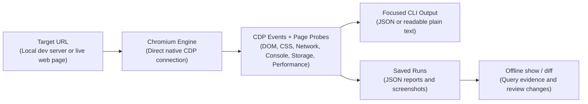

<div align="center">

# agentsEye 👁️

**A standalone browser-runtime inspector for AI coding agents and developers: structured diagnostics, targeted interactions, and before/after comparison—with zero runtime npm dependencies.**

[](package.json)
[](LICENSE)
[](package.json)
[](package.json)

[English](README.md) | [فارسی](README.fa.md)

</div>

<details>
<summary><strong>Table of Contents</strong></summary>

- [1. Why agentsEye?](#1-why-agentseye)
- [2. The Full Development Lifecycle (Dev → Debug → Verify)](#2-the-full-development-lifecycle-dev--debug--verify)
- [3. How It Works](#3-how-it-works)
- [4. Key Capabilities](#4-key-capabilities)
- [5. How to Use as an AI Agent Skill](#5-how-to-use-as-an-ai-agent-skill)
- [6. Quick Start & Common Recipes](#6-quick-start--common-recipes)
- [7. Saved Runs & Cleanup](#7-saved-runs--cleanup)
- [8. Log-Driven Debugging for AI Coding Agents](#8-log-driven-debugging-for-ai-coding-agents)
- [9. Layout Shift vs Intentional Animations (CLS vs Motion)](#9-layout-shift-vs-intentional-animations-cls-vs-motion)
- [10. Safety and Limitations](#10-safety-and-limitations)
- [11. Development & Architecture](#11-development--architecture)
- [License](#license)

</details>

## 1. Why agentsEye?

AI coding assistants can read and edit source code, but need browser evidence to understand what the application actually does. **agentsEye provides that feedback through three core workflows:**

- **Runtime crash diagnosis:** Capture uncaught JavaScript exceptions and console logs—including hydration errors reported by the application—and filter tagged logs to investigate state and lifecycle bugs.

- **Network & API diagnosis:** Identify failed requests, HTTP 4xx/5xx responses and slow endpoints, including protected routes inspected with origin-scoped headers.

- **Interaction and bugfix verification:** Exercise menus, tabs and modals with scoped semantic refs, then compare saved before/after runs for new errors and issues.

The engine runs from one `.mjs` file using Node.js 22+ and an installed Chromium browser, independently of your frontend framework. It combines browser events and page probes into focused JSON or plain text, with saved reports and screenshots for follow-up review. Capture once, then query the evidence offline instead of repeatedly dumping the whole page.

## 2. The Full Development Lifecycle (Dev → Debug → Verify)

Use an evidence-first loop: **capture → reproduce → fix → compare**.

| Phase | Current workflow | Expected result |
| :--- | :--- | :--- |
| **1. Observe & baseline** | Save a run with `--temp`; start with the summary, then use `--focus interactive --compact` for control names, input types and refs. Add `--no-css-vars` when design tokens are irrelevant. | A saved baseline and a focused, actionable catalog. |
| **2. Reproduce & diagnose** | Filter console logs and inspect network failures; isolate computed CSS with `--selector`/`--style-props`. Use fresh refs with `--interactive-scope`, chained actions and `--delta`; `--explore` tests disclosure toggles only. | Runtime evidence for a targeted source-code fix. |
| **3. Verify & review** | Repeat the same viewport and actions, then run `node agentsEye.mjs diff <before-id> <after-id>`. Drill down offline with `node agentsEye.mjs show <run-id> interactive.items[15]`. | Check `summary.newErrors === 0` and `summary.newIssues === 0`; review layout/style changes, `network.failures`, and resolution of the original defect. |

`--matrix` captures a viewport series; review `matrix.snapshots` separately. One before/after diff compares the primary snapshot, not every breakpoint. Keep `--temp` runs until follow-up queries/diffs finish, then clean only those run IDs.

## 3. How It Works



## 4. Key Capabilities

| Capability | What it does | Practical value |
| :--- | :--- | :--- |
| **Standalone CDP engine** | One `.mjs` file using native Node.js 22+ APIs and an installed Chrome, Edge, Brave, or Chromium browser. | No runtime npm packages or additional browser download required. |
| **Combined runtime evidence** | Collects DOM/computed CSS, request statuses and timings, JavaScript/console errors, performance observations, and screenshots. | Connects UI symptoms with browser-side evidence that build logs alone cannot provide. |
| **Agent-focused output** | JSON or plain text, targeted `--focus` slices, compact interactive catalogs, and interactive `--delta` output. | Keeps inspection focused instead of repeatedly sending full DOM dumps to the agent. |
| **Scoped semantic interactions** | Click, hover, scroll, and keyboard actions using CSS selectors or catalog refs such as `e1`; `--interactive-scope` narrows discovery. | Targets controls by their names and roles. Refs are snapshot-specific and can become stale after DOM changes. |
| **Offline regression review** | `show` queries saved JSON; `diff` uses heuristic DOM matching to compare bounds, styles, and newly observed errors/issues. | Reuses captured evidence without launching a browser; differences still need review. |
| **Responsive snapshots** | `--matrix` samples mobile and Tailwind breakpoints; `--viewports` selects a custom series. Captures a screenshot per viewport. | Supports cross-breakpoint review in Chromium, not testing every physical device or browser. |
| **Layout, form & accessibility signals** | Bounds, visibility reasons, scroll-lock risks, touch-target/input-font warnings, sampled text contrast, and opt-in Chromium AX data (`--a11y`). | Provides CSS paths and usability signals—not a complete accessibility audit. |
| **Attached Chromium & scoped headers** | `--cdp` uses a fresh incognito context/tab; `--header` values apply only to the exact initial origin. | Reuses a running browser process without reusing its signed-in tabs; supports header-authenticated routes. |
| **Best-effort safeguards** | Recognized credential masking, prompt-injection heuristics, and interaction policy checks. | Reduces known risks; page data remains untrusted. See the [security model](references/security-model.md). |

## 5. How to Use as an AI Agent Skill

The skill package combines the executable with `SKILL.md` and focused `references/` guides. Install it in an AI assistant that supports local agent skills so the assistant can follow the inspection workflow as well as run the CLI.

### Install from the Release ZIP

1. Open the [latest GitHub Release](https://github.com/herehossein/agentsEye/releases/latest) and download the **skill `.zip` package** from **Assets**.

2. Extract the ZIP. It includes **all required files**: `agentsEye.mjs`, `SKILL.md`, and the complete `references/` directory.

3. Move the extracted skill folder to one of the installation locations below as `agents-eye/`. Keep all its contents together; `SKILL.md` must be directly inside that folder:

   ```text
   📁 agents-eye/
   ├── 📄 agentsEye.mjs       # Standalone CLI engine (no npm packages required)
   ├── 📄 SKILL.md            # Standardized instructions and decision tree for agents
   └── 📁 references/         # In-depth technical guides (layout shifts, log debugging)
   ```

### Installation Locations:

- **Claude Code**: `.claude/skills/agents-eye/` (project) or `~/.claude/skills/agents-eye/` (user).

- **Antigravity IDE/CLI**: `.agents/skills/agents-eye/` (workspace). Antigravity CLI also supports `~/.gemini/antigravity-cli/skills/agents-eye/` (user).

- **Gemini CLI**: `.gemini/skills/agents-eye/` (workspace) or `~/.gemini/skills/agents-eye/` (user).

- **Cursor**: `.cursor/skills/agents-eye/` (project) or `~/.cursor/skills/agents-eye/` (user).

- **Other skill-capable assistants**: Use the skill location documented for your assistant's version; trust/reload the skill if required.

### Example Interactions:

Ask your assistant:

1. **Hydration and async-render crashes:**

   > _"The build passes, but the UI crashes after loading. Find the browser-side failure."_

   → Inspect `--focus console` with `--console-level error,warn` for exceptions and hydration traces.

2. **Protected-route API failures:**

   > _"Reproduce this 401/500 response and identify the failing endpoint."_

   → Use `--focus network --compact` and origin-scoped `--header` values. Optional `--cdp` creates a fresh isolated context, not a signed-in tab.

3. **State and lifecycle races:**

   > _"Trace why authentication state resets after a component remount."_

   → Add temporary `[AUTH_TRACE]` logs, filter with `--console-filter '[AUTH_TRACE]'`, and inspect live or offline via `show`; remove the logs after the fix.

4. **Scoped interaction debugging:**

   > _"Inside this dialog, switch tabs, close it with Escape and explain any skipped action."_

   → Read a fresh catalog with `--interactive-scope` and `--focus interactive --compact`; keep the same scope for `--click e1 --key Escape --delta`, choosing the ref from that catalog. Inspect `interactions.actions` for skip reasons.

5. **Multi-viewport regression checks:**

   > _"Compare matched before/after runs and review the other breakpoints."_

   → Repeat the same viewport/actions, run `node agentsEye.mjs diff <before-id> <after-id>`, and check both regression counters and the original defect. Use `--matrix` to review `matrix.snapshots` separately.

Use interactions only on trusted applications; the [interaction safety gates](references/interactive-refs-guide.md) still apply.

## 6. Quick Start & Common Recipes

### Prerequisites

- **Node.js**: Version `22.0.0` or higher.
- **Browser**: An installed Chromium-based browser (Google Chrome, Microsoft Edge, Brave, or Chromium), or an existing Chromium CDP endpoint for `--cdp`.
- **Verified Platform**: Verified on Windows 11 with Node 22+. Linux/macOS: expected to work, not yet verified.

<details>
<summary><strong>Common CLI Recipes</strong></summary>

Run these examples from the installed folder containing `agentsEye.mjs`. In a source checkout, run `npm run build` first and use `node dist/agentsEye.mjs` from the repository root instead.

| Need | Command | Explanation |
| :--- | :--- | :--- |
| **Quick Inspection** | `node agentsEye.mjs http://localhost:3000 --temp` | Summary of captured layout, errors, headings, and performance signals. |
| **Plain Text Output** | `node agentsEye.mjs http://localhost:3000 --format text --temp` | Human-readable terminal output instead of JSON. |
| **App Crash / JS Errors** | `node agentsEye.mjs <url> --focus console --temp` | Browser-reported exceptions and console errors, including reported hydration failures. |
| **Network & API Failures** | `node agentsEye.mjs <url> --focus network --compact --temp` | Failed requests, HTTP 4xx/5xx responses, and the slowest captured requests. |
| **Inspect Specific Element** | `node agentsEye.mjs <url> --selector "#login-modal" --temp` | Computed styles, bounds, and rendering/visibility reasons for the selected subtree. |
| **Exact Computed CSS** | `node agentsEye.mjs <url> --selector "#modal" --style-props "display,position,z-index,backdrop-filter" --temp` | Retains the requested computed properties instead of compacting default styles. |
| **Interactive Click Test** | `node agentsEye.mjs <url> --click "#menu-button" --temp` | Performs a guarded click and records post-action evidence or a skip reason. |
| **Semantic Ref Interaction** | `node agentsEye.mjs <url> --click e1 --hover e2 --scroll e3 --temp` | Use refs chosen from a fresh catalog, not persistent identifiers across runs. Bare refs also avoid PowerShell splatting. |
| **Subtree Ref Scoping** | `node agentsEye.mjs <url> --interactive-scope "#modal" --click e1 --temp` | Narrows ref allocation to the chosen subtree; choose the ref from that same scope. |
| **Interactive Catalog** | `node agentsEye.mjs <url> --focus interactive --compact --temp` | Refs, accessible names, input types, and bounds within collection limits. |
| **Chained Action Sequence** | `node agentsEye.mjs <url> --click "#menu" --key Escape --scroll 0,500 --temp` | Sequences up to 50 clicks, hovers, scrolls, and keyboard actions in one run. |
| **Explore Disclosure UI** | `node agentsEye.mjs <url> --explore --temp` | Conservatively explores disclosure candidates, not arbitrary buttons or a complete user journey. |
| **Wait for a Selector** | `node agentsEye.mjs <url> --wait-for "#results" --temp` | Waits for selector existence, not visibility or full app readiness; warns on timeout. |
| **Dark Mode & Contrast** | `node agentsEye.mjs <url> --color-scheme dark --focus issues --temp` | Emulates `prefers-color-scheme` and reports heuristic solid-color text contrast warnings. |
| **Locale & Timezone** | `node agentsEye.mjs <url> --locale fa-IR --timezone Asia/Tehran --temp` | Emulates locale-sensitive formatting and timezone; does not translate the app or force RTL. |
| **Attach to Running Browser** | `node agentsEye.mjs <url> --cdp http://127.0.0.1:9222 --temp` | Reuses the browser process in a fresh incognito context, not an existing signed-in tab. |
| **Offline Console Regex** | `node agentsEye.mjs show <run-id> console --console-filter "/\[AUTH\].*error/i"` | Finds captured authentication-error logs offline without reopening the browser. |
| **Mobile Overflow Check** | `node agentsEye.mjs <url> --focus issues --temp` | Uses the mobile-first 375x667 default and reports sampled overflowing elements. |
| **Viewport Matrix** | `node agentsEye.mjs <url> --matrix --temp` | Samples mobile and the standard Tailwind breakpoints (`sm` through `2xl`). |
| **Review Bugfix (Diff)** | `node agentsEye.mjs diff <before-id> <after-id>` | Offline structural/style and error/issue comparison; review the differences and the original defect. |
| **Inspect Storage** | `node agentsEye.mjs <url> --focus storage --temp` | Opts into storage entries with best-effort sensitive-value redaction. |
| **One-Off Ephemeral Run** | `node agentsEye.mjs <url> --ephemeral --summary-only` | Writes artifacts, then attempts to delete the run directory on exit; no follow-up `show`/`diff`. |

</details>

> [!IMPORTANT]
> Exit `0` / `report.ok === true` means inspection completed, not that the page is error-free. Check `issues`, `network.failures`, `errors.uncaught`, `console.errors`, and `warnings`. Exit `1` indicates an operational failure (including DNS); exit `2` indicates invalid usage or preflight SSRF-policy rejection.

## 7. Saved Runs & Cleanup

Runs are stored in `.agentsEye/runs/`, or OS temporary storage with `--temp`. `show` and `diff` find saved temp runs automatically. Prefer cleaning only your task's run IDs; bare `clean` deletes nothing and exits `2`.

- **Clean specific runs**:

   ```bash
   node agentsEye.mjs clean <run-id-1> <run-id-2>
   ```

- **Broad cleanup**: `--older-than` and `--all` also search shared OS-temp and legacy roots and may remove other projects' runs. Use them only when that scope is intended.

- **Clean runs older than a duration** (e.g. 1 hour, 2 days):

   ```bash
   node agentsEye.mjs clean --older-than 1h
   ```

- **Clean all runs**:

   ```bash
   node agentsEye.mjs clean --all
   ```

- **Run, then discard its artifacts**:

   ```bash
   node agentsEye.mjs <url> --ephemeral
   ```

> `--ephemeral` is not a no-write mode: files are created first, then cleanup is attempted. Explicit `--out` and `--screenshot` exports are not removed. Keep saved runs when you need follow-up queries or comparisons.

## 8. Log-Driven Debugging for AI Coding Agents

When diagnosing lifecycle timing or complex state in SPAs, repeated full-page dumps can obscure the signal. Use a **log-driven debugging workflow**:

1. Add temporary tagged phase or boolean logs in your source code—not tokens, cookies, or user records:

   ```javascript
   console.log('[AGENT_DEBUG_TAG]', { phase: 'session-restored' });
   ```

2. Run agentsEye with targeted log filtering:

   ```bash
   node agentsEye.mjs http://localhost:3000 --temp --focus console --console-filter '[AGENT_DEBUG_TAG]'
   ```

3. Read the exact lifecycle logs without noise from framework logs or third-party libraries.

4. Remove the temporary logs once the bug is resolved.

Consult the [Log-Driven Debugging Guide](references/log-driven-debugging.md) for details.

## 9. Layout Shift vs Intentional Animations (CLS vs Motion)

Modern web apps use intentional motion (marquee tickers, slide-ins, accordion expansions). CLS and bounding-box changes are different signals; neither alone classifies motion as a defect:

### Intentional Motion (Expected):

- Marquee logos and news tickers sliding across the screen.
- Interactive accordions, drawers, and modal transitions.
- CSS animations (`transform`, `opacity`) within bounded containers.
- _Rule_: Never disable intentional animations solely to lower a CLS score.

### Real Layout Shift Bugs (To Fix):

- Missing image/video dimensions (`width`, `height`, `aspect-ratio`) causing layout jumps.
- Dynamic content injected into document flow without placeholder dimensions.
- Unintended displacement of surrounding content from layout-affecting transitions (`top`, `margin`, `height`).

Consult the [Layout Shift Guide](references/layout-shift-guide.md) for details.

Consult the [Interactive Refs Guide](references/interactive-refs-guide.md) for semantic ref locators, scoping, and interaction safety.

## 10. Safety and Limitations

### Implemented safeguards:

- Newly launched Chromium uses a disposable profile and a loopback debugging port. CDP attachments use a fresh incognito context/tab; remote endpoints require `--allow-remote-cdp`.

- Target preflight rejects known cloud metadata and IPv4 link-local addresses. Private and loopback targets remain allowed for development; IPv6 and request-guard boundaries are documented in the [security model](references/security-model.md).

- Passive by default: no requested clicks or keystrokes. The tool still loads the page, executes probes, and dismisses browser dialogs.

- Click guards reject navigation/link controls, form submission/reset controls, file/editable targets, and failed actionability checks. `--allow-destructive` relaxes only the English/Persian keyword filter, not structural safeguards.

- Custom `--header` values apply only to the exact initial URL origin; matching header names are stripped from intercepted cross-origin requests.

- Best-effort recognized-credential redaction, heuristic prompt-injection sanitization, and download-denial requests reduce known risks without guaranteeing isolation.

### Observation boundaries and remaining risks:

- `diff` is a heuristic structural comparison, not a pixel-diff or network-failure comparison. Zero new-error/issue counters do not prove that all defects are resolved; review the original bug, network failures, and layout/style differences.

- Reports cover the observed time window and configured collection limits. Late async failures may be missed; inspect `warnings` and truncation fields before judging completeness. Accessibility and contrast signals are not a full WCAG audit.

- Inspection is framework-independent at the browser level, not framework-component introspection. DOM probes cannot traverse closed shadow roots or cross-origin frame documents, or inspect controls drawn inside Canvas/WebGL. Screenshots and browser-level telemetry can still help.

- Chromium viewport/media emulation is not verification in Safari/Firefox or on physical mobile devices. `--locale` does not translate the application or set its RTL direction.

- DNS addresses are not pinned; there is no DNS-rebinding guarantee. Page scripts and requested interactions may mutate state or initiate network activity, and injection heuristics can miss attacks.

- Screenshots are unredacted. Other local processes may connect to the exposed debug port. Cleanup is attempted, but OS permissions or file locks can prevent complete removal.

> [!WARNING]
> _Page, console, storage, and derived report data remain untrusted even after sanitization. Inspect hostile sites only in an isolated environment with an appropriate network policy; this is not an SSRF sandbox._

## 11. Development & Architecture

The repository uses a modular TypeScript architecture in `src/`, bundled via `esbuild` into the zero-dependency standalone `dist/agentsEye.mjs`. The generated `dist/` directory is ignored by Git. For contributions, edit `src/`, build locally, and commit source changes—not the compiled bundle.

The runtime needs Node.js 22+; the locked development tooling requires Node.js `^22.13.0 || >=24`.

```bash
# Install development tooling (devDependencies only; runtime has zero dependencies)
npm ci

# Type check TypeScript source files
npm run typecheck

# Lint and check formatting
npm run lint
npm run format:check

# Bundle src/ into standalone dist/agentsEye.mjs
npm run build

# Run from the repository root
node dist/agentsEye.mjs http://localhost:3000 --temp

# Run complete test suite (builds first)
npm test
```

**Manual release:** After validation, run `npm run build` from the release's tagged source. Place `dist/agentsEye.mjs` as `agentsEye.mjs`, `SKILL.md`, and the complete `references/` directory together inside an `agents-eye/` folder. Package that folder as a `.zip` and attach it to the GitHub Release; users only need to download, extract, and install this package.

## License

MIT License — Copyright (c) 2026 herehossein. See [LICENSE](LICENSE) for details.
