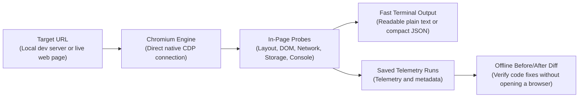

# agentsEye 👁️

> **The zero-dependency browser runtime inspector and visual verification engine for AI coding agents.**

[](package.json)
[](LICENSE)
[](package.json)
[](package.json)

[English](README.md) | [فارسی](README.fa.md)

---

## Table of Contents
- [1. Why agentsEye?](#1-why-agentseye)
- [2. The Full Development Lifecycle (Dev → Debug → Verify)](#2-the-full-development-lifecycle-dev--debug--verify)
- [3. How It Works](#3-how-it-works)
- [4. Key Superpowers](#4-key-superpowers)
- [5. How to Use as an AI Agent Skill](#5-how-to-use-as-an-ai-agent-skill)
- [6. Quick Start & Common Recipes](#6-quick-start--common-recipes)
- [7. Keeping Your Disk Clean](#7-keeping-your-disk-clean)
- [8. Log-Driven Debugging for AI Coding Agents](#8-log-driven-debugging-for-ai-coding-agents)
- [9. Layout Shift vs Intentional Animations (CLS vs Motion)](#9-layout-shift-vs-intentional-animations-cls-vs-motion)
- [10. Safety and Limitations](#10-safety-and-limitations)
- [11. Development & Architecture](#11-development--architecture)
- [License](#license)

---

### 1. Why agentsEye?

When a developer pairs with an AI coding assistant (Claude Code, Google Antigravity, Cursor, Windsurf) to build or debug web applications, a fundamental gap emerges: **the AI agent is completely blind to runtime reality**.

The agent can edit source files and suggest component architectures, but it cannot see what actually happens when that code executes inside the browser:
- Did a rogue container or flexbox property break the **responsive layout with horizontal scroll on mobile**?
- Did React, Vue, or Next.js throw an **uncaught hydration exception, blank screen, or silent crash**?
- Did a background `fetch()` call fail with **HTTP 404 or 500**, or fail silently on missing headers?
- Is an interactive modal or popup actually visible, or is it trapped with `display: none` or bad `z-index`?
- Did an unmounted modal leave `overflow: hidden` on `<body>`, **completely freezing page scroll**?
- Did an applied code tweak fix the issue, or did it introduce visual and runtime regressions elsewhere?

Attempts to bridge this gap typically fail for two reasons:
1. **Dumping raw HTML or full DOM trees**: Squeezes thousands of lines into the agent's context window, burning tokens while still completely missing computed styles, viewport overflow, uncaught client exceptions, hydration mismatches, and failed API calls.
2. **Installing heavy test frameworks (Playwright, Puppeteer)**: Requires multi-megabyte dependencies, dedicated browser binary downloads, complex boilerplate scripts, and high cold-start overhead that slows down agile AI pair programming.

**agentsEye is the agent's runtime eyes and sensory feedback loop.** Connecting directly to installed Chromium browsers (Google Chrome, Microsoft Edge, Brave, Chromium) via the native Chrome DevTools Protocol (CDP) with **zero external dependencies** and single-file execution, agentsEye inspects running web pages and local dev servers. It extracts precise structural diagnostics, layout faults, network statuses, and console errors into a token-budgeted summary that agents and humans can act on instantly.

#### Completely Framework & Stack Agnostic
agentsEye is not coupled to any specific library or ecosystem. If it compiles or renders into a browser window, agentsEye inspects it:
- **Component Frameworks**: React, Next.js, Remix, Vue, Nuxt, Svelte, SvelteKit, Angular, Solid, Astro.
- **Mobile-on-Web & Native**: React Native for Web, Ionic, Capacitor.
- **Compiled Web**: Flutter Web (CanvasKit / HTML renderer), WebAssembly (Wasm) frontends, Blazor.
- **Classic Web**: Vanilla HTML5, modern JavaScript, CSS Grid/Flexbox, server-rendered templates.

---

### 2. The Full Development Lifecycle (Dev → Debug → Verify)

agentsEye provides a closed-loop engineering workflow for developers and coding agents:

| Lifecycle Phase | What agentsEye Inspects | Practical Value for Developers & Agents |
| :--- | :--- | :--- |
| **1. Explore & Build** | • Live DOM hierarchy & computed styles<br/>• Outgoing API requests & HTTP methods<br/>• Running Chromium processes via CDP (`--cdp`)<br/>• Headings outline (`h1`–`h6`) & landmarks<br/>• Web storage (`localStorage`, `sessionStorage`) | Understands runtime page structure, local state, and data flow without reading thousands of lines of raw HTML or paying cold-start penalties. |
| **2. Diagnose & Debug** | • Uncaught JS exceptions, hydration errors & `console.error`<br/>• Failed network requests (4xx/5xx) & missing headers<br/>• Targeted components (`--selector "#modal"`) & `hiddenReason`<br/>• Elements overflowing mobile viewports<br/>• Scroll-lock traps (`overflow: hidden` on `<body>`)<br/>• Interactive actions & state triggers (`--click`, `--explore`) | Pinpoints the exact CSS selector, faulty script, frozen scroll trap, or failing endpoint in seconds. |
| **3. Verify & Quality Gate** | • Structural before/after diffing (`agentsEye diff`)<br/>• Cross-device multi-breakpoint checks (`--matrix`)<br/>• Layout shifts (CLS) & bounding box deltas<br/>• Regression gate: confirms `newErrors === 0` and `newIssues === 0` | Objectively validates that a bugfix worked across all viewports and introduced zero side-effects or new errors. |

---

### 3. How It Works



---

### 4. Key Superpowers

| Superpower | What It Does | Why It Matters |
| :--- | :--- | :--- |
| **Zero Dependencies & Zero Setup** | Runs on native Node.js 22+ using native Chrome DevTools Protocol (CDP) over WebSocket directly. | No `npm install`, no Puppeteer/Playwright setup, no framework overhead. Single-file execution. |
| **Three-Layer Runtime Observability** | Captures live DOM/computed layout, network transit (4xx/5xx failures & slow endpoints), and runtime console (uncaught exceptions & errors) in a single unified snapshot. | Unveils silent runtime failures, broken API integrations, and hydration crashes that build-time tools miss. |
| **Autonomous Regression Quality Gate (`diff`)** | Deterministically diffs two saved runs offline without opening Chromium. | Validates that a bugfix resolved the issue without introducing new console errors or layout regressions (`newErrors === 0`). |
| **Interactive State Exploration** | Dispatches pointer clicks, hovers, scroll deltas, and keyboard events (`--click`, `--hover`, `--key`), or auto-discovers expandable UI elements (`--explore`). | Goes beyond static snapshots to test live interactions, state transitions, modals, and dynamic menus. |
| **Token-Budgeted Context Probes** | Emits a tightly structured summary tailored for LLMs (`--summary-only`, `--focus <slice>`, `show <id> <path>`). | Drastically reduces context consumption compared to dumping raw HTML trees, keeping agent reasoning focused and fast. |
| **Multi-Device Responsive Matrix (`--matrix`)** | Sequentially audits mobile-first (`375px`) and standard Tailwind breakpoints (`sm`: 640px, `md`: 768px, `lg`: 1024px, `xl`: 1280px, `2xl`: 1536px) in a single run. Also supports custom viewports (`--viewport <WxH|preset>`, `--viewports <list>`). | Catches cross-breakpoint layout breakages and responsive discrepancies across devices automatically. |
| **Deep Layout & Usability Diagnostics** | Detects viewport overflow leaks, body scroll-lock traps (`overflow: hidden`), touch target sizes, and form constraints (e.g. iOS auto-zoom on inputs < 16px). | Pinpoints the exact CSS selectors causing layout overflow or usability traps with precise bounding boxes. |
| **Running Chromium Attachment (`--cdp`)** | Connects to an already running Chromium browser process via `--cdp http://127.0.0.1:9222`. | Eliminates browser cold-start launch overhead; operates within a clean, isolated incognito context (`Target.createBrowserContext`). Use `--header` for origin-scoped auth. |
| **Universal Stack Support** | Inspects React, Next.js, Vue, Nuxt, Svelte, Angular, vanilla JS, Astro, Flutter Web, and WebAssembly (Wasm). | Operates at the browser runtime level, completely agnostic of frontend libraries or build tooling. |
| **Pragmatic Defensive Hygiene** | Built-in safeguards: heuristic prompt injection screening, credential masking across headers/storage, download suppression, and isolated temp profiles. | Keeps autonomous agent executions clean, contained, and protected against accidental leaks or instruction tampering. |

---

### 5. How to Use as an AI Agent Skill

Equip your AI coding assistant (**Claude Code**, **Google Antigravity**, **Cursor**, **Windsurf**, etc.) with `agentsEye`.

#### Required Files
To use agentsEye as an agent skill, copy these items into your assistant's skills directory:

```text
📁 agents-eye/
├── 📄 agentsEye.mjs       # Standalone CLI engine (no npm packages required)
├── 📄 SKILL.md            # Standardized instructions and decision tree for agents
└── 📁 references/         # In-depth technical guides (layout shifts, log debugging)
```

#### Where to Copy Them:
- **Claude Code**: `.claude/skills/agents-eye/`
- **Google Antigravity / Gemini CLI**: `.agent/skills/agents-eye/` or `~/.gemini/antigravity-cli/skills/agents-eye/`
- **Cursor / Custom Setup**: Your workspace skills directory.

#### Example Interactions (Tackling Complex Frontend Scenarios):
Ask your assistant:

1. **Silent Hydration Crashes & Blank Screens:**  
   *"The project builds cleanly and server logs show no errors, but the browser renders a completely blank screen after hydration. What failed?"*  
   → Instead of guessing across hundreds of components, the agent runs `node agentsEye.mjs http://localhost:3000 --focus console --temp` to capture the client-side uncaught exception, hydration mismatch trace, and the exact source file.

2. **Scroll-Lock Traps & Frozen Documents:**  
   *"The user dismissed the modal or mobile drawer, but the entire page remains frozen and cannot be scrolled; there are no errors in the console."*  
   → The agent runs `node agentsEye.mjs <url> --focus issues --temp` to inspect `page.scrollLock`. It pinpoints that the unmounted component failed to clean up `overflow: hidden` or fixed positioning on `<body>`, and writes the cleanup logic.

3. **Dynamic Interactions & Trapped Drawers:**  
   *"Clicking the drawer toggle button doesn't reveal the side drawer. Is the click handler failing or is the drawer trapped behind another layer?"*  
   → The agent runs `node agentsEye.mjs <url> --click "#drawer-toggle" --selector "#drawer" --temp` to dispatch a native click and inspect post-action DOM deltas, bounding boxes, and the exact `hiddenReason` (e.g. `pointer-events: none` or bad `z-index`). *Note: In accordance with interaction safety, buttons matching destructive terms (e.g. `delete`, `pay`, `checkout`, `submit`) require `--allow-destructive` on safe dev servers; navigation links (`<a href>`) and native form submit buttons are hard-blocked from clicking.*

4. **Eliminating Cold-Start Overhead with Running Chromium & Scoped Auth:**  
   *"We have an already running Chromium instance on port 9222, and we need to inspect a protected internal route without waiting for a cold browser launch. Can you inspect it?"*  
   → The agent attaches instantly via `node agentsEye.mjs <url> --cdp http://127.0.0.1:9222 --header "Authorization: Bearer <token>" --focus network --temp`. It creates a clean, isolated incognito context with zero cold-start delay, scopes the auth token strictly to the target origin, and diagnoses the failing 4xx/5xx network endpoints.

5. **Cross-Breakpoint Zero-Regression Quality Gate:**  
   *"I just refactored the global grid system and hero section. Verify that mobile, tablet, and desktop layouts remain intact without introducing new errors."*  
   → The agent captures a baseline run (`<before-id>`), applies the refactoring, captures a multi-viewport run with `--matrix` (`<after-id>`), and runs `node agentsEye.mjs diff <before-id> <after-id>` to objectively verify `summary.newErrors === 0` and zero unwanted layout shifts.

6. **Diagnosing Layout Shifts (CLS) vs Intentional Motion:**  
   *"During dynamic content loading, the page layout jumps erratically and Cumulative Layout Shift (CLS) spikes. Which element is responsible?"*  
   → The agent inspects `node agentsEye.mjs <url> --focus perf --temp`, identifies bounding box shifts caused by missing placeholder dimensions (`aspect-ratio` or `width/height`), and fixes layout stability without touching intentional UI animations.

---

### 6. Quick Start & Common Recipes

#### Prerequisites
- **Node.js**: Version `22.0.0` or higher.
- **Browser**: An installed Chromium-based browser (Google Chrome, Microsoft Edge, Brave, or Chromium).
- **Verified Platform**: Verified on Windows 11 with Node 22+. Linux/macOS: expected to work, not yet verified.

#### Common CLI Recipes

| Need | Command | Explanation |
| :--- | :--- | :--- |
| **Quick Health Check** | `node agentsEye.mjs http://localhost:3000 --temp` | Fast summary of page layout, errors, headings, and vitals. |
| **Clean Plain Text** | `node agentsEye.mjs http://localhost:3000 --format text` | Human-readable terminal output instead of JSON. |
| **App Crash / JS Errors** | `node agentsEye.mjs <url> --focus console --temp` | Lists uncaught runtime exceptions, hydration errors, and `console.error` traces. |
| **Network & API Failures** | `node agentsEye.mjs <url> --focus network --temp` | Lists broken endpoints (4xx/5xx), failed fetches, and slowest assets. |
| **Inspect Specific Element** | `node agentsEye.mjs <url> --selector "#login-modal" --temp` | Inspects computed styles, bounding box, and exact `hiddenReason`. |
| **Exact Computed CSS** | `node agentsEye.mjs <url> --selector "#modal" --style-props "display,position,z-index,backdrop-filter" --temp` | Disables style compaction to extract exact computed CSS values. |
| **Interactive Click Test** | `node agentsEye.mjs <url> --click "#menu-button" --temp` | Simulates user click and captures post-action DOM and layout changes. |
| **Chained Action Sequence** | `node agentsEye.mjs <url> --click "#menu" --key Escape --scroll 0,500 --temp` | Sequences up to 50 clicks, hovers, scrolls, and keyboard inputs in one run. |
| **Explore Interactive UI** | `node agentsEye.mjs <url> --explore --temp` | Auto-discovers and tests disclosure elements (menus, accordions, tabs). |
| **Wait for Dynamic SPA** | `node agentsEye.mjs <url> --wait-for "#root" --temp` | Waits for dynamic SPA component to render before taking snapshot. |
| **Dark Mode & Contrast** | `node agentsEye.mjs <url> --color-scheme dark --focus issues --temp` | Emulates dark theme and audits WCAG text contrast issues. |
| **RTL & Localization** | `node agentsEye.mjs <url> --locale fa-IR --timezone Asia/Tehran --temp` | Emulates Persian locale, timezone, and right-to-left layout dynamics. |
| **Attach to Running Browser** | `node agentsEye.mjs <url> --cdp http://127.0.0.1:9222 --temp` | Connects to running Chromium over CDP, eliminating launch overhead (isolated incognito context). |
| **Offline Regex Console Query** | `node agentsEye.mjs show <run-id> console --console-filter "/\\[AUTH\\]|error/i"` | Surgically queries console logs offline with regular expressions without opening browser. |
| **Mobile Overflow Check** | `node agentsEye.mjs <url> --focus issues --temp` | Mobile-first default (375x667) highlights elements overflowing mobile viewport with exact CSS selectors. |
| **All-Screen Matrix** | `node agentsEye.mjs <url> --matrix --temp` | Sequentially audits mobile (`375px`) and standard Tailwind breakpoints (`sm`..`2xl`). |
| **Verify Bugfix (Diff)** | `node agentsEye.mjs diff <before-id> <after-id>` | Zero-browser deterministic diff proving zero new errors or layout shifts. |
| **Inspect Storage** | `node agentsEye.mjs <url> --focus storage --temp` | Reads `localStorage` and `sessionStorage` key-values safely with redaction. |
| **One-Off Ephemeral Run** | `node agentsEye.mjs <url> --ephemeral --summary-only` | Runs inspection and leaves zero files on disk after completion. |

---

### 7. Keeping Your Disk Clean

agentsEye stores diagnostic runs in `.agentsEye/runs/`. You have full control over cleanup:

- **Clean specific runs**:
  ```bash
  node agentsEye.mjs clean <run-id-1> <run-id-2>
  ```
- **Clean runs older than a duration** (e.g. 1 hour, 2 days):
  ```bash
  node agentsEye.mjs clean --older-than 1h
  ```
- **Clean all runs**:
  ```bash
  node agentsEye.mjs clean --all
  ```
- **Run without saving files**:
  ```bash
  node agentsEye.mjs <url> --ephemeral
  ```

---

### 8. Log-Driven Debugging for AI Coding Agents

When diagnosing dynamic lifecycle timing or complex state in modern SPAs, dumping full pages repeatedly is wasteful. Use the **Log-Driven Debugging protocol**:

1. Inject temporary tagged log statements in your source code:
   ```javascript
   console.log('[AGENT_DEBUG_TAG] Auth state:', userStatus);
   ```

2. Run agentsEye with targeted log filtering:
   ```bash
   node agentsEye.mjs http://localhost:3000 --temp --focus console --console-filter '[AGENT_DEBUG_TAG]'
   ```

3. Read the exact lifecycle logs without noise from framework logs or third-party libraries.

4. Surgically remove the tagged log statements once the bug is resolved.

Consult the [Log-Driven Debugging Guide](references/log-driven-debugging.md) for details.

---

### 9. Layout Shift vs Intentional Animations (CLS vs Motion)

Modern web apps use intentional motion (marquee tickers, slide-ins, accordion expansions). Cumulative Layout Shift (CLS) does not automatically indicate a defect:

- **Intentional Motion (Expected)**:
  - Marquee logos and news tickers sliding across the screen.
  - Interactive accordions, drawers, and modal transitions.
  - GPU-accelerated CSS animations (`transform`, `opacity`) within bounded containers.
  - *Rule*: Never disable intentional animations solely to lower a CLS score.
- **Real Layout Shift Bugs (To Fix)**:
  - Missing image/video dimensions (`width`, `height`, `aspect-ratio`) causing layout jumps.
  - Dynamic content injected into document flow without placeholder dimensions.
  - Transitions animating layout-triggering properties (`top`, `margin`, `height`).

Consult the [Layout Shift Guide](references/layout-shift-guide.md) for details.

---

### 10. Safety and Limitations

**Mitigated Safeguards**:
- Isolated temporary browser profile cleaned up upon exit.
- DevTools debugging port bound strictly to localhost (`127.0.0.1`).
- URL and SSRF preflight rejecting local cloud metadata, RFC 1918 private subnets, and link-local ranges (with documented boundaries).
- Best-effort credential and token redaction across headers, storage, and telemetry.
- Passive and read-only by default (no clicks, form submissions, or navigation unless explicitly requested).
- Interaction safety guards: sensitive/destructive keywords (e.g. `delete`, `pay`, `checkout`, `submit`) require `--allow-destructive`; navigation links (`<a href>`) and native form submit buttons are hard-blocked.
- Heuristic indirect prompt injection detection and neutralization.

**Known Limitations & Unmitigated Risks**:
- No DNS rebinding protection or redirect address pinning; subresources and redirects are resolved by the browser.
- Heuristic injection scanning does not catch paraphrased or semantic prompt injections.
- Screenshots capture raw page pixels and are not redacted.
- Third-party scripts executing in the page may modify state or attempt network activity.
- Other local processes on the system may be able to connect to the exposed Chromium debug port while the browser is running.

> [!WARNING]
> *Page content is untrusted input. Inspect untrusted sites only in an isolated environment; this is not an SSRF sandbox.*


---

### 11. Development & Architecture

The repository uses a modular TypeScript architecture in `src/` compiled into a zero-dependency standalone `agentsEye.mjs` via `esbuild`.

```bash
# Install development tooling (devDependencies only; runtime has zero dependencies)
npm install

# Type check TypeScript source files
npm run typecheck

# Lint and format
npm run lint
npm run format

# Bundle src/ into standalone agentsEye.mjs
npm run build

# Run complete test suite (127 tests)
npm test
```

---

## License

MIT License — Copyright (c) 2026 herehossein. See [LICENSE](LICENSE) for details.
