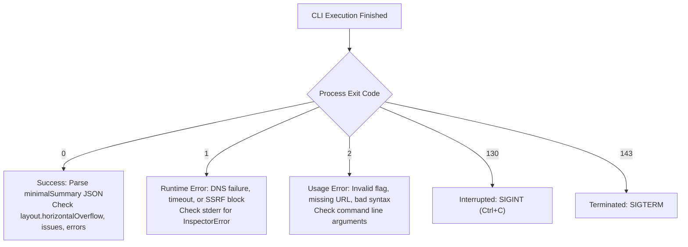

# agentsEye CLI Reference

> **Tool**: `agentsEye` v2.1.1  
> **Node.js**: `>= 22.0.0` (native WebSocket, `node:fs/promises`, `node:crypto`)  
> **Protocol**: Chromium DevTools Protocol (CDP) over native loopback WebSocket  

This reference documentation details all command-line interface commands, arguments, option flags, output slices, redaction modes, and exit codes for `agentsEye`.

---

## 1. Invocation Syntax

```bash
# Direct execution via Node.js
node agentsEye.mjs <url> [options]

# Offline run inspection (zero browser launch)
node agentsEye.mjs show <run-id> [slice|property.path]

# Offline run comparison (zero browser launch)
node agentsEye.mjs diff <before-run-id> <after-run-id>
node agentsEye.mjs --diff <before-run-id> <after-run-id>
```

---

## 2. Core Commands

| Command | Syntax | Description |
| :--- | :--- | :--- |
| **`inspect` (default)** | `node agentsEye.mjs <url> [options]` | Launches headless Chromium, performs passive inspection, saves telemetry to `.agentsEye/runs/<id>/` (or OS temp when `--temp` is used), and outputs a compact `minimalSummary` JSON to stdout. |
| **`show`** | `node agentsEye.mjs show <run-id> [slice\|dotted.path]` | Reads a saved run from disk **without launching Chromium**. Outputs the minimal summary, a focused slice (`issues`, `forms`, `dom`, `network`, `perf`, `console`, `storage`, `interactive`), or queries a deep nested JSON path (e.g. `page.metrics.overflowElements`). |
| **`diff`** | `node agentsEye.mjs diff <run-1> <run-2>` | Compares two saved runs offline. Produces a structural delta report showing added/removed DOM nodes, bounding box shifts, computed style alterations, and newly introduced console/layout errors. |
| **`clean`** | `node agentsEye.mjs clean <run-id>...` \| `clean --older-than <dur>` \| `clean --all` | Removes specified runs, runs older than a duration, or all saved runs. |
| **`help`** | `node agentsEye.mjs --help`, `-h` | Prints the complete built-in command help and flag options. |
| **`version`** | `node agentsEye.mjs --version`, `-V` | Displays CLI and schema versions. |

---

## 3. CLI Flags by Category

### A. Target & Browser Configuration

| Flag | Argument | Default | Description |
| :--- | :--- | :--- | :--- |
| `<url>` | string (Required) | *None* | Target `http://` or `https://` URL. Subjected to DNS preflight checks before browser launch. |
| `--cdp` | `<http-or-ws-url>` | `null` | Attaches to an existing Chromium DevTools Protocol endpoint (e.g. `http://127.0.0.1:9222`) into an isolated incognito target without touching user cookies. |
| `--allow-remote-cdp`| boolean | `false` | Permits non-loopback endpoints for `--cdp`. *(Unsafe: transmits unencrypted CDP over network).* |
| `--browser` | `<path\|command>` | Auto-detected | Explicit path or command for Chromium, Google Chrome, Microsoft Edge, or Brave. |
| `--headed` | boolean | `false` | Launches Chromium with a visible graphical window instead of headless mode. |
| `--no-sandbox` | boolean | `false` | Passes `--no-sandbox` to Chromium. Useful in root Docker environments. *(Unsafe).* |
| `--ignore-certificate-errors` | boolean | `false` | Accepts invalid or self-signed TLS/SSL certificates. *(Unsafe).* |
| `--no-proxy` | boolean | `false` | Disables system proxy configurations for direct loopback connections. |
| `--disable-cache` | boolean | `false` | Bypasses Chromium HTTP network cache on all requests. |

### B. Viewports & Responsive Emulation

| Flag | Argument | Default | Description |
| :--- | :--- | :--- | :--- |
| `--viewport` | `<WxH\|preset>` | `375x667` | Emulated viewport resolution in CSS pixels. Defaults to mobile-first baseline (`375x667`, `mobile: true`). Supports Tailwind presets (`mobile`, `sm`, `md`, `lg`, `xl`, `2xl`) or custom dimensions (`<WxH>`, e.g. `412x915`, `1920x1080`). For custom dimensions, widths `< 768px` infer `mobile: true`. |
| `--width` | `<px>` | `375` | Explicit viewport width in CSS pixels. Widths `< 768px` infer `mobile: true` unless overridden. |
| `--height` | `<px>` | `667` | Explicit viewport height in CSS pixels. |
| `--dpr` | `<n>` | `1` | Device pixel ratio (e.g. `2` or `3` for Retina/High-DPI displays). |
| `--mobile` | boolean | `true` | Enables mobile browser viewport meta tag interpretation. Enabled by default under mobile-first philosophy. |
| `--desktop`, `--no-mobile` | boolean | `false` | Explicitly disables mobile browser emulation (desktop mode). |
| `--touch` | boolean | `false` | Enables touch event emulation and touch hit-testing. Automatically enabled when mobile emulation is active. |
| `--user-agent` | `<string>` | Default browser UA | Custom `User-Agent` HTTP header and navigator string. |
| `--color-scheme` | `light \| dark` | System default | Emulates `prefers-color-scheme` CSS media feature. |
| `--reduced-motion` | `reduce \| no-preference` | System default | Emulates `prefers-reduced-motion` CSS media feature. |
| `--timezone` | `<IANA_ID>` | System default | Overrides timezone emulation (e.g., `America/New_York`, `Asia/Tehran`). |
| `--locale` | `<bcp47>` | System default | Overrides browser UI and HTTP `Accept-Language` locale (e.g. `en-US`, `fa-IR`). |

### C. Network & Authentication

| Flag | Argument | Default | Description |
| :--- | :--- | :--- | :--- |
| `--header` | `"Name: Value"` | `null` | Custom HTTP request header. **Repeatable**. Uses CDP Fetch interception scoped **strictly to exact target origin**; custom headers are never forwarded to 3rd-party domains or CDN assets. |
| `--no-network` | boolean | `false` | Disables network request telemetry retention (network quiet window is still observed). |
| `--block` | `<pattern>` | `null` | Blocks URLs matching wildcard glob pattern (e.g. `*analytics*`). Repeatable. |

### D. Loading & Synchronization

| Flag | Argument | Default | Description |
| :--- | :--- | :--- | :--- |
| `--timeout` | `<ms>` | `30000` | Maximum navigation and total operation timeout in milliseconds. |
| `--wait-for` | `<css-selector>` | `null` | Delays DOM probe execution until the specified CSS selector matches in the DOM tree. |
| `--wait-ms` | `<ms>` | `400` | Additional settling delay in milliseconds after load and network-idle. |
| `--idle-ms` | `<ms>` | `500` | Network-idle quiet window. Probe considers network idle when 0 in-flight requests remain for this duration. |
| `--no-network-idle` | boolean | `false` | Skips the network-idle quiet window check and inspects immediately upon `DOMContentLoaded`/`load`. |

### E. DOM & Accessibility Extraction

| Flag | Argument | Default | Description |
| :--- | :--- | :--- | :--- |
| `--selector` | `<css-selector>` | `documentElement`| Scopes inspection to the subtree matching this selector. |
| `--all-matches` | boolean | `false` | When `--selector` is passed, inspects every matching element under a `roots` array. |
| `--max-nodes` | `<n>` | `3000` | Hard cap on total DOM nodes traversed to protect memory and token context. |
| `--max-depth` | `<n>` | `40` | Maximum tree traversal depth. |
| `--text-limit` | `<n>` | `160` | Maximum character length preserved per DOM node text content. |
| `--attribute-limit`| `<n>` | `24` | Maximum number of HTML attributes preserved per DOM element. |
| `--style-props` | `<list \| none>` | 30 common properties | Comma-separated list of computed CSS styles to capture (e.g. `display,overflow,position`). Default captures 30 common layout and typography properties (`DEFAULT_STYLE_PROPS`). Passing `--style-props` disables `compactStyles` to capture all listed properties. |
| `--visible-only` | boolean | `false` | Prunes visually hidden elements (`display: none`, `visibility: hidden`, `opacity: 0`). |
| `--no-shadow-dom` | boolean | `false` | Skips traversing open Shadow DOM roots. |
| `--no-iframes` | boolean | `false` | Skips expanding same-origin iframe document trees. |
| `--include-templates`| boolean | `false` | Traverses `<template>` fragment contents. |
| `--css-vars` | boolean | `false` | Collects computed CSS custom properties (`--*`) on the root element. |
| `--interactive-scope`| `<css-selector>` | `null` | Scopes semantic ref allocation (`@e1`..`@eN`) and interactive element discovery to the specified container subtree. |
| `--a11y` | boolean | `false` | Opt-in extraction of the full Chromium Accessibility (AX) tree. |
| `--max-a11y-nodes` | `<n>` | `1000` | Cap on accessibility tree nodes returned. |

### F. Interactions & State Exploration

| Flag | Argument | Default | Description |
| :--- | :--- | :--- | :--- |
| `--click` | `<selector\|@eN>` | `null` | Performs hit-test validation and dispatches a native pointer click on target CSS selector or semantic ref (`@e1`, `@e2`), recording DOM diff. |
| `--hover` | `<selector\|@eN>` | `null` | Dispatches native mouse pointer movement to selector or semantic ref bounding-box center. |
| `--scroll` | `<X,Y\|selector\|@eN>` | `null` | Dispatches native mouse wheel scroll deltas (e.g. `0,600`) or element-centric `scrollIntoView` for selector or semantic ref (`@eN`). |
| `--key` | `<name>` | `null` | Dispatches safe keyboard key event. Supports 12 keys: `Enter`, `Escape`, `Tab`, `Space`, `ArrowLeft`, `ArrowRight`, `ArrowUp`, `ArrowDown`, `Home`, `End`, `PageUp`, `PageDown`. |
| `--explore` | boolean | `false` | Conservatively discovers and clicks interactive disclosure elements (menus, accordions, tabs) and logs before/after diffs. |
| `--max-explore` | `<n>` | `8` | Maximum number of exploratory clicks allowed (upper bound: 50). |
| `--allow-destructive`| boolean | `false` | Disables the destructive-label text blacklist for `--click`, `--key`, and `--explore`. *(Form submission, reset controls, navigation, and file inputs remain strictly blocked).* |

### G. Responsive Analysis

| Flag | Argument | Default | Description |
| :--- | :--- | :--- | :--- |
| `--matrix` | boolean | `false` | Sequentially inspects standard Tailwind breakpoints: Mobile (`375x667`), `sm` (`640x800`), `md` (`768x1024`), `lg` (`1024x768`), `xl` (`1280x800`), and `2xl` (`1536x960`). Computes cross-breakpoint diffs and captures screenshots for each. |
| `--viewports` | `<list>` | `null` | Inspects a custom comma-separated list of viewports or Tailwind presets (e.g. `375x667,sm,lg,1920x1080`). Automatically activates matrix mode. |
| `--diff` | `<id-1> <id-2>` | `null` | Offline structural comparison between two previous runs. |

### H. Output Slices & Formats

| Flag | Argument | Default | Description |
| :--- | :--- | :--- | :--- |
| `--temp` | boolean | `false` | Stores run artifacts in OS temporary directory (`%TEMP%/.agentsEye/runs/`) instead of workspace `.agentsEye/runs/`. |
| `--ephemeral` | boolean | `false` | Automatically deletes the run directory immediately after producing stdout. |
| `--focus` | `<slice>` | `null` | Emits a focused slice directly to stdout. Allowed: `issues`, `forms`, `dom`, `network`, `perf`, `console`, `storage`, `interactive`. |
| `--console-filter` | `<pattern>` | `null` | Filters console entries by case-insensitive substring or `/regex/flags` pattern (e.g. `'[AGENT_DEBUG_TAG]'` or `/\/api\/error/i`). Works live with `--focus console` and offline via `show`. |
| `--console-level` | `<levels>` | `all` | Filters console entries by comma-separated levels: `error,warn,info,log,debug,all`. Works live and offline via `show`. |
| `--full` | boolean | `false` | Emits complete comprehensive JSON report to stdout. *(Not recommended for AI agent contexts).* |
| `--summary-only` | boolean | `true` (default) | Explicit alias for standard compact `minimalSummary` JSON. |
| `--format` | `json \| text` | `json` | Formats stdout output as JSON or clean plain human-readable text. |
| `--pretty` | boolean | `false` | Indents stdout JSON with 2 spaces for human legibility. |
| `--out` | `<path>` | `null` | Writes full unredacted/redacted JSON report to the specified file path. |
| `--allow-outside-cwd`| boolean | `false` | Permits `--out` or `--screenshot` paths outside the current working directory. |
| `--screenshot` | `<path>` | `null` | Copies the initial viewport screenshot to the specified file path. |
| `--full-page` | boolean | `false` | Captures complete scrollable document height instead of viewport bounds. |
| `--screenshot-format`| `png \| jpeg \| webp`| `png` | Image format for screenshot capture. |
| `--screenshot-quality`| `<0-100>` | `90` | Image compression quality for `jpeg` and `webp`. |
| `--hide-scrollbars`| boolean | `false` | Emulates CSS `overflow: hidden` to omit scrollbar gutters from screenshots. |
| `--include` | `<sections>` | `null` | Comma-separated report sections to retain in full report. |
| `--exclude` | `<sections>` | `null` | Comma-separated report sections to strip from full report. |
| `--quiet` | boolean | `false` | Suppresses informational status output on stderr. |

### I. Data Privacy & Redaction Modes

| Flag | Argument | Default | Description |
| :--- | :--- | :--- | :--- |
| `--storage` | boolean | `false` | Opt-in retention of `localStorage` and `sessionStorage` keys and values (subject to redaction). |
| `--cookies` | boolean | `false` | Opt-in retention of cookie names and values (subject to redaction). |
| `--redact` | `sensitive \| all \| none` | `sensitive` | Configures credential and PII sanitization across stdout, reports, and disk artifacts. |
| `--sanitize-injections` | `neutralize \| warn \| none` | `neutralize` | Indirect Prompt Injection defense mode (`neutralize`: neutralizes LLM control tokens/delimiters and audits injection lures; `warn`: logs findings without neutralizing text; `none`: disables prompt injection sanitization). |
| `--no-sanitize-injections` | boolean | `false` | Disables prompt injection sanitization (unsafe). |

---

## 4. Output Slices (`--focus <slice>`)

When you need deeper details on a specific subsystem without context window blowout, use `--focus`:

| Focus Slice | Included Fields | Best Used For |
| :--- | :--- | :--- |
| **`issues`** | Detected issue list, layout metrics (`horizontalOverflow`, `scrollTrap`, `overflowElements`), scroll-lock diagnostics, console error entries, CLS score. | Diagnosing responsive breakage, horizontal scrollbars, tap target sizes, and contrast failures. |
| **`forms`** | Form elements, input types, names, autocomplete attributes, validation states, inputs with `font-size < 16px`, submit buttons. | Debugging form validation, iOS auto-zoom bugs, missing form names or labels. |
| **`dom`** | Compact DOM tree structure, computed CSS layout properties, element selectors, and tree depth stats. | Inspecting rendered DOM hierarchy, CSS class structures, and component boundaries. |
| **`network`** | Request count, HTTP status breakdown, failed requests (4xx/5xx/CORS/aborts), top 5 slowest endpoints, transfer bytes. | Investigating API failures, hanging requests, slow backend services, and asset sizes. |
| **`perf`** | Core Web Vitals (LCP, CLS, FCP, FID, INP), timing milestones (navigation, paint timings), DOM node count. | Auditing frontend performance regressions and layout stability. |
| **`console`** | Console entries matching optional `--console-filter` and `--console-level`, console error/warn/log counts. | Targeted log-driven agent debugging, inspecting injected debug tags, and filtering out framework noise. |
| **`storage`** | Extracted key-values from `localStorage` and `sessionStorage` (with sensitive value redaction), entry counts, and storage availability. | Inspecting client-side session state, auth tokens, cached filters, and storage quota bugs. |

---

## 5. Offline Inspection & Dotted-Path Queries (`show`)

Saved runs in `.agentsEye/runs/<id>/` can be queried instantly with zero overhead:

```bash
# Display standard summary of past run
node agentsEye.mjs show 2026-10-23T17-45-12-849Z-a9f2

# Inspect specific focus slice
node agentsEye.mjs show 2026-10-23T17-45-12-849Z-a9f2 issues
node agentsEye.mjs show 2026-10-23T17-45-12-849Z-a9f2 network
node agentsEye.mjs show 2026-10-23T17-45-12-849Z-a9f2 console --console-filter '[AGENT_DEBUG_TAG]'

# Query surgical dotted property paths
node agentsEye.mjs show 2026-10-23T17-45-12-849Z-a9f2 page.metrics.overflowElements
node agentsEye.mjs show 2026-10-23T17-45-12-849Z-a9f2 page.scrollLock
node agentsEye.mjs show 2026-10-23T17-45-12-849Z-a9f2 network.failures
node agentsEye.mjs show 2026-10-23T17-45-12-849Z-a9f2 errors.uncaught
node agentsEye.mjs show 2026-10-23T17-45-12-849Z-a9f2 performance.page.webVitals
```

---

## 6. Exit Codes & Agent Decision Table

`agentsEye` utilizes standardized POSIX-compliant exit codes:



| Exit Code | Classification | Cause & Handling |
| :---: | :--- | :--- |
| **`0`** | **Success** | The inspection ran to completion. **Important**: Detected layout issues (`horizontal-document-overflow`), console errors, or network 404s are recorded as structured data inside the JSON output; they do *not* trigger a non-zero exit code. |
| **`1`** | **Runtime Failure** | Target server is unreachable, DNS preflight lookup failed, target hit SSRF metadata blocklist, navigation timed out, or Chromium process crashed. Stderr contains diagnostic JSON with error code. |
| **`2`** | **Usage Error** | Invalid command-line arguments provided (e.g. malformed `--viewport`, unsupported focus slice, or missing target URL). Stderr details the syntax requirement. |
| **`130`** | **SIGINT** | Process was interrupted by user or orchestrator signal (`Ctrl+C`). Cleanup routines safely terminated Chromium child processes and released file locks. |
| **`143`** | **SIGTERM** | Process was terminated by operating system or container manager (`SIGTERM`). Disposable browser profiles cleaned up. |
